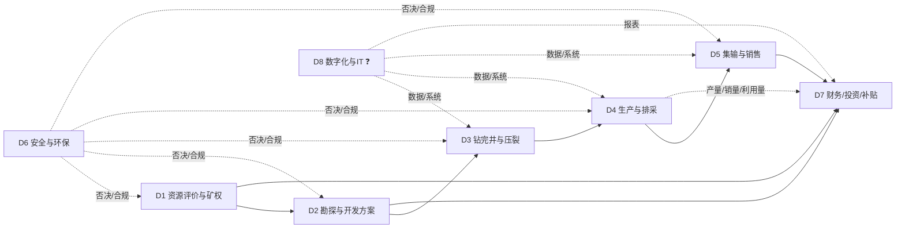
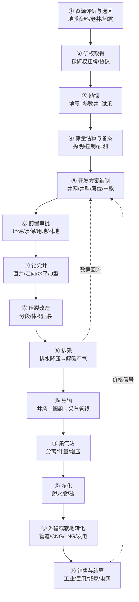
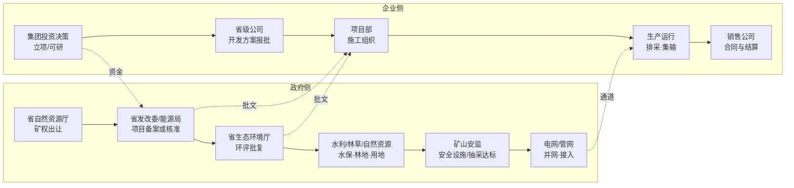

# 煤层气 · 业务域 / 流程 / 活动

> compact 示例：原 domains.md + flow.md + activities.md 合并。

## 1. 业务域

> **声明**：这是按公开信息（年报的部门/业务表述、监管文件、环评批复、行业论文）**推断**的域划分，**不是客户的组织架构图**。客户的部门名、边界、汇报线一定不同——请拿它去校准（见 §5）。
> 用途：FDE 在画流程图之前，先回答"客户这家公司由哪几块业务能力组成"，避免把"工序"当"部门"。
> 信心：✅ 有公开源支撑该域存在 ／ ⚠️ 有源但边界/归属不明 ／ ❓ 纯推断
> 来源编号见 `sources.jsonl`；环节级明细见 `activities.md`。

---

## 0. 为什么先切域，再画流程

- 流程图回答"**先后顺序**"；业务域回答"**谁负责、边界在哪、跟谁交接**"。
- 一线员工被问"你们流程是什么"时，通常答的是**自己域内**的流程；跨域部分会被简化或扭曲。
- 所以先给一张域图，让对方说"我们不是这么分的，A 和 B 是一个部门 / C 是集团管的"——**这句否定比流程细节值钱**。

---

## 1. 八个业务域（工作假设）

| # | 业务域 | 一句话目标 | 主责角色（推断） | 核心流程 | 主要接口 | 成熟度（推断） | 信心 |
|---|---|---|---|---|---|---|---|
| D1 | 资源评价与矿权 | 拿到并保住"能采的气" | 资源/矿权管理部、地质研究所 | 选区、矿权取得、储量估算与备案 | D2、D7、D6 | 高（政策熟） | ✅ |
| D2 | 勘探与开发方案 | 把资源变成可执行的产能设计 | 勘探开发部/研究院 | 地震、参数井、试采、开发方案、前置审批 | D1、D3、D7、D6 | 中高 | ✅ |
| D3 | 钻完井与压裂 | 把设计打成井、把井改造好 | 工程技术部/项目经理部 | 钻井、固井、完井、压裂 | D2、D4、D7 | 中（依赖外部队伍） | ✅ |
| D4 | 生产与排采 | 稳定、连续、长期地把气采出来 | 生产运行部/采气区/井区 | 排采、修井检泵、控递减、间开调压 | D3、D5、D6、D8 | 中（精细化程度分化大） | ✅ |
| D5 | 集输与销售 | 把气变成可交付的商品并卖出价 | 地面工程部 + 销售公司/调度 | 集输、增压、净化、计量交接、销售结算 | D4、D7、外部管网/客户 | 中高 | ✅ |
| D6 | 安全与环保（HSE/QHSE） | 不因安全环保停产 | 安全环保部/QHSE | 抽采达标、环评/水保/用地、采出水、放空/甲烷 | 全部域（否决权） | 高（合规驱动） | ✅ |
| D7 | 财务、投资与补贴 | 钱够不够、划不划算、补贴拿不拿得到 | 财务部/计划投资部/经营分析 | 投资决策、预算、补贴申报、税务、融资 | D1—D5、D6 | 高（但口径易混） | ✅ |
| D8 | 数字化与 IT | 让数据可用、可追溯、可决策 | 信息中心/数字化部（**可能存在，也可能没有**） | 数据采集、生产管理系统、报表、系统集成 | 全部域 | 低—中（最不确定） | ❓ |

**为什么是 8 个**：公开材料里能明确看到职责痕迹的只有 D1—D7；D8 是大多数 FDE 项目的落点，但**客户是否设独立部门完全未知**，所以单列并标 ❓。

---

## 2. 域间接口图（推断）

**接口上的三个高频断点（推断，需验证）**：
1. **D4→D7**：产量（井口）与销量（交接）不是一回事，三口径陷阱就发生在这里。
2. **D2↔D6**：开发方案与环评/用地是双向修改关系，不是"方案定了再报环评"。
3. **D4↔D8**：单井数据是人工填报还是自动采集，决定数字化项目的起点。

---

## 3. 逐域说明

### D1 资源评价与矿权
- **目标**：拿到区块、保住矿权、把储量做到可备案。
- **包含流程**：选区评价、矿权取得（招拍挂/协议）、综合勘查与储量估算、储量备案。
- **对外接口**：省自然资源厅（出让/登记）、集团投资决策。
- **痛点（推断）**：区块与煤炭采矿权重叠的协调成本；新区块"预探"到"探明"周期长。
- **公开证据**：故县区块出让条件（预探、5 年、净资产门槛）[S13] ✅；储量规范分级条件 [S12] ⚠️。
- **信心**：域存在 ✅；内部怎么分工 ⚠️。

### D2 勘探与开发方案
- **目标**：把"地下的气"翻译成"可施工的井网+产能+投资"。
- **包含流程**：地震、参数井、试采、储量复算、开发方案编制与审批、前置审批（环评/水保/用地）。
- **对外接口**：省发改委/能源局（备案/核准）、生态环境厅（环评）、集团投委会。
- **痛点（推断）**：开发方案审批卡产量——新天然气马必北区 MB076 井区"总体开发方案尚未完成审批，开发进度受到影响" [S25] ✅。
- **信心**：域存在 ✅；审批主体链条 ❓（见 `flow.md` §3）。

### D3 钻完井与压裂
- **目标**：按设计完成井筒与储层改造，控制单井成本。
- **包含流程**：钻井、固井、完井、测井、压裂（分段/体积）、试气。
- **对外接口**：油服/装备供应商（杰瑞 [S17]、石化油服 [S18]）、集团采办。
- **痛点（推断）**：深部水平井+大规模压裂的成本与效果不确定性 [S19] ⚠️；工程队伍管理。
- **信心**：域存在 ✅；自营/外包比例 ❓。

### D4 生产与排采
- **目标**：稳产、控递减、把单井潜力榨干。
- **包含流程**：排采制度执行（定产水/定井底流压）、修井检泵、间开/调压、低效井治理、递减分析。
- **公开证据**：排采原则"连续、稳定、缓慢、长期"，不采用定产气 [S26] ✅；蓝焰"气井精细管理与排采优化、降低自然递减率" [S15] ✅。
- **痛点（推断）**：老井递减、低产低效井多、人工抄表数据质量差。
- **信心**：域存在 ✅；制度细节 ⚠️（有论文但客户可能不同）。

### D5 集输与销售
- **目标**：把气安全、达标、经济地送到客户。
- **包含流程**：井场计量→阀组→采气管线→集气站→增压→净化→外输/CNG/LNG→计量交接→销售结算。
- **对外接口**：国家管网/省管网 [S09][S10]、城燃/工业客户、电网（发电）。
- **公开证据**：柿庄南地面工程量 [S14] ✅；亚美能源销售与接入模式 [S25] ✅；两区块实现价 2.09/2.30 元/m³ [S25] ✅。
- **痛点（推断）**：产销平衡、管输费、结算周期、补贴申报主体（PSC 下可能是中方伙伴）[S25] ⚠️。
- **信心**：域存在 ✅；销售组织形态 ❓。

### D6 安全与环保
- **目标**：不因安全/环保问题停产或被处罚。
- **包含流程**：抽采达标、瓦斯治理、环评/水保/用地、采出水处理、放空/甲烷管控、应急。
- **对外接口**：矿山安监、生态环境、水利/林草/自然资源。
- **公开证据**：抽采达标规定 [S11] ✅；环评批复的采出水/泉域/防渗要求 [S14] ✅；甲烷排放控制行动方案 [S24] ⚠️。
- **痛点（推断）**：合规要求分散在 5 个部门，数据要反复报。
- **信心**：域存在 ✅；与生产的界面（谁能否决停机）❓。

### D7 财务、投资与补贴
- **目标**：投得对、算得清、补贴拿得到。
- **包含流程**：投资决策、预算、成本核算、补贴申报与清算、税务（含增值税优惠变化）、融资。
- **公开证据**：蓝焰 2026 年计划投资约 10 亿元、融资 16 亿元、营收约 21 亿元 [S15] ✅；补贴"多增多补/冬增多补" [S15][S05] ⚠️；增值税先征后退取消 [S15][S28] ⚠️。
- **痛点（推断）**：补贴口径变化快（0.3 定额→0.3—0.6→梯级奖补）[S03][S05]；财务科目与业务口径不一致。
- **信心**：域存在 ✅；补贴在报表的科目归属 ❓（见 `verification-list.md` #6）。

### D8 数字化与 IT
- **目标**：让数据可采集、可追溯、可支持决策。
- **包含流程（推断）**：单井数据采集、生产管理系统、报表、系统集成、数据治理。
- **公开证据**：**几乎没有**。唯一线索是蓝焰年报提"数智赋能" [S15] ✅、石化油服提"远程测控" [S18] ⚠️。
- **痛点（推断）**：井数多（样本项目 1,709 口井 [S14]）、数据分散、口径不统一。
- **信心**：❓ 域是否存在独立部门、系统叫什么、由谁维护，全部未知。

---

## 4. 域间接口矩阵（✓ 有交接，? 不确定）

| 从 \ 到 | D1 | D2 | D3 | D4 | D5 | D6 | D7 | D8 |
|---|---|---|---|---|---|---|---|---|
| D1 | — | ✓ 区块/储量 |  |  |  | ✓ 环评前置 | ✓ 投资 | ? |
| D2 | ✓ 方案调整 | — | ✓ 井位/设计 | ✓ 投产交接 | ✓ 地面配套 | ✓ 环评/用地 | ✓ 投资 | ? |
| D3 |  | ✓ 实钻反馈 | — | ✓ 交井 |  | ✓ 安全设施 | ✓ 成本 | ? |
| D4 |  | ✓ 产能反馈 | ✓ 修井需求 | — | ✓ 产量/销量 | ✓ 抽采达标 | ✓ 产量口径 | ? |
| D5 |  |  |  | ✓ 计量 | — | ✓ 放空/泄漏 | ✓ 气款/结算 | ? |
| D6 | ✓ 禁采区 | ✓ 批复 | ✓ 安全 | ✓ 停机整改 | ✓ 排放 | — | ✓ 环保支出 | ? |
| D7 | ✓ 矿权价款 | ✓ 预算 | ✓ 结算 | ✓ 成本 | ✓ 收入 | ✓ 合规成本 | — | ? |
| D8 | ? | ? | ? | ? | ? | ? | ? | — |

**用法**：把这张矩阵打印出来，让客户在格子里写"实际对接人"——填不满的格子就是组织断点，也是数字化项目的入口。

---

## 5. 我明确猜的地方（请客户改）

| # | 我的分法 | 可能错在哪 | 验证方式 |
|---|---|---|---|
| G1 | D1 与 D2 是两个域 | 客户可能合成一个"勘探开发部" | "矿权和储量、开发方案，是一个部门管还是两个？" |
| G2 | D5 集输与销售是一个域 | 客户可能"地面工程"与"销售公司"完全分开，甚至销售是集团层面 | "气是谁卖的？销售公司是独立法人吗？" |
| G3 | D6 对全链有否决权 | 实际可能只有建议权，停产决定在集团 | "谁有权让一口井/一个站停下来？" |
| G4 | D7 管补贴申报 | PSC 模式下可能是中方合作伙伴申报 [S25] | "补贴是我们申报还是合作方申报？" |
| G5 | D8 独立存在 | 可能挂在生产部或办公室下 | "数字化/信息化归哪个部门？" |
| G6 | 八个域的边界 | 客户可能按"区块/项目公司"而不是"职能"划分 | "你们是按职能分部门，还是按区块设项目公司？" |

---

## 6. 与其它文件的关系

- `activities.md`：把本文的 8 个域展开成 ≥20 个具体环节/活动。
- `flow.md`：工序顺序与审批链。
- `chain.md`：链上玩家与关系。
- `verification-list.md`：本文 G1—G6 与 `activities.md` 的 ❓ 行已并入待验证候选。

---

## 2. 流程

> **这是本包最该被改的文件。** 每个节点标了信心等级，文末汇总成待验证清单候选。
> ✅ 有来源 ／ ⚠️ 有来源但可能过时或口径不明 ／ ❓ 我猜的
> 用法：打印出来，逐节点问一线："这个顺序对吗？哪一步其实不是这样？"

---

## 1. 主流程（资源 → 销售）

### 节点信心表

| # | 节点 | 主要活动 | 输出物 | 信心 | 依据 / 待验证 |
|---|---|---|---|---|---|
| ① | 资源评价与选区 | 收集煤田地质、老井、地震资料；圈甜点 | 选区报告 | ❓ | 行业通行流程，无公开源；**客户是否自评价还是买区块，待验证** |
| ② | 矿权取得 | 招拍挂/协议出让；探矿权→采矿权 | 勘查许可证/采矿许可证 | ✅ | 故县区块公告：291.68 km²、预探、5 年、起始价 204.4 万元、起始出让收益率 0.3%（S13）；政策要求综合勘查、限期开发（S01） |
| ③ | 勘探 | 地震、参数井、试采；取心测含气量、试井测渗透率 | 参数井/探井、试采曲线 | ✅ | 储量规范定义探井/参数井/排采井（S12）；"目的层全部取心"是探明储量条件 |
| ④ | 储量估算与备案 | 按 DZ/T 0216 估算；报自然资源部门备案 | 储量报告/备案证明 | ⚠️ | 规范是报批稿（S12）；**备案流程细节未核实** |
| ⑤ | 开发方案编制 | 井网井距、井型、层位、产能、投资、经济评价 | 开发方案（ODP） | ❓ | 环评批复提到"开发方案"（S14），但方案内容与审批机关**未核实** |
| ⑥ | 前置审批 | 环评（报告书）、水保、用地、林地、安全设施 | 批复文件 | ✅ | 柿庄南：2022 年获环评批复（S14）；2020-08 取得省企业投资项目备案证（同源） |
| ⑦ | 钻完井 | 钻井、固井、完井、测井 | 井筒 | ✅ | 柿庄南 1709 口井（直井/定向 1690 + U 型 19）（S14）；井型定义见 S12 |
| ⑧ | 压裂改造 | 分段压裂/体积压裂、支撑剂、压裂液 | 改造后的储层 | ⚠️ | 深层靠水平井+大规模压裂（S19）；**具体工艺参数不公开** |
| ⑨ | 排采 | 排水降压、定产水/定井底流压、套压控制、修井检泵 | 产气曲线 | ⚠️ | 排采井定义（S12）；"连续、稳定、缓慢、长期"、不采用定产气（S26）；客户实际制度仍未见，见 verification-list #4 |
| ⑩ | 集输 | 单井计量、阀组、采气管线 | 湿气汇流 | ✅ | 柿庄南：阀组 132 个、采气管线 1754.61 km、支线 227.642 km（S14） |
| ⑪ | 集气站 | 分离、计量、增压 | 合格外输气 | ✅ | 柿庄南：集气站 6 座、干线 29.23 km（S14）；压缩机组应用（S17） |
| ⑫ | 净化 | 脱水、脱硫（脱碳？） | 达标气 | ❓ | 环评只提"分离"；**具体净化工艺与是否脱碳未知** |
| ⑬ | 外输/就地转化 | 管道外输 / CNG / LNG / 瓦斯发电 | 商品气/电力 | ✅ | 外输管线 51.957 km（S14）；CNG/LNG 定义（S15）；瓦斯发电优先自用、富余上网（S01） |
| ⑭ | 销售与结算 | 长协/现货、照付不议、结算周期 | 收入 | ⚠️ | 出厂价市场化、进城市管网按不低于同等热值天然气价（S01）；**结算与信用条款无公开源** |

---

## 2. 时间轴：一个项目到底要多久

| 事件 | 时间 | 间隔 | 来源 |
|---|---|---|---|
| 柿庄南东区：国家能源局同意开展前期工作 | 2015-04 | — | S14（国能煤炭〔2015〕140号） |
| 柿庄南东区：省企业投资项目备案 | 2020-08-19 | **5 年 4 个月** | S14 |
| 柿庄南东区：环评批复 | 2022-03-23 | 1 年 7 个月 | S14 |
| 柿庄南东区：建设期 | 分 3 年建成 | — | S14 |
| 大吉：先导性试验开始建设 | 2019 年 | — | S21 |
| 大吉：标杆井开钻 | 2022-05 | 3 年 | S21 |
| 大吉：压裂试气 | 2022-12 | 7 个月 | S21 |
| 大吉：投产 | 2023-01 | 1 个月 | S21 |
| 故县区块：探矿权出让 | 2025-12-03 | 出让年限 5 年 | S13 |

**推断（请客户确认）**：从"同意前期工作"到"环评批复"用 7 年，从"先导试验"到"投产"用 4 年——**煤层气项目的时间常数是"年"，不是"月"**。任何以"季度"为单位的方案，都要先确认它落在流程的哪一段。

---

## 3. 审批 / 决策链（另一张图）

| 环节 | 谁批 | 客户内部谁负责 | 信心 | 备注 |
|---|---|---|---|---|
| 矿权 | 省自然资源厅（部委托/省级） | 资源/勘探部门 | ✅ | 故县样本（S13） |
| 项目备案/核准 | 省发改委/能源局 | 规划计划部门 | ✅ | 国办发 93 号明确"审批、核准或备案制"（S01）；柿庄南取得省企业投资项目备案证（S14） |
| 环评 | 省/市生态环境部门 | HSE/安环部门 | ✅ | 柿庄南为省厅批复（S14） |
| 水保/林地/用地 | 水利/林草/自然资源 | 前期/外协部门 | ❓ | 环评批复提到临时使用林地许可，但**流程与主管机关未核实** |
| 安全设施/抽采达标 | 矿山安监部门 | 安全部门 | ⚠️ | 抽采达标规定（S11）；**煤层气地面开采是否同等适用，待验证** |
| 并网/接入 | 电网/管网企业 | 销售/调度部门 | ⚠️ | 公平开放（S09）、基础设施办法（S10）；**具体接入流程未核实** |
| 集团投资决策 | 集团董事会/投委会 | 战略/财务 | ❓ | 完全推测，无公开源 |

---

## 4. 业务流程图背后真正要问的 5 个决策点

FDE 画的流程图如果只画"工序"，价值有限；**能画出"谁在什么条件下拍板"才有价值**。以下 5 个是我猜测的决策点（全部 ❓）：

1. **买区块还是买公司**？——探矿权出让（S13）与股权收购（S23）是两条完全不同的路径。
2. **先上产能还是先铺管网**？——"以管道输送为主、就近利用余气外输"（S02）意味着管网时序可能倒逼产能时序。
3. **自建集输还是接入第三方**？——环评样本里采气管线 1754 km 是自建（S14）；但也有区块靠国家管网"管网通"外输（S15）。
4. **卖给谁、什么价、什么合同时长**？——出厂价市场化（S01），但没有公开的合同样本。
5. **瓦斯治理服务接不接**？——蓝焰把"有偿提供瓦斯抽采服务"作为收入来源之一（S15），这可能是纯煤层气公司之外的第二增长曲线。

---

## 5. 我明确猜错概率最高的 6 处（请重点改）

| 处 | 我的画法 | 为什么可能错 |
|---|---|---|
| ① 资源评价 | 认为客户自己做选区 | 很多省属公司直接买现成区块，不做选区 |
| ④ 储量备案 | 认为必须备案后才能开发 | 实际可能是"开发方案 + 储量报告"并行 |
| ⑤ 开发方案 | 认为有独立审批环节 | 可能只是集团内部审批，不需政府批 |
| ⑫ 净化 | 画成独立工序 | 中浅层可能只做分离脱水，没有独立净化站 |
| 审批链 | 画成串行 | 实际大量并行（环评与用地同时跑） |
| 时间常数 | 用"项目"粒度 | 客户可能按"滚动开发/逐年加密井"组织，没有单一项目终点 |

---

## 6. 待验证清单候选（→ 交给 verification-list.md 排序）

| # | 待验证点 | 当前信心 | 谁会知道 |
|---|---|---|---|
| F1 | 排采制度（定压/定产、套压区间、允许停机条件） | ⚠️ 只知道名词 | 一线排采工程师 |
| F2 | 前置审批的实际顺序与耗时（环评/水保/用地/安全） | ✅ 有单项目样本 | 前期/外协 |
| F3 | 开发方案由谁批、批什么 | ❓ | 技术/规划 |
| F4 | 储量备案与开发方案的先后关系 | ❓ | 资源评价岗 |
| F5 | 净化工艺到底有哪几步 | ❓ | 地面工程 |
| F6 | 外输是自建管线还是接入国家/省管网 | ✅ 有样本但仅一个项目 | 销售/调度 |
| F7 | 销售合同结构（长协/现货/照付不议）与结算周期 | ❓ | 商务 |
| F8 | 瓦斯治理服务费的计价方式 | ❓ | 商务/煤矿方 |
| F9 | 采出水处理成本与处置路径 | ⚠️ 有环保要求，无成本 | HSE |
| F10 | 一个区块从矿权到投产的真实周期（客户案例） | ⚠️ 外部样本 4—7 年 | 前期 |
| F11 | 项目决策是"整体开发"还是"滚动加密" | ❓ | 规划/技术 |
| F12 | 数字化系统目前覆盖到哪一步（井口/集气站/销售） | ❓ | IT/生产 |

---

## 7. 换一个视角：谁在看什么数（数字化落点）

> 这张表是本包**最像"FDE 该交付的东西"**的一节——把工序翻译成"人在哪、看什么数、做什么决定"。
> 全部为推断（❓），但结构可直接拿去被改。

| 角色 | 所在环节 | 盯的数 | 做的最重要决定 | 数据现状 |
|---|---|---|---|---|
| 排采工/井区长 | ⑨ 排采 | 套压、日产气、日产水、泵况 | 调压/调频、是否停机、是否检泵 | ❓ 人工抄表 vs 自动采集 |
| 集气站值班 | ⑪ 集气站 | 进出站压力、流量、温度、露点 | 增压机启停、分离排污 | ❓ |
| 调度/中控 | ⑩—⑬ | 全网压力平衡、外输量 | 气量调配、应急 | ❓ |
| 地质/气藏工程师 | ③—⑤、⑨ | 含气量、渗透率、压力、递减曲线 | 井位、层位、压裂规模、排采制度 | ❓ |
| 生产计划 | ⑤、⑭ | 产量完成率、销量、利用量 | 月度排产、检修窗口 | ❓ |
| 商务/销售 | ⑭ | 合同量、结算价、回款 | 卖给谁、什么价、多长合同 | ❓ |
| HSE | ⑥、⑨ | 采出水指标、放空量、甲烷浓度 | 是否停产整改 | ❓ |
| 财务 | ⑭ | 单位成本、补贴到账、毛利 | 投资是否继续 | ❓ |

**三个"数字化最容易切进去"的位置（推断）**：
1. **单井排采数据**（套压/日产/泵况）：井数多（样本项目 1709 口井，S14 ✅）、人工抄表成本高、数据质量差——**痛点最实**。
2. **集气站与外输的产供销平衡**：气量在"井口—集气站—外输—销售"之间对不上，是常见的账实差异。
3. **补贴与利用量的申报**：补贴从"量补"转"效补"后，**数据口径与佐证材料的要求会变严**（S04、S05 ⚠️）——这是 2025 年后的新需求。

**反面提醒**：不要一上来就卖"AI 优化排采"。排采制度本身（定压/定产、允许停机条件）如果没搞清，模型越准越危险。

---

## 8. 用这张图去被否定的正确姿势

1. **只带图，不带结论**。开场："我画了张图，肯定有不对的地方，您帮我改改。"
2. **从最不确定的节点开始问**：⑨ 排采 → ① 选区 → ⑤ 开发方案，不要从最确定的矿权开始（那会变成"你查得挺细"）。
3. **让对方动手画**：递笔，让他划掉、加箭头、写部门名。
4. **记录"被改的地方"而不是"改对后的图"**：被改的 5 处才是真正的交付物，它告诉你客户的组织边界在哪。
5. **追问一句**："如果只能改一个地方，您改哪个？"——通常指向真正的痛点。

---

## 3. 活动表

> **这张表是给一线划的靶子。** 每一行都写清"谁做、影响谁、用什么、为什么"，目的是让对方一眼看出"这行不对"。
> 信心：✅ 有公开源支撑 ／ ⚠️ 有源但不完整/可能过时 ／ ❓ 推断
> 工具/系统一列**只写类别，不写厂商名**——我也不知道客户用哪家；标 ❓ 的就是要问的。
> 业务域编号对应 `domains.md`（D1—D8）；来源编号见 `sources.jsonl`。

---

## 0. 怎么读这张表

1. 先看"业务域"和"流程"，判断**归属**对不对（归错部门，后面全错）。
2. 再看"当前环节做什么"和"业务背景"——这两列最容易被一线改。
3. "用什么工具/系统"是数字化项目的入口：**❓ 越多，机会越大**。
4. 最后看"影响到谁"——这里藏着跨部门摩擦。

---

## 1. 活动明细（36 项）

> 后五列（多久一次/什么触发、常见异常/出错后果、上下游交接、谁验收/签字、是否外包/自营）是按行业常识推断的，`❓` 表示还没被客户确认；第 4 步重点拿这些列去问。

### D1 资源评价与矿权 / D2 勘探与开发方案

| 业务域 | 流程 | 环节/活动 | 当前环节做什么 | 谁做（角色/部门） | 影响到谁 | 用什么工具/系统 | 业务背景 | 多久一次 / 什么触发 | 常见异常 / 出错后果 | 上下游交接（谁给、给谁、留什么记录） | 谁验收/签字 | 是否外包/自营 | 输入→输出 | 信心 | 来源 |
|---|---|---|---|---|---|---|---|---|---|---|---|---|---|---|---|
| D1 | 矿权 | 选区与资源评价 | 收集老井/煤田地质/地震资料，圈定有利区 | 地质研究所/资源部 ❓ | D2、D7 | GIS/地质建模软件 ❓ | 决定"钱往哪投" | ❓ 按项目 / 到期前 | ❓ 材料不齐、界址或矿权重叠争议 | ❓ 省自然资源厅 ↔ 公司资源部；留许可证/出让合同/年检记录 | ❓ 资源部负责人、法务、分管领导 | ❓ 自营 | 资料包→选区报告 | ❓ | 推断 |
| D1 | 矿权 | 探矿权出让/竞买 | 参加网上挂牌，缴保证金，报价 | 资源部/法务/财务 | 省自然资源厅 | 矿业权交易平台（公开）✅ | 区块是稀缺资源，需竞争获取 | ❓ 按项目 / 到期前 | ❓ 材料不齐、界址或矿权重叠争议 | ❓ 省自然资源厅 ↔ 公司资源部；留许可证/出让合同/年检记录 | ❓ 资源部负责人、法务、分管领导 | ❓ 自营 | 出让公告→竞得/矿权证 | ✅ | [S13] |
| D1 | 矿权 | 矿权维护与年检 | 最低勘查投入、限期提交储量报告 | 资源部 | 省自然资源厅 | 矿业权人勘查开采信息管理系统 ❓ | 投入不足会被核减面积/收回 | ❓ 按项目 / 到期前 | ❓ 材料不齐、界址或矿权重叠争议 | ❓ 省自然资源厅 ↔ 公司资源部；留许可证/出让合同/年检记录 | ❓ 资源部负责人、法务、分管领导 | ❓ 自营 | 投入凭证→年检通过 | ⚠️ | [S01] |
| D1 | 储量 | 参数井与试采 | 取心测含气量、试井测渗透率、试采取产能 | 勘探部/研究院/钻井队 | D2、D7 | 录井/测井/试井软件 ❓ | 探明储量要求"目的层全部取心" | ❓ 按项目/审批节点 | ❓ 储量不达标、方案退回 | ❓ 技术部 → 管理层/监管；留报告/评审意见 | ❓ 总工/技术负责人、管理层 | ❓ 自营，专项咨询外包 ❓ | 井位设计→参数+试采曲线 | ✅ | [S12] |
| D1 | 储量 | 储量估算与备案 | 按规范估算探明/控制/预测，报备案 | 研究院/储量评估岗 | 自然资源部门、D7 | 储量估算软件/Excel ❓ | 备案是融资与开发方案前提 | ❓ 按项目/审批节点 | ❓ 储量不达标、方案退回 | ❓ 技术部 → 管理层/监管；留报告/评审意见 | ❓ 总工/技术负责人、管理层 | ❓ 自营，专项咨询外包 ❓ | 参数表→储量报告 | ⚠️ | [S12] |
| D2 | 开发 | 开发方案编制 | 井网井距、井型、层位、产能、投资、经济评价 | 勘探开发部/研究院 | D3、D7、D6 | 油藏/数值模拟软件 ❓ | 一份方案决定未来 3—5 年投资 | ❓ 按项目/审批节点 | ❓ 储量不达标、方案退回 | ❓ 技术部 → 管理层/监管；留报告/评审意见 | ❓ 总工/技术负责人、管理层 | ❓ 自营，专项咨询外包 ❓ | 储量+试采→ODP | ❓ | 推断 |
| D2 | 开发 | 开发方案审批/备案 | 内部投委会+政府备案或核准 | 计划部/集团投委会/省发改委 | D3、D7 | OA/投资管理系统 ❓ | 审批卡住会直接拖产量 | ❓ 按项目/审批节点 | ❓ 储量不达标、方案退回 | ❓ 技术部 → 管理层/监管；留报告/评审意见 | ❓ 总工/技术负责人、管理层 | ❓ 自营，专项咨询外包 ❓ | ODP→批复 | ⚠️ | [S01][S25] |
| D2 | 前置 | 环境影响评价 | 编制报告书、评估、报批 | HSE/第三方环评机构 | 省生态环境厅、D3 | 环评编制工具 ❓ | 年产能 1 亿 m³ 及以上通常需报告书 | ❓ 按项目 / 方案编制或审批节点 | ❓ 储量不达标、方案被退回、审批周期拉长 | ❓ 技术部 → 管理层/监管；留方案/评审意见/批复 | ❓ 总工/技术负责人、管理层 | ❓ 自营（方案/储量），专项咨询外包 | 工程方案→环评批复 | ✅ | [S14] |
| D2 | 前置 | 水保/用地/林地 | 水保方案、临时用地、林地许可 | 前期部/外协 | 水利/自然资源/林草 | 行政审批系统 ❓ | 井场/管线占地是硬约束 | ❓ 按项目 / 开工前 | ❓ 批复慢、公众投诉、选址冲突 | ❓ 前期/HSE → 生态环境/水利/林草；留批复/监测报告 | ❓ HSE/前期负责人、分管领导 | ❓ 外包编制、自营报批 | 用地图→许可 | ⚠️ | [S14] |

### D3 钻完井与压裂 / D4 生产与排采

| 业务域 | 流程 | 环节/活动 | 当前环节做什么 | 谁做（角色/部门） | 影响到谁 | 用什么工具/系统 | 业务背景 | 多久一次 / 什么触发 | 常见异常 / 出错后果 | 上下游交接（谁给、给谁、留什么记录） | 谁验收/签字 | 是否外包/自营 | 输入→输出 | 信心 | 来源 |
|---|---|---|---|---|---|---|---|---|---|---|---|---|---|---|---|
| D3 | 钻井 | 井位部署与钻前 | 定井位、修路、平井场、协调占地 | 项目经理部/外协 | 地方、D6 | 井位设计软件 ❓ | 井场数量大（样本 1,251 座） | ❓ 按井 / 施工季 | ❓ 井漏、固井质量差、工期延误 | ❓ 工程队 → 生产部；留钻井日报/固井报告 | ❓ 钻井监督、生产部 | ❓ 外包 | 井位图→钻前条件 | ✅ | [S14] |
| D3 | 钻井 | 钻井/固井/完井 | 按设计钻进、下套管、固井、完井 | 钻井队（自营或外包）❓ | D4、D7 | 钻井参数采集 ❓ | 井筒质量决定后续排采 | ❓ 按井 / 施工季 | ❓ 井漏、固井质量差、工期延误 | ❓ 工程队 → 生产部；留钻井日报/固井报告 | ❓ 钻井监督、生产部 | ❓ 外包 | 设计→井筒 | ✅ | [S14] |
| D3 | 钻井 | 测井与录井 | 测参数、录井、解释含气量/渗透率 | 测录井队（专业服务商） | D1、D2 | 测井解释软件 ❓ | 储量与甜点评价的数据源 | ❓ 按井 / 施工季 | ❓ 井漏、固井质量差、工期延误 | ❓ 工程队 → 生产部；留钻井日报/固井报告 | ❓ 钻井监督、生产部 | ❓ 外包 | 井筒→解释成果 | ⚠️ | [S12][S18] |
| D3 | 压裂 | 压裂设计与施工 | 定规模/排量/支撑剂，现场压裂 | 工程技术部+压裂队 | D4、D7 | 压裂设计/施工监控软件 ❓ | 低渗煤层靠压裂连通割理 | ❓ 按井 / 施工季 | ❓ 压裂失败、加砂不均、返排异常 | ❓ 工程队 → 生产部；留压裂曲线/施工总结 | ❓ 钻井监督/生产部 | ❓ 外包 | 储层参数→改造后的井 | ⚠️ | [S19] |
| D4 | 排采 | 排采制度制定 | 定"定产水/定井底流压"、压降速度、套压区间 | 技术组/采气区 | 一线排采工 | 制度文件/Excel ❓ | 排采遵循"连续、稳定、缓慢、长期"，不采用定产气 | ❓ 每天 / 连续 | ❓ 泵卡、套压异常、递减快、停机 | ❓ 班组 → 站/生产部；留排采日报/曲线/修井单 | ❓ 站长、生产部 | ❓ 自营为主，低产井外包 ❓ | 储层参数→排采制度 | ✅ | [S26] |
| D4 | 排采 | 日常排采监控 | 看套压/日产气/日产水/泵况，调频/调压 | 排采工/井区长 | D5、D7 | 人工抄表 或 SCADA ❓ | 数据质量直接决定优化空间 | ❓ 每天 / 连续 | ❓ 泵卡、套压异常、递减快、停机 | ❓ 班组 → 站/生产部；留排采日报/曲线/修井单 | ❓ 站长、生产部 | ❓ 自营为主，低产井外包 ❓ | 仪表/巡检→日报 | ⚠️ | [S15] |
| D4 | 生产 | 修井/检泵 | 停产检修、换泵、解堵 | 修井队/采气区 | D5、D7 | 作业票/工单系统 ❓ | 井数多、单井产量低→运维成本敏感 | ❓ 每天 / 连续 | ❓ 泵卡、套压异常、递减快、停机 | ❓ 班组 → 站/生产部；留排采日报/曲线/修井单 | ❓ 站长、生产部 | ❓ 自营为主，低产井外包 ❓ | 故障→恢复生产 | ❓ | 推断 |
| D4 | 生产 | 低效井治理与间开 | 负压抽采、间开、措施改造 | 采气区/技术组 | D7 | 生产管理系统 ❓ | 蓝焰明确"低产低效井改造、降递减" | ❓ 每天 / 连续 | ❓ 泵卡、套压异常、递减加快、非计划停机 | ❓ 班组 → 站/生产部；留排采日报/曲线/修井记录 | ❓ 站长、生产部 | ❓ 自营为主，低产井外包 ❓ | 单井历史→治理方案 | ✅ | [S15][S25] |
| D4 | 生产 | 递减分析与配产 | 拟合递减、编月度/年度配产 | 技术组/计划部 | D7、D5 | 递减分析/Excel ❓ | 产量目标是考核核心 | ❓ 每天 / 连续 | ❓ 泵卡、套压异常、递减加快、非计划停机 | ❓ 班组 → 站/生产部；留排采日报/曲线/修井记录 | ❓ 站长、生产部 | ❓ 自营为主，低产井外包 ❓ | 历史产量→配产计划 | ❓ | 推断 |
| D4 | 生产 | 产量/销量/利用量统计 | 按口径汇总上报 | 计划统计岗 | D7、监管 | 报表/统计系统 ❓ | **三口径陷阱高发区** | ❓ 每天 / 连续 | ❓ 泵卡、套压异常、递减加快、非计划停机 | ❓ 班组 → 站/生产部；留排采日报/曲线/修井记录 | ❓ 站长、生产部 | ❓ 自营为主，低产井外包 ❓ | 日报→月报 | ⚠️ | [S06][S15] |

### D5 集输与销售 / D6 安全与环保

| 业务域 | 流程 | 环节/活动 | 当前环节做什么 | 谁做（角色/部门） | 影响到谁 | 用什么工具/系统 | 业务背景 | 多久一次 / 什么触发 | 常见异常 / 出错后果 | 上下游交接（谁给、给谁、留什么记录） | 谁验收/签字 | 是否外包/自营 | 输入→输出 | 信心 | 来源 |
|---|---|---|---|---|---|---|---|---|---|---|---|---|---|---|---|
| D5 | 集输 | 单井计量与阀组 | 单井气/水计量，汇流到阀组 | 采气区/集气站 | D7、D4 | 计量仪表/流量计 ❓ | 计量准确性影响结算与考核 | ❓ 每天 / 连续 | ❓ 泄漏/冻堵、计量偏差、增压机故障 | ❓ 站 → 销售/调度；留计量单/巡检记录 | ❓ 站长、调度 | ❓ 自营为主 ❓ | 井流→计量数据 | ⚠️ | [S14] |
| D5 | 集输 | 采气管线与巡线 | 管线巡检、泄漏排查 | 集输队 | D6、D7 | 巡检 APP/GIS ❓ | 山区管线长（样本 1,754 km） | ❓ 每天 / 连续 | ❓ 泄漏/冻堵、计量偏差、增压机故障 | ❓ 站 → 销售/调度；留计量单/巡检记录 | ❓ 站长、调度 | ❓ 自营为主 ❓ | 管线图→巡检记录 | ✅ | [S14] |
| D5 | 增压 | 集气站增压 | 压缩机组运行、分离、排污 | 集气站值班 | D5、D7 | 站控系统/SCADA ❓ | 压力不足则气送不出去 | ❓ 每天 / 连续 | ❓ 泄漏/冻堵、计量偏差、增压机故障 | ❓ 站 → 销售/调度；留计量单/巡检记录 | ❓ 站长、调度 | ❓ 自营为主 ❓ | 来气→外输气 | ✅ | [S14][S17] |
| D5 | 净化 | 脱水/脱硫 | 按管网要求处理气质 | 集气站/净化站 | 管网、客户 | 在线分析仪 ❓ | 不达标不能进管网 | ❓ 每天 / 连续 | ❓ 脱水/脱硫不达标、气质不合格 | ❓ 站 → 销售/管网；留气质报告 | ❓ 站长、销售 | ❓ 自营 ❓ | 湿气→达标气 | ⚠️ | [S14] |
| D5 | 销售 | 计量交接与结算 | 与客户/管网交接计量、开票、回款 | 销售公司/财务 | D7、客户 | 计量系统/ERP ❓ | 出厂价市场化、按同等热值定价 | ❓ 每天 / 连续 | ❓ 泄漏/冻堵、计量偏差、增压机故障 | ❓ 站 → 销售/调度；留计量单/巡检记录 | ❓ 站长、调度 | ❓ 自营为主 ❓ | 交接单→发票/回款 | ❓ | [S01][S25] |
| D5 | 销售 | 合同与气量调配 | 长协/现货、调峰、管网容量 | 销售/调度 | D7、管网 | 合同管理/调度系统 ❓ | 蓝焰引入"管网通"做调峰 | ❓ 按合同 / 月度 | ❓ 计量争议、回款逾期、价格倒挂 | ❓ 销售 → 财务/客户；留合同/结算单/发票 | ❓ 销售负责人、财务 | ❓ 自营 | 合同→排产 | ✅ | [S15] |
| D6 | 安全 | 抽采达标管理 | 抽采量/浓度达标考核、资料归档 | 安全部/通风科（煤矿侧） | 生产、监管 | 瓦斯监控系统 ❓ | 不达标不能采煤 | ❓ 定期/迎检 | ❓ 抽采不达标、处罚、停产整改 | ❓ 安全部 → 矿山安监；留抽采记录/整改单 | ❓ 安全负责人、总经理 | ❓ 管理自营，工程外包 | 抽采数据→达标报告 | ✅ | [S11] |
| D6 | 环保 | 采出水处理 | 防渗池、处理站、回用或达标外排 | HSE/水处理站 | 生态环境部门 | 在线监测 ❓ | 环评对采出水有硬要求 | ❓ 每天/定期 | ❓ 超标排放、处罚、回注不畅 | ❓ HSE → 生态环境；留监测报告/处置台账 | ❓ HSE 负责人 | ❓ 管理自营，处置外包 | 采出水→达标水 | ✅ | [S14] |
| D6 | 环保 | 放空与甲烷管控 | 减少放空、燃烧后放空、回收 | HSE/生产 | 生态环境部门 | 放空计量 ❓ | 甲烷政策趋严 | ❓ 每天/定期 | ❓ 超标排放、处罚、回注不畅 | ❓ HSE → 生态环境；留监测报告/处置台账 | ❓ HSE 负责人 | ❓ 管理自营，处置外包 | 放空量→报表 | ⚠️ | [S14][S24] |
| D6 | 环保 | 排污许可与监测 | 申领排污许可、例行监测 | HSE | 生态环境部门 | 排污许可平台 ❓ | 无证排污是硬违法 | ❓ 每天/定期 | ❓ 超标排放、处罚、回注不畅 | ❓ HSE → 生态环境；留监测报告/处置台账 | ❓ HSE 负责人 | ❓ 管理自营，处置外包 | 排放口→许可证 | ❓ | 推断 |

### D7 财务/投资/补贴 / D8 数字化与IT

| 业务域 | 流程 | 环节/活动 | 当前环节做什么 | 谁做（角色/部门） | 影响到谁 | 用什么工具/系统 | 业务背景 | 多久一次 / 什么触发 | 常见异常 / 出错后果 | 上下游交接（谁给、给谁、留什么记录） | 谁验收/签字 | 是否外包/自营 | 输入→输出 | 信心 | 来源 |
|---|---|---|---|---|---|---|---|---|---|---|---|---|---|---|---|
| D7 | 投资 | 投资决策与预算 | 可研、经济评价、投委会决策 | 计划投资部/财务/投委会 | 全部域 | 投资管理/ERP ❓ | 蓝焰 2026 计划投资约 10 亿元 | ❓ 按项目/年度 | ❓ 预算超支、审批慢、收益率不达标 | ❓ 业务部门 → 投委会/财务；留可研/批复 | ❓ 投委会/总经理 | ❓ 自营 | ODP→投资计划 | ✅ | [S15] |
| D7 | 补贴 | 补贴申报与清算 | 按利用量/增幅申报，配合核查 | 财务/经营分析 | 财政部/地方财政 | 申报系统/Excel ❓ | 2025 年起改"梯级奖补+取暖季增量" | ❓ 按年度/批次 | ❓ 口径不符、材料退回、政策变化 | ❓ 财务 → 财政/税务；留申报材料/批复/台账 | ❓ 财务负责人、总经理 | ❓ 自营 | 计量数据→补贴到账 | ⚠️ | [S04][S05] |
| D7 | 税务 | 增值税与优惠处理 | 进项抵扣、即征即退/先征后退申请 | 财务/税务岗 | 税务局 | 电子税务局 ❓ | 2025-11 起取消煤层气先征后退 | ❓ 按年度/批次 | ❓ 口径不符、材料退回、政策变化 | ❓ 财务 → 财政/税务；留申报材料/批复/台账 | ❓ 财务负责人、总经理 | ❓ 自营 | 销售数据→退税/税负 | ⚠️ | [S15][S28] |
| D7 | 核算 | 成本核算与单位成本 | 分区块/分井核算操作成本 | 财务/经营分析 | 管理层 | ERP/成本系统 ❓ | 单位成本是投资决策依据 | ❓ 月度/季度/年度 + 项目节点 | ❓ 补贴申报错、税负变化、预算超支、回款逾期 | ❓ 财务 → 税务/财政/管理层；留台账/凭证/批复/结算单 | ❓ 财务负责人、总经理 | ❓ 自营 | 费用→元/m³ | ❓ | 推断 |
| D8 | 数据 | 单井数据采集 | 采集套压/日产/泵况等 | 采气区/信息中心 ❓ | D4、D7 | 人工抄表 或 SCADA ❓ | 井数多，人工成本高 | ❓ 日常/按项目 | ❓ 数据缺失、口径不一致、权限不清 | ❓ IT → 业务部门；留数据字典/工单/验收单 | ❓ IT 负责人、业务部门 | ❓ 自营 + 外包 ❓ | 仪表→数据库 | ❓ | [S14] |
| D8 | 数据 | 生产报表与看板 | 日报/月报、产量完成率 | 计划统计/信息中心 ❓ | 管理层、集团 | BI/报表工具 ❓ | 口径不统一导致"数不一致" | ❓ 日常/按项目 | ❓ 数据缺失、口径不一致、权限不清 | ❓ IT → 业务部门；留数据字典/工单/验收单 | ❓ IT 负责人、业务部门 | ❓ 自营 + 外包 ❓ | 数据库→报表 | ❓ | 推断 |
| D8 | 系统 | 系统集成与运维 | 各系统对接、账号权限、数据治理 | 信息中心 ❓ | 全部域 | 各类系统 ❓ | 系统孤岛是常见现状 | ❓ 日常/按项目 | ❓ 数据缺失、口径不一致、权限不清 | ❓ IT → 业务部门；留数据字典/工单/验收单 | ❓ IT 负责人、业务部门 | ❓ 自营 + 外包 ❓ | 需求→接口 | ❓ | 推断 |

**统计**：36 行中 ✅ 13 行、⚠️ 13 行、❓ 10 行——**❓/⚠️ 占 64%**，全部可作为"被一线否定"的靶子。

---

## 2. 八个域的"活动画像"（一句话，便于对号入座）

| 域 | 活动画像 | 最像"数字化机会"的地方 |
|---|---|---|
| D1 | 一年做几次重大决策，平时维护合规 | 储量/矿权台账 |
| D2 | 项目制、跨部门、被审批卡 | 开发方案与审批进度跟踪 |
| D3 | 外包为主、现场执行、成本敏感 | 作业票/进尺/成本归集 |
| D4 | 每天重复、数据密集、经验驱动 | **单井排采数据与制度执行** |
| D5 | 连续性运行、计量与结算挂钩 | 产供销平衡、计量交接 |
| D6 | 合规驱动、台账多、检查多 | 环保/安全台账与在线监测 |
| D7 | 月末/季末忙、口径多、审计严 | 补贴与成本的自动归集 |
| D8 | 存在感取决于上面七个域的需求 | 数据治理与报表统一 |

---

## 3. 十个高频断点（推断，优先验证）

1. **产量口径**：井口量、销售气量、瓦斯抽采量三套数并存 [S06][S15] → 见 `verification-list.md` #1。
2. **开发方案审批卡产量**：马必北区 MB076 是公开案例 [S25]。
3. **排采制度与系统能力不匹配**：制度要求"缓慢连续"，系统却按"定产气"设计 ❓。
4. **补贴申报主体**：PSC 下可能由中方伙伴申报 [S25]。
5. **增值税变化**：先征后退取消，税负与现金流重算 [S15][S28]。
6. **采出水成本**：环保要求明确但成本不公开 [S14]。
7. **管输容量与议价**：公平开放有制度，排产有现实 [S09][S15]。
8. **修井与产量的关系**：停产损失 vs 维修成本，多数靠经验 ❓。
9. **多系统数据不一致**：报表数、系统数、上报数三套 ❓。
10. **矿权重叠的时序**："5 年窗口"决定先采气还是先采煤 [S01]。

---

## 4. 工具/系统：只写类别，不写厂商

| 类别 | 典型用途 | 在本表的出现位置 | 我的信心 |
|---|---|---|---|
| 地质/储量/建模类软件 | 选区、储量估算、数值模拟 | D1、D2 | ❓ 具体用什么不知道 |
| 钻井/压裂工程软件 | 设计、施工监控 | D3 | ❓ |
| 生产管理系统 / SCADA | 排采监控、站控 | D4、D5 | ❓ 是否存在不确定 |
| 计量与交接系统 | 单井/外输计量 | D5 | ❓ |
| ERP / 财务系统 | 成本、投资、结算 | D7 | ❓ |
| 报表 / BI | 上报、看板 | D8 | ❓ |
| 纸质台账 / 微信 / Excel | "隐形系统" | 多处 | ❓ 但极可能存在 |

**提醒**：不要假设客户"没有系统"。很多现场是"有 SCADA 但只用于监控、报表还是 Excel"——这种半数字化状态才是 FDE 的真实起点。

---

## 5. 覆盖度自检（对照任务要求）

| 要求覆盖的环节 | 是否覆盖 | 行号（本表顺序） |
|---|---|---|
| 矿权获取 | ✅ | 2 |
| 储量估算备案 | ✅ | 5 |
| 开发方案 | ✅ | 6—7 |
| 环评/水保/用地 | ✅ | 8—9 |
| 钻井 | ✅ | 10—12 |
| 压裂 | ✅ | 13 |
| 排采 | ✅ | 14—15 |
| 修井 | ✅ | 16 |
| 集输 | ✅ | 19—20 |
| 增压 | ✅ | 21 |
| 净化 | ✅ | 22 |
| 销售结算 | ✅ | 23—24 |
| 补贴申报 | ✅ | 26 |
| 安全抽采达标 | ✅ | 25 |
| 采出水处理 | ✅ | 27 |
| 投资决策 | ✅ | 29 |
| 数字化/报表 | ✅ | 31—33 |

---

## 6. 与 `verification-list.md` 的映射

| 本表 ❓/⚠️ 行 | 对应待验证项 | 建议动作 |
|---|---|---|
| 产量/销量/利用量统计 | #1 产量口径 | 进现场第 1 问 |
| 补贴申报与清算 | #2 补贴口径、#6 科目归属 | 进现场第 2 问 |
| 开发方案审批 | #9 审批路径 | 问计划部 |
| 排采制度制定/监控 | #4 排采制度 | 问一线排采工 |
| 采出水处理 | #10 环保成本 | 问 HSE |
| 计量交接与结算 | #7 气价与结算 | 问销售 |
| 单井数据采集 | #14 数字化现状 | 问信息中心 |
| 矿权维护/重叠 | #3 矿权重叠 | 问资源部 |

**下一步**：把本表打印成 A3，让客户在"谁做/用什么工具"两列直接改——**改完的表就是客户的真实流程底稿**。

---

## 7. 每个环节的典型考核指标（推断，用来对上客户的 KPI）

| 环节 | 客户大概率在考核什么 | 数据从哪来 | 我的信心 |
|---|---|---|---|
| 矿权 | 区块数、面积、勘查投入完成率、储量备案进度 | 矿权台账 | ❓ |
| 勘探 | 探明储量、参数井数、试采成功率 | 储量报告 | ⚠️ |
| 开发方案 | 方案批复数、产能建设完成率 | 审批台账 | ❓ |
| 钻井 | 进尺、井数、钻井周期、复杂事故率 | 工程日报 | ⚠️ |
| 压裂 | 压裂井次、加砂量、压后效果 | 施工日报 | ❓ |
| 排采 | 日产气、单井日产、递减率、生产时率、泵效 | 生产日报 | ⚠️ |
| 修井 | 修井井次、停产时间、复产率 | 作业票 | ❓ |
| 集输 | 外输量、商品率、增压电耗、泄漏率 | 计量/站控 | ⚠️ |
| 销售 | 销量、实现气价、回款率、合同兑现率 | 销售系统 | ❓ |
| 安全 | 抽采达标率、事故为零、隐患整改率 | 安全台账 | ⚠️ |
| 环保 | 采出水达标率、放空量、排污许可合规 | 在线监测 | ❓ |
| 财务 | 单位成本、投资完成率、补贴到账率 | ERP | ❓ |

**用法**：让客户在这张表里圈出"真正进考核的 5 个指标"——**这 5 个指标决定了数字化项目的立项理由**。

---

## 8. 三个典型"班"的动作（现场感，全部 ❓ 推断）

> 这一段是给 FDE 建立"现场时间感"用的，不是事实。**请一线直接改。**

| 角色 | 一个班大概在做什么 | 他们最烦的事（猜） |
|---|---|---|
| 排采工 | 巡检井场、抄套压/日产、调频、处理报警、配合修井 | 井太多跑不过来；数据要重复填；异常判断靠老师傅 |
| 集气站值班 | 盯进出站压力/流量/温度、启停增压机、排污、记录 | 压力波动与下游需求对不上；报表要手填 |
| 调度/中控 | 平衡全网压力、调配气量、处理应急 | 各站数据不一致；电话协调多 |

**问法**："我猜排采工一天要跑 X 口井、抄 Y 个数据——**您帮我改成实际数**。"（这比问"你们怎么排采"有效得多）

---

## 9. 这张表最容易错的三类格子

| 类型 | 例子 | 为什么会错 | 怎么改 |
|---|---|---|---|
| **归属错** | 把"排采制度"放在技术组 | 客户可能是"采气区定、技术组审" | 让对方在"谁做"列画箭头 |
| **工具错** | 写"SCADA" | 可能只有监控没有数据入库 | 问"数据存哪、谁能导出来" |
| **漏环节** | 漏了"土地协调/外协" | 这项在山西是真实工作量 | 问"哪一步最耗人" |
