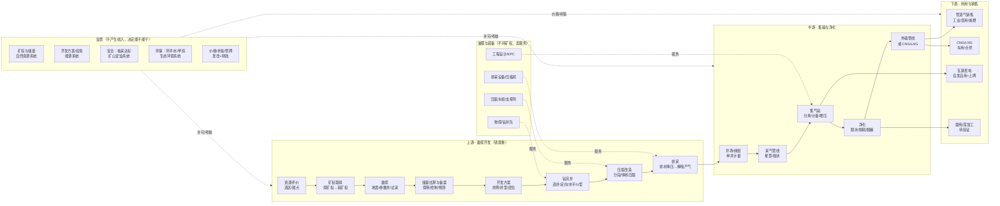
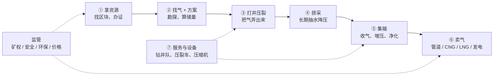
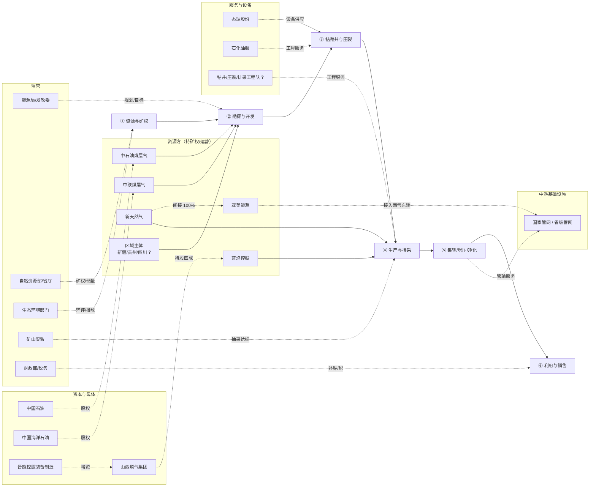
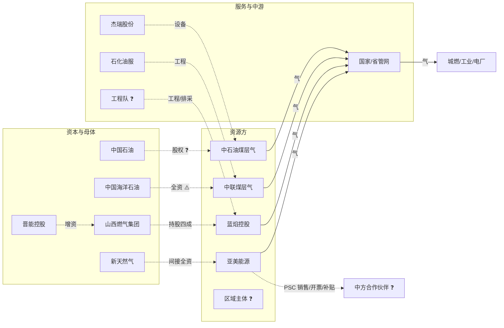

# 煤层气 · 全链路与钱怎么流（compact 示例）

> 历史示例已迁移到 compact 8 文件布局；原 `chain.md` 与 `value-chain.md` 合并到这里。

## 1. 钱怎么流

> 用法：这张图是**用来被改的**。每个环节只有 1—3 个数字敢标来源，其余是结构占位。
> 符号：✅ 有来源 ／ ⚠️ 有来源但可能过时或口径不明 ／ ❓ 推断（请客户纠正）

---

## 1. 一张图

---

## 2. 环节拆解

### 2.1 上游 · 勘探开发（占资本开支 80% 以上 ❓）

| 项 | 内容 | 钱/量 | 来源 |
|---|---|---|---|
| 主要活动 | 选区评价 → 矿权 → 勘探（地震、参数井、试采）→ 储量备案 → 开发方案 → 钻井 → 压裂 → 排采 | — | 结构为行业通行流程 ❓ |
| 收入项 | **还没收入**（试采气可少量销售） | — | ❓ |
| 成本大头 | 钻井、压裂、排采设备与电费、折旧；**单井投资高、回收期长** | — | ❓ |
| 关键指标 | 单井日产、含气量、渗透率、临界解吸压力、递减率、采收率 | — | S12 定义 |
| 典型项目体量 | 柿庄南东区：8.644 亿 m³/年产能，1709 口井，总投资 55.59 亿元 | **约 6.4 元/(m³·年) 的产能投资强度**（计算：55.59÷8.644，推断） | S14 + 本人计算 |
| 单井标杆 | 大吉煤岩气田吉深 10-8 平 01 井：累计 7000 万 m³，日产稳定 4.5 万 m³ 以上，连续稳产 29 个月 | — | S21 ✅ |
| 递减 | 老井递减是产量目标最大威胁，行业普遍关注"控制递减" | 具体递减率**待验证** | S19（专家表述）⚠️ |

**上游的钱从哪来**：自有资金 + 银行项目贷 + 母公司注资 + 中央预算内投资/示范项目支持（S01 第（三）条 ✅）。**没有"按米进尺付费"的第三方买单方**，这是重资产行业。

### 2.2 中游 · 集输与净化（决定气能不能变成钱）

| 项 | 内容 | 钱/量 | 来源 |
|---|---|---|---|
| 主要活动 | 单井计量 → 采气管线 → 集气站（分离/计量/增压）→ 净化（脱水/脱硫）→ 外输 | — | S14 ✅ |
| 基础设施量级 | 柿庄南东区：集气站 6 座、阀组 132 个、采气管线 1754.61 km、集气支线 227.642 km、干线 29.23 km、外输管线 51.957 km | — | S14 ✅ |
| 成本大头 | 管线钢材与施工、压缩机与电耗、增压站运维；**低产井的集输单位成本极高** | 具体元/m³ **待验证** | ❓ |
| 政策约束 | 以管道输送为主、"就近利用、余气外输" | — | S02、S07 ✅ |
| 接入规则 | 油气管网设施须公平开放；基础设施规划建设受新令约束 | — | S09、S10 ✅ |
| 瓶颈 | 区块分散、单井产量低 → 管线利用率低；跨省外输需管网容量与"管网通"类服务 | 蓝焰 2025 已引入国家管网"管网通"储气调峰 | S15 ✅ |

### 2.3 下游 · 利用与销售（收入真正实现的地方）

| 路径 | 机制 | 价格/量 | 来源 |
|---|---|---|---|
| 管道气 | 就近工业/民用/城燃；进城市公共管网按**不低于同等热值天然气价格** | 出厂价已市场化（供需协商） | S01 ✅ |
| CNG | 加压气态，槽车运输，适合小气量/短半径 | 定义见年报释义 | S15 ✅ |
| LNG | 冷却至 −162°C 液化，适合远距离/调峰 | 同上 | S15 ✅ |
| 瓦斯发电 | 优先自发自用，富余电量电网全部收购；"十三五"末全国瓦斯发电装机超 260 万千瓦 | — | S01、S07 ✅ |
| 提纯/深加工 | **我不确定这个环节在客户那边是否存在** | 待验证 | ❓ |

**实现价格参考（唯一可算的公开样本）**：蓝焰控股 2025 年煤层气销售 19.81 亿元 ÷ 销售量 12.25 亿 m³ ≈ **1.62 元/m³**（不含税口径推断）✅（S15）。这只是一个样本，不代表行业均价 ❓。

### 2.4 油服与装备（不持矿权，赚服务费/设备钱）

| 环节 | 代表能力 | 与煤层气的接口 | 来源 |
|---|---|---|---|
| 钻完井装备 | 钻修设备、压裂成套、连续油管、固井 | 深部煤层气水平井、多煤层合采 | S17 ✅ |
| 压缩机组 | 增压外输、煤层气集输、煤层气发电 | 中游增压 + 瓦斯发电 | S17 ✅ |
| 钻井/测录井服务 | 钻井进尺、测录定一体化、远程测控 | 煤层气被明确列为远程测控推广场景 | S18 ✅ |
| 排采设备 | 抽油机/螺杆泵/电潜泵、智能排采 | 排采制度执行的核心硬件 | ❓ |

**注意**：杰瑞、石化油服的煤层气收入占比**均未披露**，不要用公司总收入当煤层气市场规模（见 `players.md`）。

### 2.5 监管（不赚钱，但决定项目生死）

五条线：矿权与储量（自然资源）、开发方案与投资（能源）、安全抽采达标（矿山安监）、环保（环评/水/甲烷）、价格补贴管网（发改+财政）。详见 `regulators.md`。

---

## 3. 单位经济性（能算的都算了，算不出的标出来）

### 3.1 蓝焰控股 2025 年（A 股唯一纯煤层气地面开发标的）

| 指标 | 数值 | 计算/来源 |
|---|---|---|
| 销售量 | 12.25 亿 m³（同比 −2.93%） | S15 ✅ |
| 煤层气销售收入 | 19.81 亿元 | S15 ✅ |
| 煤层气销售成本 | 13.60 亿元 | S15 ✅ |
| 毛利 | 6.21 亿元 | 计算 |
| 毛利率 | 31.35%（同比 −4.33 pct） | S15 ✅ |
| **实现气价** | **≈1.62 元/m³** | 19.81÷12.25，不含税口径推断 |
| **单位成本** | **≈1.11 元/m³** | 13.60÷12.25，推断 |
| **单位毛利** | **≈0.51 元/m³** | 计算 |
| 财务费用 | 0.98 亿元（同比 −15.14%） | S15 ✅ |
| 研发投入 | 0.85 亿元 | S15 ✅ |
| 矿业权 | 24 宗，2799.35 km²，累计探明 531.91 亿 m³ | S15 ✅ |

**关键推论（推断，请客户验证）**：在 1.6 元/m³ 的气价下，单方毛利约 0.5 元；**补贴（0.3 元/m³ 量级）相当于毛利的 60% 左右**——这就是为什么补贴口径变化会直接改写项目可行性。若客户项目的气价低于 1.2 元/m³ 且无补贴，单方毛利可能不足 0.2 元。

### 3.2 一个开发项目的资本强度

柿庄南东区：55.59 亿元 / 8.644 亿 m³/年 ≈ **6.4 元/（m³·年）**（推断）。
含义：建 1 亿 m³/年产能，约需 6—7 亿元资本开支（本样本口径）。若单方净现金流 0.5 元，年净现金流约 0.5 亿元 → 静态回收期约 12—13 年（**极粗推断，未计时间价值、未计补贴与税**）。这与"煤层气是长周期重资产生意"的行业印象一致，但**具体回收期必须用客户实际数据重算**。

### 3.3 收入结构（蓝焰 2025）

| 收入项 | 金额 | 占比 | 说明 |
|---|---|---|---|
| 煤层气销售 | 19.81 亿元 | 93.88% | 主粮 |
| 气井建造工程 | 0.98 亿元 | 4.62% | 给别的矿权方打工 |
| 其他（含运输） | 0.32 亿元 | 1.50% | LNG/CNG 运输等 |
| **合计** | **21.10 亿元** | 100% | 同比 −6.87% |

**注意**：年报口径里**没有单列"瓦斯治理服务费"和"补贴"**。前者可能并进"气井建造工程/其他"❓，后者通常计入"其他收益"而非营业收入❓。这两项在客户的内部报表里可能是独立科目——**这是必须问的第一类问题**。

---

## 4. 成本大头（排序为推断，需客户确认）

| 排序 | 成本项 | 依据 | 信心 |
|---|---|---|---|
| 1 | 折旧摊销（井、管线、站场） | 重资产 + 55.59 亿元级投资 | ❓ 推断 |
| 2 | 钻井与压裂工程费 | 1709 口井的工程量 | ❓ 推断 |
| 3 | 电费与增压能耗 | 排采 + 集输增压 | ❓ 推断 |
| 4 | 修井/检泵/排采维护 | 井数多、单井产量低 | ❓ 推断 |
| 5 | 采出水处理与环保 | 环评批复对采出水、泉域、防渗有硬要求 | S14 ✅（要求存在）+ ❓（金额） |
| 6 | 财务费用 | 蓝焰 0.98 亿元，占收入 4.6% | S15 ✅ |
| 7 | 管输费 | 进管网需付费；新规强调降低管输成本 | S01/S09 ⚠️ |

---

## 5. 关键瓶颈（按"会不会卡死项目"排序）

1. **矿权与煤炭采矿权的空间/时间重叠**：政策给了"合作或调整范围""先采气后采煤""5 年建井窗口"三种处理方式（S01 第（十）条 ✅），但**具体到某个区块是哪一种，公开源查不到** → 必问。
2. **单井产量与递减**：直井单井日产普遍低，水平井/深层是增量（S19、S21 ⚠️）。储量起算标准同时看埋深分档（<500、500—1000、1000—2000 m）与单井日产起算值（m³/d）（S12 ⚠️ 报批稿）。
3. **管网与消纳**：产区集中于沁水/鄂东，外输依赖管网容量；蓝焰需引入"管网通"做季节调峰（S15 ✅）。
4. **采出水与生态约束**：泉域、水源地禁采区、防渗系数要求（S14 ✅）——在山西这是真实的选址约束，不是纸面要求。
5. **补贴退坡/改规则**：从"量补"到"效补"，"达标即止"的企业激励被打破（S05 ⚠️）。
6. **气价**：与管道天然气、LNG 进口价联动；2026 年进口下降、国产替代逻辑增强（S19 ⚠️）。

---

## 6. 这张图我明确猜了的地方（请客户画叉）

- 上游占资本开支 80% 以上 —— ❓ 纯推断，没有公开拆分。
- 成本排序 —— ❓ 除财务费用外全是推断。
- 下游"提纯/深加工"环节是否存在 —— ❓ 不确定客户是否有这一环。
- 单方回收期 12—13 年 —— ❓ 极粗推断，请用客户实际气价/补贴/税后现金流重算。
- 收入结构里"瓦斯治理服务费/补贴"的科目归属 —— ❓ 年报未单列。
- 中游"净化"的具体工艺（脱水/脱硫/脱碳哪几种） —— ❓ 环评批复只提到"分离"，未给工艺细节。

---

## 7. 值得追的 3 个外部数据源（本包未取得）

1. 券商煤层气深度报告（用户方法论指定要读 3 份）——**本包一份都没有**，需另行获取。
2. 《煤炭工业发展"十五五"规划》原文——目标数字目前只有媒体转述（S19）。
3. 《鄂尔多斯盆地东部区域煤层气增储上产行动方案（2026—2030年）》原文——180 亿 m³ 目标同上。

---

## 2. 全链路与玩家关系

> **这是工作假设，不是行业定论。** 分段方式、玩家归属、彼此关系都是我按公开信息拼的，**客户的实际产业链结构一定不同**——请拿它去被改（见文末待验证关系）。
> 信心：✅ 有公开源直接支撑 ／ ⚠️ 有源但可能过时/转述/口径不明 ／ ❓ 推断或未找到公开源
> 规划标注：**【公司自述】**（年报/公告原文）／**【媒体转述】**（媒体引用规划，未取原文）／**【推断】**（我推的，不是任何人的话）
> 与 `players.md`（单家画像）、`value-chain.md`（钱与成本）、`flow.md`（工序与审批）互补，不重复。来源编号见 `sources.jsonl`。

---

## 0. 三条读图规则

1. **持股 ≠ 控制 ≠ 合作**：三种关系在表里分开写，别把"出现在同一句话里"当股权关系。
2. **规划不是已发生**：所有"未来"都带标签，客户若把规划当现状讲，要追问"哪一年、哪个区块、批了没有"。
3. **链上有两套账**：资源方的账（气价、补贴、成本）和政府的账（矿权出让收益、税、保供）。FDE 只看前者会漏掉一半约束。

---

## 1. 产业链总览：每段在干啥

先记住一句话：这条链就是「拿区块 → 找气 → 打井压裂 → 长期排水采气 → 收气增压 → 卖气」，外加卖设备和受监管。

| # | 这一段 | 大白话：在干啥 | 谁在忙 | 钱/物怎么流 | 卡在哪 |
|---|---|---|---|---|---|
| ① | 资源与矿权 | 先找到煤层气富集的地方，把探矿权/采矿权办下来 | 省自然资源厅（出让方）、资源方（竞买方） | 企业交矿业权出让收益给省财政（故县样本起始收益率 0.3%）[S13] ✅ | 区块可能和煤矿采矿权重叠 [S01] ⚠️ |
| ② | 勘探与开发方案 | 打参数井、试采，算清楚有多少气、怎么开发，报方案 | 中石油煤层气、中联煤层气、蓝焰、新天然气 | 开始花钱（资本开支），还没收入 | 储量算不清、开发方案审批慢 [S12][S25] ⚠️ |
| ③ | 钻完井与压裂 | 打井、固井、压裂，把煤里的气“打通”到井筒 | 杰瑞、石化油服、各类工程队 | 资源方付钱给油服/设备商 | 深层要水平井 + 大规模压裂，成本高 [S19] ⚠️ |
| ④ | 生产与排采 | 长期抽水、降压，让气慢慢解吸出来；修井、控递减 | 各资源方生产部门、排采站 | 卖气前的“养井”阶段：电费、维护、人工 | 排采要“连续、稳定、缓慢、长期”，急不得 [S26] ✅ |
| ⑤ | 集输/增压/净化 | 把各井的气收起来，增压、脱水/净化，送进管网 | 资源方地面工程、国家/省级管网 | 花管线、压缩机、电费；可能付管输费 | 管网公平开放、接入条件 [S09][S10] ✅ |
| ⑥ | 利用与销售 | 把气卖给城燃/工业/电厂，或做成 CNG/LNG、瓦斯发电 | 各资源方销售公司、城燃、工业客户、电网 | 钱进来了：气款、补贴、电价 | 出厂价随行就市、进城管网按热值 [S01] ✅ |
| ⑦ | 服务与设备 / 监管 | 卖钻井、压裂、压缩机；五个部门管你 | 杰瑞、石化油服；能源局、自然资源部、生态环境部、矿山安监、财政税务 | 服务费/设备款；监管不产生钱流，但能否决项目 | 补贴改“效补”、增值税政策变化 [S04][S15][S28] ⚠️ |

### 1.1 玩家总表（15 家/类，详见 `players.md`）

| 玩家 | 角色 | 现状 | 近 12 个月动作 | 未来规划 | 信心 | 来源 |
|---|---|---|---|---|---|---|
| 中石油煤层气 | 上游·深层龙头 | 非上市，中国石油子公司；大吉气田 | 深层煤岩气持续上产；鄂东行动方案主力 | 【媒体转述】鄂东 2030 年 180 亿 m³、深层 160 亿 m³+ | ⚠️ | S21、S19 |
| 中联煤层气 | 上游·沁水主力 | 非上市，中国海油全资（2019 年收购） | 柿庄南开发项目（8.644 亿 m³/a、1709 口井） | ❓ 未找到近 12 个月公开规划 | ⚠️ | S23、S14 |
| 蓝焰控股 | 上游+瓦斯治理服务 | 深交所 000968；24 宗矿业权、2799 km² | 2025 年报：销量 12.25 亿 m³、毛利率 31.35% | 【公司自述】"一核两翼"；加密井、侯甲—龙湾 | ✅ | S15 |
| 新天然气 | 上游·跨区域 | 上交所 603393；潘庄/马必/紫金山 | 2025 年报：营收 39.24 亿、产量 24.13 亿 m³ | 【公司自述】紫金山提储、马必北区开发方案审批 | ⚠️ | S16、S25 |
| 亚美能源 | 上游·潘庄/马必运营主体 | 新天然气间接持股 100%；PSC 模式 | 通过新天然气年报披露产量与售价 | ❓ 未单独披露 | ⚠️ | S25 |
| 区域主体（新疆/贵州/四川） | 上游·区域玩家 | 具体主体待验证 | 新疆阜康 2026-08 日抽采超 80 万 m³ | ❓ | ❓ | S19、S22 |
| 中国石油 | 资本与母体 | A+H 601857/0857 | 无单独煤层气披露 | ❓ | ❓ | S15 |
| 中国海洋石油 | 资本与母体 | A+H 600938/0883 | 无单独煤层气披露 | ❓ | ⚠️ | S23 |
| 山西燃气集团 | 省属燃气平台 | 蓝焰控股控股股东（40.05%） | 无独立披露 | ❓ | ✅（股权） | S15 |
| 晋能控股装备制造 | 省属能源集团 | 蓝焰前控股股东；2023 年增资山西燃气 | 无独立披露 | ❓ | ✅（股权） | S15 |
| 杰瑞股份 | 油服与装备 | 深交所 002353；电驱压裂、压缩机组 | 2026-04 年报摘要：电驱压裂国内领先 | 【公司自述】继续推电驱压裂/柱塞泵 | ✅ | S17 |
| 石化油服 | 油服 | A+H 600871/1033；钻井/测录井 | 2026-03 年报：营收 807.12 亿、进尺 1115 万米 | 【公司自述】2026 年钻井进尺 1,085 万米 | ✅ | S18 |
| 山西焦煤 | 下游/协同·煤炭企业 | 深交所 000983；炼焦煤为主，高瓦斯/突出矿井有瓦斯治理需求 | **待验证**（年报页需 JS 渲染，本次未取得原文） | ❓ | ❓ | — |
| 钻井/压裂/排采工程队 | 服务·非上市 | 大量未上市、无公开信息 | 待验证 | ❓ | ❓ | — |
| 国家管网/省级管网 | 中游基础设施 | 管输服务；公平开放 | 第 33/35 号令施行 | 待验证 | ⚠️ | S09、S10 |

---

## 2. 全链路关系图

**看图要点**：资源方是"重资产+多环节自营"，服务与设备是"轻资产卖能力"，中游是"必须接入但议价弱"，监管是"不产生收入但能否决项目"。

---

## 3. 逐段拆解：现状与规划

### ① 资源与矿权

- **做什么**：拿探矿权 → 勘探 → 转采矿权；区块与煤炭采矿权的空间/时序协调。
- **现状（公开样本）**：山西省 2025-12 仍在挂牌出让新区块（故县区块 291.68 km²、预探、5 年、起始价 204.4 万元、起始出让收益率 0.3%、竞买人净资产≥5 亿元）[S13] ✅。这说明**区块供给没有停**。
- **规划**：省级"十五五"层面尚无已核实的煤层气矿业权投放计划 → ❓ 待验证。
- **关键玩家**：省自然资源厅（出让方）；资源方（竞买方）。

### ② 勘探与开发方案

- **做什么**：地震/参数井/试采 → 储量估算与备案 → 开发方案 → 前置审批。
- **现状**：中石油煤层气主导大吉气田（鄂尔多斯盆地东缘，资源量估算约 6000 亿 m³，2019 年开始先导试验）[S21] ⚠️；中联煤层气在沁水盆地柿庄南有开发项目（环评批复的 8.644 亿 m³/年、1709 口井、总投资 55.59 亿元）[S14] ✅；新天然气紫金山区块"调整为以中深部煤层气勘探为主、兼探致密气"，2025 年完钻 28 口，下一步做提储与总体开发方案编制/审批/备案 [S25] ✅。
- **规划**：
  - 中石油煤层气：**【媒体转述】**《鄂尔多斯盆地东部区域煤层气增储上产行动方案（2026—2030年）》提出 2030 年鄂东 180 亿 m³、深层 160 亿 m³ 以上，承担主要增产任务 [S19] ⚠️。
  - 蓝焰控股：**【公司自述】**"十五五"实施"一核两翼"（勘探开发为核心，工程装备服务+新能源为两翼）；2026 年推进晋城矿区加密井、侯甲—龙湾等重点项目 [S15] ✅。
  - 新天然气：**【公司自述】**2026 年推进紫金山区块提储与开发方案审批、马必北区 MB076 井区开发方案审批 [S25] ✅。
  - 中联煤层气：**❓ 未找到 12 个月内的公开规划**（仅知 2019 年被中海油收购 [S23]）。
- **注意**：开发方案审批是真实卡点——新天然气明确写"马必区块由于北区 MB076 井区总体开发方案尚未完成审批，开发进度受到影响，导致产量虽增长但未达预期" [S25] ✅。这是"流程卡住产量"的罕见公开证据。

### ③ 钻完井与压裂

- **做什么**：钻井、固井、完井、压裂；深部需要水平井+大规模压裂+精细排采 [S19] ⚠️。
- **钱怎么流**：资源方资本开支 → 装备与工程服务商。杰瑞的压缩机组明确用于"煤层气集输、LNG 液化工厂、煤层气发电" [S17] ✅；石化油服把煤层气列为测录井远程测控的推广场景 [S18] ✅。
- **规划**：
  - 石化油服：**【公司自述】**2026 年计划钻井进尺 1,085 万米、测井 25,455 万标准米、录井进尺 847 万米 [S18] ✅（公司整体，非煤层气单列）。
  - 杰瑞：**【公司自述】**继续推电驱压裂、柱塞泵等装备 [S17] ✅（未单列煤层气）。
- **注意**：两家都不披露煤层气收入占比 → 不能用其总收入倒推煤层气市场规模。

### ④ 生产与排采

- **做什么**：排水降压→解吸→产气；定产水/定井底流压；修井检泵；控递减。
- **排采制度（v0.2 新增证据）**：煤层气井生产制度一般为**定产水**，中后期通过控制井底压力下降幅度，遵循"**连续、稳定、缓慢、长期**"的排采原则，**不采用定产气**；论文示例为前期定产水 1 m³/d、中后期定井底流压 1 MPa [S26] ✅。这推翻了我 v0.1 里"排采制度零公开源"的判断。
- **现状**：蓝焰 2025 年销售量 12.25 亿 m³（同比 −2.93%）、毛利率 31.35%（同比 −4.33 pct）[S15] ✅——**存量稳产压力已经体现在报表上**。
- **规划**：蓝焰 **【公司自述】**"深化气井精细管理与排采优化，加大对低产、低效井改造力度，深挖老井潜力，延长稳产周期，**降低自然递减率**"，并提出"数智赋能" [S15] ✅。这是数字化最直接的预算理由。
- **新天然气**：**【公司自述】**潘庄"老井泄压提产、新井加速排采、低老病废井治理、低能量井负压抽采、推进薄煤层产能释放" [S25] ✅。

### ⑤ 集输/增压/净化

- **做什么**：单井计量→阀组→采气管线→集气站（分离/计量/增压）→净化→外输。
- **现状**：柿庄南东区样本：集气站 6 座、阀组 132 个、采气管线 1,754.61 km、支线 227.642 km、干线 29.23 km、外输管线 51.957 km [S14] ✅；亚美能源通过地区管道向河南/山东输气，也可经中石油中央处理中心连接西气东输一线 [S25] ✅。
- **规划**：**【公司自述】**新天然气提到"潘庄、马必区块联络线顺利投运"、构建"更具韧性的销售网络和调峰空间" [S25] ✅。
- **监管**：管网公平开放（第 33 号令，2025-11-01 施行）[S09] ✅；基础设施规划建设运营（第 35 号令，2026-01-01 施行）[S10] ✅。

### ⑥ 利用与销售

- **做什么**：管道气/CNG/LNG/瓦斯发电；合同、结算、补贴申报。
- **价格（公开样本）**：潘庄 2025 年平均销售价 2.09 元/m³（+0.48%）、马必 2.30 元/m³（−2.13%）[S25] ✅；蓝焰反推约 1.62 元/m³ [S15]（计算）。**同一行业价差可达 40%+，说明"资源禀赋+销售半径"比"行业均价"更重要。**
- **PSC 模式（重要）**：亚美能源与"中方合作伙伴"订有煤层气销售合作协议——亚美负责按约交付气量，中方伙伴负责存置记录、开票、纳税、**申请退税及政府补贴** [S25] ✅。这意味着**补贴申报主体可能不是开采主体**，是 FDE 最容易问错的一个点。
- **规划**：尚无公开的销售/长协规划 → ❓。
- **风险（新）**：2025 年 10 月《关于调整风力发电等增值税政策的公告》废止目录涉及煤层气抽采相关条款，自 2025-11-01 起废止 [S28] ⚠️；蓝焰年报明确"取消煤层气抽采销售增值税先征后退政策，对公司经营业绩产生一定影响" [S15] ✅；新天然气在互动平台称"煤层气增值税即征即退政策取消，对公司 2026 年盈利有一定影响，影响金额与年度产量、收入密切相关" [S29] ⚠️。

### ⑦ 服务与设备 / 监管与行业组织

- **服务与设备**：杰瑞（装备）、石化油服（工程）[S17][S18]；大量钻井/压裂/排采工程队未上市、无公开信息 ❓。
- **监管五线**：矿权与储量（自然资源）、规划与投资（能源/发改）、安全抽采达标（矿山安监）、环保（生态环境）、价格/补贴/税/管网（发改+财政+税务）→ 详见 `regulators.md`。
- **行业组织**：本包**没有核实的行业组织名单**（如专业委员会/联盟），不写，避免编造 ❓。

---

## 4. relations 表（20 条，全部可追溯或标 ❓）

| from | 关系类型 | to | 证据 | 信心 | 来源 |
|---|---|---|---|---|---|
| 中国海洋石油 | 股权（100% 收购） | 中联煤层气 | 2019 年中海油旗下上市公司以约 53.35 亿元收购中联煤 100% 股权 | ⚠️ 2019 年状态 | [S23] |
| 中联煤层气 | 运营 | 沁水盆地柿庄南区块 | 环评批复抬头为"中联煤层气有限责任公司" | ✅ | [S14] |
| 山西燃气集团 | 控股股东（40.05%） | 蓝焰控股 | 2023 年晋控装备以持有的 40.05% 股份增资至山西燃气集团并完成过户 | ✅ | [S15] |
| 晋能控股装备制造集团 | 增资/股权 | 山西燃气集团 | 同上 | ✅ | [S15] |
| 新天然气 | 间接持股 100% | 亚美能源 | "香港利明持有的亚美能源的 100.00% 股权质押"；并购贷款用于收购其 43.04% 股权 | ✅ | [S25] |
| 亚美能源 | 产品分成/销售合作 | 中方合作伙伴（**名称未披露**） | 与中方合作伙伴订立煤层气销售合作协议；中方负责开票、纳税、申请退税及政府补贴 | ⚠️ 关系存在，对手方未知 | [S25] |
| 亚美能源 | 管输接入 | 中石油中央处理中心→西气东输一线 | "可通过中石油的中央处理中心连接西气东输一线" | ✅ | [S25] |
| 蓝焰控股 | 瓦斯治理服务（客户） | 有关煤炭企业（**未点名**） | "与有关煤炭企业签订了瓦斯治理协议，有偿提供瓦斯抽采服务" | ⚠️ | [S15] |
| 蓝焰控股 | 合作开发 | 国内大型油气企业（**未点名**） | "与国内大型油气企业合作在其矿业权范围内开展煤层气地面抽采" | ⚠️ | [S15] |
| 中国石油 | 股权（**名称推断**） | 中石油煤层气 | 公司名称含"中石油"；报道仅称"从中石油煤层气有限责任公司获悉" | ❓ 未见明示股权文件 | [S21] |
| 中石油煤层气 | 主导开发 | 大吉气田（大宁—吉县） | "由中石油煤层气有限责任公司主导开发" | ✅ | [S21] |
| 杰瑞股份 | 设备供应 | 煤层气资源方 | 压缩机组应用于煤层气集输、LNG 液化工厂、煤层气发电 | ✅ | [S17] |
| 石化油服 | 工程服务 | 煤层气资源方 | 2026 年计划"在地热、煤层气等市场逐步推广远程测控施工模式" | ⚠️ 计划态 | [S18] |
| 煤层气资源方 | 管输服务采购 | 国家管网 | 蓝焰 2025 年引入国家管网"管网通"服务做储气调峰 | ✅ | [S15] |
| 国家能源局/发改委 | 监管（规划/目标） | 全行业 | "十五五"规划 2030 年 260 亿 m³；鄂东行动方案 180 亿 m³ | ⚠️ 媒体转述 | [S19] |
| 自然资源部/省自然资源厅 | 监管（矿权/储量） | 资源方 | 故县区块探矿权挂牌出让公告 | ✅ | [S13] |
| 山西省生态环境厅 | 监管（环评） | 中联煤层气 | 柿庄南东区环评批复 | ✅ | [S14] |
| 财政部/税务总局 | 监管（补贴/税） | 资源方与贸易主体 | 财建〔2025〕35号；增值税先征后退取消 | ⚠️ | [S04][S28] |
| 中石油煤层气 / 中联煤层气 / 蓝焰 / 新天然气 | 竞争 | 彼此（同一盆地相邻区块） | 同处沁水/鄂尔多斯盆地东缘 | ❓ 推断（无公开竞争表述） | — |
| 山西焦煤 | 潜在客户/合作（瓦斯治理） | 煤层气资源方 | 无直接证据；仅知山西煤炭企业普遍有瓦斯治理需求 | ❓ 推断 | — |

---

### 4.1 玩家关系图（先看个大概，准确依据看上面的表）

> 虚线 = 不确定关系或非股权关系；带 ❓ 的节点/边表示待验证。准确依据看上面的 relations 表。

## 5. 待验证关系（5–8 条，全部进 verification-list 候选）

| # | 待验证关系 | 为什么重要 | 建议问法 |
|---|---|---|---|
| R1 | 亚美能源的"中方合作伙伴"到底是谁？ | PSC 决定补贴申报主体、销售开票主体，直接影响财务与数据归属 | "我在图里把'中方合作伙伴'画成一个空框，**您帮我填上是谁，以及谁在申报补贴**。" |
| R2 | 中国石油与中石油煤层气的股权层级 | 决定决策链长度与预算来源 | "我按名称推断它是中石油子公司，**这条线我画得对吗？**" |
| R3 | 蓝焰的瓦斯治理协议对方是哪些煤矿 | 决定它到底是"卖气公司"还是"卖服务公司" | "我在图上把煤矿画成蓝焰的客户，**您帮我把实际的协议方写上去**。" |
| R4 | 中联煤层气当前是否仍为中海油 100% 全资 | 2019 年信息可能已过时 | "我引的是 2019 年的收购报道，**现在股权有变化吗？**" |
| R5 | 山西焦煤与哪家煤层气公司有实际合作 | 判断"煤炭企业"在链上是客户、对手还是合作方 | "我猜煤炭企业和煤层气公司是'客户+合作'双关系，**这条虚线存在吗？**" |
| R6 | 区块与煤炭采矿权的重叠处理方式 | 合法性与时序（"5 年窗口"）[S01] | 见 `verification-list.md` #3 |
| R7 | 区域主体（新疆阜康、贵州织金、四川筠连）是谁在运营 | 跨区域复制时找不到对口人 | "这三个地方我只知道产量，**运营主体分别是哪家？**" |
| R8 | 行业组织/标准归口（有无可对标的协会/标委会） | 影响标准与话语体系 | "煤层气的标准主要看哪个标委会？我**没查到公开名单**。" |

---

## 6. 与已有文件的分工（别重复读）

| 想知道 | 读 |
|---|---|
| 单家玩家的上市状态、财务、区块清单 | `players.md` |
| 钱从哪来、成本压在哪、单位经济性 | `value-chain.md` |
| 工序顺序、审批链、每个节点的信心 | `flow.md` |
| 链上"谁和谁是什么关系"、规划真假 | **本文** |
| 业务域怎么切、每个环节谁在做 | `domains.md`、`activities.md` |
