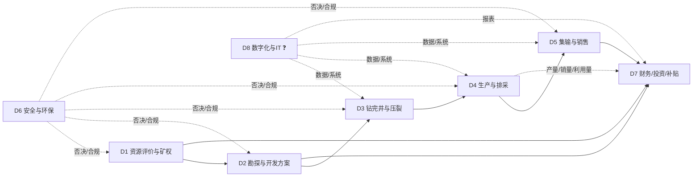

# 业务域划分（v0.2 · 公开源草稿）

> **声明**：这是按公开信息（年报的部门/业务表述、监管文件、环评批复、行业论文）**推断**的域划分，**不是客户的组织架构图**。客户的部门名、边界、汇报线一定不同——请拿它去校准（见 §5）。
> 用途：FDE 在画流程图之前，先回答"客户这家公司由哪几块业务能力组成"，避免把"工序"当"部门"。
> 信心：✅ 有公开源支撑该域存在 ／ ⚠️ 有源但边界/归属不明 ／ ❓ 纯推断
> 来源编号见 `sources.jsonl`；环节级明细见 `activities.md`。

---

## 0. 为什么先切域，再画流程

- 流程图回答"**先后顺序**"；业务域回答"**谁负责、边界在哪、跟谁交接**"。
- 一线员工被问"你们流程是什么"时，通常答的是**自己域内**的流程；跨域部分会被简化或扭曲。
- 所以先给一张域图，让对方说"我们不是这么分的，A 和 B 是一个部门 / C 是集团管的"——**这句否定比流程细节值钱**。

---

## 1. 八个业务域（工作假设）

| # | 业务域 | 一句话目标 | 主责角色（推断） | 核心流程 | 主要接口 | 成熟度（推断） | 信心 |
|---|---|---|---|---|---|---|---|
| D1 | 资源评价与矿权 | 拿到并保住"能采的气" | 资源/矿权管理部、地质研究所 | 选区、矿权取得、储量估算与备案 | D2、D7、D6 | 高（政策熟） | ✅ |
| D2 | 勘探与开发方案 | 把资源变成可执行的产能设计 | 勘探开发部/研究院 | 地震、参数井、试采、开发方案、前置审批 | D1、D3、D7、D6 | 中高 | ✅ |
| D3 | 钻完井与压裂 | 把设计打成井、把井改造好 | 工程技术部/项目经理部 | 钻井、固井、完井、压裂 | D2、D4、D7 | 中（依赖外部队伍） | ✅ |
| D4 | 生产与排采 | 稳定、连续、长期地把气采出来 | 生产运行部/采气区/井区 | 排采、修井检泵、控递减、间开调压 | D3、D5、D6、D8 | 中（精细化程度分化大） | ✅ |
| D5 | 集输与销售 | 把气变成可交付的商品并卖出价 | 地面工程部 + 销售公司/调度 | 集输、增压、净化、计量交接、销售结算 | D4、D7、外部管网/客户 | 中高 | ✅ |
| D6 | 安全与环保（HSE/QHSE） | 不因安全环保停产 | 安全环保部/QHSE | 抽采达标、环评/水保/用地、采出水、放空/甲烷 | 全部域（否决权） | 高（合规驱动） | ✅ |
| D7 | 财务、投资与补贴 | 钱够不够、划不划算、补贴拿不拿得到 | 财务部/计划投资部/经营分析 | 投资决策、预算、补贴申报、税务、融资 | D1—D5、D6 | 高（但口径易混） | ✅ |
| D8 | 数字化与 IT | 让数据可用、可追溯、可决策 | 信息中心/数字化部（**可能存在，也可能没有**） | 数据采集、生产管理系统、报表、系统集成 | 全部域 | 低—中（最不确定） | ❓ |

**为什么是 8 个**：公开材料里能明确看到职责痕迹的只有 D1—D7；D8 是大多数 FDE 项目的落点，但**客户是否设独立部门完全未知**，所以单列并标 ❓。

---

## 2. 域间接口图（推断）

**接口上的三个高频断点（推断，需验证）**：
1. **D4→D7**：产量（井口）与销量（交接）不是一回事，三口径陷阱就发生在这里。
2. **D2↔D6**：开发方案与环评/用地是双向修改关系，不是"方案定了再报环评"。
3. **D4↔D8**：单井数据是人工填报还是自动采集，决定数字化项目的起点。

---

## 3. 逐域说明

### D1 资源评价与矿权
- **目标**：拿到区块、保住矿权、把储量做到可备案。
- **包含流程**：选区评价、矿权取得（招拍挂/协议）、综合勘查与储量估算、储量备案。
- **对外接口**：省自然资源厅（出让/登记）、集团投资决策。
- **痛点（推断）**：区块与煤炭采矿权重叠的协调成本；新区块"预探"到"探明"周期长。
- **公开证据**：故县区块出让条件（预探、5 年、净资产门槛）[S13] ✅；储量规范分级条件 [S12] ⚠️。
- **信心**：域存在 ✅；内部怎么分工 ⚠️。

### D2 勘探与开发方案
- **目标**：把"地下的气"翻译成"可施工的井网+产能+投资"。
- **包含流程**：地震、参数井、试采、储量复算、开发方案编制与审批、前置审批（环评/水保/用地）。
- **对外接口**：省发改委/能源局（备案/核准）、生态环境厅（环评）、集团投委会。
- **痛点（推断）**：开发方案审批卡产量——新天然气马必北区 MB076 井区"总体开发方案尚未完成审批，开发进度受到影响" [S25] ✅。
- **信心**：域存在 ✅；审批主体链条 ❓（见 `flow.md` §3）。

### D3 钻完井与压裂
- **目标**：按设计完成井筒与储层改造，控制单井成本。
- **包含流程**：钻井、固井、完井、测井、压裂（分段/体积）、试气。
- **对外接口**：油服/装备供应商（杰瑞 [S17]、石化油服 [S18]）、集团采办。
- **痛点（推断）**：深部水平井+大规模压裂的成本与效果不确定性 [S19] ⚠️；工程队伍管理。
- **信心**：域存在 ✅；自营/外包比例 ❓。

### D4 生产与排采
- **目标**：稳产、控递减、把单井潜力榨干。
- **包含流程**：排采制度执行（定产水/定井底流压）、修井检泵、间开/调压、低效井治理、递减分析。
- **公开证据**：排采原则"连续、稳定、缓慢、长期"，不采用定产气 [S26] ✅；蓝焰"气井精细管理与排采优化、降低自然递减率" [S15] ✅。
- **痛点（推断）**：老井递减、低产低效井多、人工抄表数据质量差。
- **信心**：域存在 ✅；制度细节 ⚠️（有论文但客户可能不同）。

### D5 集输与销售
- **目标**：把气安全、达标、经济地送到客户。
- **包含流程**：井场计量→阀组→采气管线→集气站→增压→净化→外输/CNG/LNG→计量交接→销售结算。
- **对外接口**：国家管网/省管网 [S09][S10]、城燃/工业客户、电网（发电）。
- **公开证据**：柿庄南地面工程量 [S14] ✅；亚美能源销售与接入模式 [S25] ✅；两区块实现价 2.09/2.30 元/m³ [S25] ✅。
- **痛点（推断）**：产销平衡、管输费、结算周期、补贴申报主体（PSC 下可能是中方伙伴）[S25] ⚠️。
- **信心**：域存在 ✅；销售组织形态 ❓。

### D6 安全与环保
- **目标**：不因安全/环保问题停产或被处罚。
- **包含流程**：抽采达标、瓦斯治理、环评/水保/用地、采出水处理、放空/甲烷管控、应急。
- **对外接口**：矿山安监、生态环境、水利/林草/自然资源。
- **公开证据**：抽采达标规定 [S11] ✅；环评批复的采出水/泉域/防渗要求 [S14] ✅；甲烷排放控制行动方案 [S24] ⚠️。
- **痛点（推断）**：合规要求分散在 5 个部门，数据要反复报。
- **信心**：域存在 ✅；与生产的界面（谁能否决停机）❓。

### D7 财务、投资与补贴
- **目标**：投得对、算得清、补贴拿得到。
- **包含流程**：投资决策、预算、成本核算、补贴申报与清算、税务（含增值税优惠变化）、融资。
- **公开证据**：蓝焰 2026 年计划投资约 10 亿元、融资 16 亿元、营收约 21 亿元 [S15] ✅；补贴"多增多补/冬增多补" [S15][S05] ⚠️；增值税先征后退取消 [S15][S28] ⚠️。
- **痛点（推断）**：补贴口径变化快（0.3 定额→0.3—0.6→梯级奖补）[S03][S05]；财务科目与业务口径不一致。
- **信心**：域存在 ✅；补贴在报表的科目归属 ❓（见 `verification-list.md` #6）。

### D8 数字化与 IT
- **目标**：让数据可采集、可追溯、可支持决策。
- **包含流程（推断）**：单井数据采集、生产管理系统、报表、系统集成、数据治理。
- **公开证据**：**几乎没有**。唯一线索是蓝焰年报提"数智赋能" [S15] ✅、石化油服提"远程测控" [S18] ⚠️。
- **痛点（推断）**：井数多（样本项目 1,709 口井 [S14]）、数据分散、口径不统一。
- **信心**：❓ 域是否存在独立部门、系统叫什么、由谁维护，全部未知。

---

## 4. 域间接口矩阵（✓ 有交接，? 不确定）

| 从 \ 到 | D1 | D2 | D3 | D4 | D5 | D6 | D7 | D8 |
|---|---|---|---|---|---|---|---|---|
| D1 | — | ✓ 区块/储量 |  |  |  | ✓ 环评前置 | ✓ 投资 | ? |
| D2 | ✓ 方案调整 | — | ✓ 井位/设计 | ✓ 投产交接 | ✓ 地面配套 | ✓ 环评/用地 | ✓ 投资 | ? |
| D3 |  | ✓ 实钻反馈 | — | ✓ 交井 |  | ✓ 安全设施 | ✓ 成本 | ? |
| D4 |  | ✓ 产能反馈 | ✓ 修井需求 | — | ✓ 产量/销量 | ✓ 抽采达标 | ✓ 产量口径 | ? |
| D5 |  |  |  | ✓ 计量 | — | ✓ 放空/泄漏 | ✓ 气款/结算 | ? |
| D6 | ✓ 禁采区 | ✓ 批复 | ✓ 安全 | ✓ 停机整改 | ✓ 排放 | — | ✓ 环保支出 | ? |
| D7 | ✓ 矿权价款 | ✓ 预算 | ✓ 结算 | ✓ 成本 | ✓ 收入 | ✓ 合规成本 | — | ? |
| D8 | ? | ? | ? | ? | ? | ? | ? | — |

**用法**：把这张矩阵打印出来，让客户在格子里写"实际对接人"——填不满的格子就是组织断点，也是数字化项目的入口。

---

## 5. 我明确猜的地方（请客户改）

| # | 我的分法 | 可能错在哪 | 验证方式 |
|---|---|---|---|
| G1 | D1 与 D2 是两个域 | 客户可能合成一个"勘探开发部" | "矿权和储量、开发方案，是一个部门管还是两个？" |
| G2 | D5 集输与销售是一个域 | 客户可能"地面工程"与"销售公司"完全分开，甚至销售是集团层面 | "气是谁卖的？销售公司是独立法人吗？" |
| G3 | D6 对全链有否决权 | 实际可能只有建议权，停产决定在集团 | "谁有权让一口井/一个站停下来？" |
| G4 | D7 管补贴申报 | PSC 模式下可能是中方合作伙伴申报 [S25] | "补贴是我们申报还是合作方申报？" |
| G5 | D8 独立存在 | 可能挂在生产部或办公室下 | "数字化/信息化归哪个部门？" |
| G6 | 八个域的边界 | 客户可能按"区块/项目公司"而不是"职能"划分 | "你们是按职能分部门，还是按区块设项目公司？" |

---

## 6. 与其它文件的关系

- `activities.md`：把本文的 8 个域展开成 ≥20 个具体环节/活动。
- `flow.md`：工序顺序与审批链。
- `chain.md`：链上玩家与关系。
- `verification-list.md`：本文 G1—G6 与 `activities.md` 的 ❓ 行已并入待验证候选。
