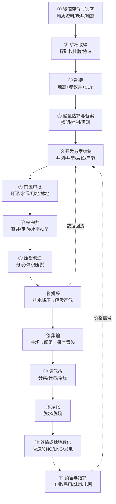
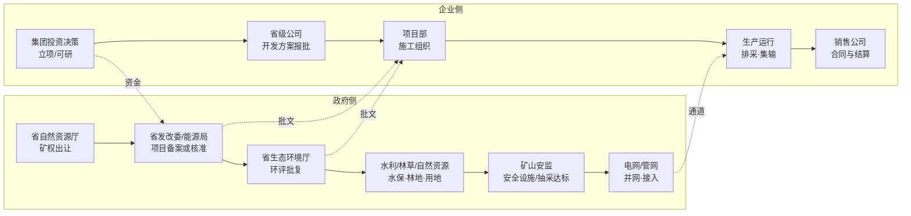

# 客户业务流程图（v0.1 · 带信心标记）

> **这是本包最该被改的文件。** 每个节点标了信心等级，文末汇总成待验证清单候选。
> ✅ 有来源 ／ ⚠️ 有来源但可能过时或口径不明 ／ ❓ 我猜的
> 用法：打印出来，逐节点问一线："这个顺序对吗？哪一步其实不是这样？"

---

## 1. 主流程（资源 → 销售）

### 节点信心表

| # | 节点 | 主要活动 | 输出物 | 信心 | 依据 / 待验证 |
|---|---|---|---|---|---|
| ① | 资源评价与选区 | 收集煤田地质、老井、地震资料；圈甜点 | 选区报告 | ❓ | 行业通行流程，无公开源；**客户是否自评价还是买区块，待验证** |
| ② | 矿权取得 | 招拍挂/协议出让；探矿权→采矿权 | 勘查许可证/采矿许可证 | ✅ | 故县区块公告：291.68 km²、预探、5 年、起始价 204.4 万元、起始出让收益率 0.3%（S13）；政策要求综合勘查、限期开发（S01） |
| ③ | 勘探 | 地震、参数井、试采；取心测含气量、试井测渗透率 | 参数井/探井、试采曲线 | ✅ | 储量规范定义探井/参数井/排采井（S12）；"目的层全部取心"是探明储量条件 |
| ④ | 储量估算与备案 | 按 DZ/T 0216 估算；报自然资源部门备案 | 储量报告/备案证明 | ⚠️ | 规范是报批稿（S12）；**备案流程细节未核实** |
| ⑤ | 开发方案编制 | 井网井距、井型、层位、产能、投资、经济评价 | 开发方案（ODP） | ❓ | 环评批复提到"开发方案"（S14），但方案内容与审批机关**未核实** |
| ⑥ | 前置审批 | 环评（报告书）、水保、用地、林地、安全设施 | 批复文件 | ✅ | 柿庄南：2022 年获环评批复（S14）；2020-08 取得省企业投资项目备案证（同源） |
| ⑦ | 钻完井 | 钻井、固井、完井、测井 | 井筒 | ✅ | 柿庄南 1709 口井（直井/定向 1690 + U 型 19）（S14）；井型定义见 S12 |
| ⑧ | 压裂改造 | 分段压裂/体积压裂、支撑剂、压裂液 | 改造后的储层 | ⚠️ | 深层靠水平井+大规模压裂（S19）；**具体工艺参数不公开** |
| ⑨ | 排采 | 排水降压、定产水/定井底流压、套压控制、修井检泵 | 产气曲线 | ⚠️ | 排采井定义（S12）；"连续、稳定、缓慢、长期"、不采用定产气（S26）；客户实际制度仍未见，见 verification-list #4 |
| ⑩ | 集输 | 单井计量、阀组、采气管线 | 湿气汇流 | ✅ | 柿庄南：阀组 132 个、采气管线 1754.61 km、支线 227.642 km（S14） |
| ⑪ | 集气站 | 分离、计量、增压 | 合格外输气 | ✅ | 柿庄南：集气站 6 座、干线 29.23 km（S14）；压缩机组应用（S17） |
| ⑫ | 净化 | 脱水、脱硫（脱碳？） | 达标气 | ❓ | 环评只提"分离"；**具体净化工艺与是否脱碳未知** |
| ⑬ | 外输/就地转化 | 管道外输 / CNG / LNG / 瓦斯发电 | 商品气/电力 | ✅ | 外输管线 51.957 km（S14）；CNG/LNG 定义（S15）；瓦斯发电优先自用、富余上网（S01） |
| ⑭ | 销售与结算 | 长协/现货、照付不议、结算周期 | 收入 | ⚠️ | 出厂价市场化、进城市管网按不低于同等热值天然气价（S01）；**结算与信用条款无公开源** |

---

## 2. 时间轴：一个项目到底要多久

| 事件 | 时间 | 间隔 | 来源 |
|---|---|---|---|
| 柿庄南东区：国家能源局同意开展前期工作 | 2015-04 | — | S14（国能煤炭〔2015〕140号） |
| 柿庄南东区：省企业投资项目备案 | 2020-08-19 | **5 年 4 个月** | S14 |
| 柿庄南东区：环评批复 | 2022-03-23 | 1 年 7 个月 | S14 |
| 柿庄南东区：建设期 | 分 3 年建成 | — | S14 |
| 大吉：先导性试验开始建设 | 2019 年 | — | S21 |
| 大吉：标杆井开钻 | 2022-05 | 3 年 | S21 |
| 大吉：压裂试气 | 2022-12 | 7 个月 | S21 |
| 大吉：投产 | 2023-01 | 1 个月 | S21 |
| 故县区块：探矿权出让 | 2025-12-03 | 出让年限 5 年 | S13 |

**推断（请客户确认）**：从"同意前期工作"到"环评批复"用 7 年，从"先导试验"到"投产"用 4 年——**煤层气项目的时间常数是"年"，不是"月"**。任何以"季度"为单位的方案，都要先确认它落在流程的哪一段。

---

## 3. 审批 / 决策链（另一张图）

| 环节 | 谁批 | 客户内部谁负责 | 信心 | 备注 |
|---|---|---|---|---|
| 矿权 | 省自然资源厅（部委托/省级） | 资源/勘探部门 | ✅ | 故县样本（S13） |
| 项目备案/核准 | 省发改委/能源局 | 规划计划部门 | ✅ | 国办发 93 号明确"审批、核准或备案制"（S01）；柿庄南取得省企业投资项目备案证（S14） |
| 环评 | 省/市生态环境部门 | HSE/安环部门 | ✅ | 柿庄南为省厅批复（S14） |
| 水保/林地/用地 | 水利/林草/自然资源 | 前期/外协部门 | ❓ | 环评批复提到临时使用林地许可，但**流程与主管机关未核实** |
| 安全设施/抽采达标 | 矿山安监部门 | 安全部门 | ⚠️ | 抽采达标规定（S11）；**煤层气地面开采是否同等适用，待验证** |
| 并网/接入 | 电网/管网企业 | 销售/调度部门 | ⚠️ | 公平开放（S09）、基础设施办法（S10）；**具体接入流程未核实** |
| 集团投资决策 | 集团董事会/投委会 | 战略/财务 | ❓ | 完全推测，无公开源 |

---

## 4. 业务流程图背后真正要问的 5 个决策点

FDE 画的流程图如果只画"工序"，价值有限；**能画出"谁在什么条件下拍板"才有价值**。以下 5 个是我猜测的决策点（全部 ❓）：

1. **买区块还是买公司**？——探矿权出让（S13）与股权收购（S23）是两条完全不同的路径。
2. **先上产能还是先铺管网**？——"以管道输送为主、就近利用余气外输"（S02）意味着管网时序可能倒逼产能时序。
3. **自建集输还是接入第三方**？——环评样本里采气管线 1754 km 是自建（S14）；但也有区块靠国家管网"管网通"外输（S15）。
4. **卖给谁、什么价、什么合同时长**？——出厂价市场化（S01），但没有公开的合同样本。
5. **瓦斯治理服务接不接**？——蓝焰把"有偿提供瓦斯抽采服务"作为收入来源之一（S15），这可能是纯煤层气公司之外的第二增长曲线。

---

## 5. 我明确猜错概率最高的 6 处（请重点改）

| 处 | 我的画法 | 为什么可能错 |
|---|---|---|
| ① 资源评价 | 认为客户自己做选区 | 很多省属公司直接买现成区块，不做选区 |
| ④ 储量备案 | 认为必须备案后才能开发 | 实际可能是"开发方案 + 储量报告"并行 |
| ⑤ 开发方案 | 认为有独立审批环节 | 可能只是集团内部审批，不需政府批 |
| ⑫ 净化 | 画成独立工序 | 中浅层可能只做分离脱水，没有独立净化站 |
| 审批链 | 画成串行 | 实际大量并行（环评与用地同时跑） |
| 时间常数 | 用"项目"粒度 | 客户可能按"滚动开发/逐年加密井"组织，没有单一项目终点 |

---

## 6. 待验证清单候选（→ 交给 verification-list.md 排序）

| # | 待验证点 | 当前信心 | 谁会知道 |
|---|---|---|---|
| F1 | 排采制度（定压/定产、套压区间、允许停机条件） | ⚠️ 只知道名词 | 一线排采工程师 |
| F2 | 前置审批的实际顺序与耗时（环评/水保/用地/安全） | ✅ 有单项目样本 | 前期/外协 |
| F3 | 开发方案由谁批、批什么 | ❓ | 技术/规划 |
| F4 | 储量备案与开发方案的先后关系 | ❓ | 资源评价岗 |
| F5 | 净化工艺到底有哪几步 | ❓ | 地面工程 |
| F6 | 外输是自建管线还是接入国家/省管网 | ✅ 有样本但仅一个项目 | 销售/调度 |
| F7 | 销售合同结构（长协/现货/照付不议）与结算周期 | ❓ | 商务 |
| F8 | 瓦斯治理服务费的计价方式 | ❓ | 商务/煤矿方 |
| F9 | 采出水处理成本与处置路径 | ⚠️ 有环保要求，无成本 | HSE |
| F10 | 一个区块从矿权到投产的真实周期（客户案例） | ⚠️ 外部样本 4—7 年 | 前期 |
| F11 | 项目决策是"整体开发"还是"滚动加密" | ❓ | 规划/技术 |
| F12 | 数字化系统目前覆盖到哪一步（井口/集气站/销售） | ❓ | IT/生产 |

---

## 7. 换一个视角：谁在看什么数（数字化落点）

> 这张表是本包**最像"FDE 该交付的东西"**的一节——把工序翻译成"人在哪、看什么数、做什么决定"。
> 全部为推断（❓），但结构可直接拿去被改。

| 角色 | 所在环节 | 盯的数 | 做的最重要决定 | 数据现状 |
|---|---|---|---|---|
| 排采工/井区长 | ⑨ 排采 | 套压、日产气、日产水、泵况 | 调压/调频、是否停机、是否检泵 | ❓ 人工抄表 vs 自动采集 |
| 集气站值班 | ⑪ 集气站 | 进出站压力、流量、温度、露点 | 增压机启停、分离排污 | ❓ |
| 调度/中控 | ⑩—⑬ | 全网压力平衡、外输量 | 气量调配、应急 | ❓ |
| 地质/气藏工程师 | ③—⑤、⑨ | 含气量、渗透率、压力、递减曲线 | 井位、层位、压裂规模、排采制度 | ❓ |
| 生产计划 | ⑤、⑭ | 产量完成率、销量、利用量 | 月度排产、检修窗口 | ❓ |
| 商务/销售 | ⑭ | 合同量、结算价、回款 | 卖给谁、什么价、多长合同 | ❓ |
| HSE | ⑥、⑨ | 采出水指标、放空量、甲烷浓度 | 是否停产整改 | ❓ |
| 财务 | ⑭ | 单位成本、补贴到账、毛利 | 投资是否继续 | ❓ |

**三个"数字化最容易切进去"的位置（推断）**：
1. **单井排采数据**（套压/日产/泵况）：井数多（样本项目 1709 口井，S14 ✅）、人工抄表成本高、数据质量差——**痛点最实**。
2. **集气站与外输的产供销平衡**：气量在"井口—集气站—外输—销售"之间对不上，是常见的账实差异。
3. **补贴与利用量的申报**：补贴从"量补"转"效补"后，**数据口径与佐证材料的要求会变严**（S04、S05 ⚠️）——这是 2025 年后的新需求。

**反面提醒**：不要一上来就卖"AI 优化排采"。排采制度本身（定压/定产、允许停机条件）如果没搞清，模型越准越危险。

---

## 8. 用这张图去被否定的正确姿势

1. **只带图，不带结论**。开场："我画了张图，肯定有不对的地方，您帮我改改。"
2. **从最不确定的节点开始问**：⑨ 排采 → ① 选区 → ⑤ 开发方案，不要从最确定的矿权开始（那会变成"你查得挺细"）。
3. **让对方动手画**：递笔，让他划掉、加箭头、写部门名。
4. **记录"被改的地方"而不是"改对后的图"**：被改的 5 处才是真正的交付物，它告诉你客户的组织边界在哪。
5. **追问一句**："如果只能改一个地方，您改哪个？"——通常指向真正的痛点。
