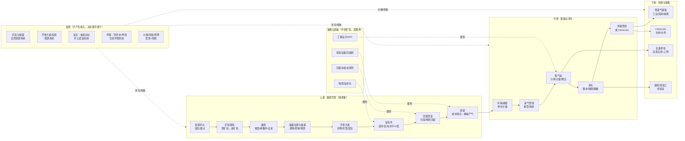

# 煤层气价值链草图（v0.1 · 公开源）

> 用法：这张图是**用来被改的**。每个环节只有 1—3 个数字敢标来源，其余是结构占位。
> 符号：✅ 有来源 ／ ⚠️ 有来源但可能过时或口径不明 ／ ❓ 推断（请客户纠正）

---

## 1. 一张图

---

## 2. 环节拆解

### 2.1 上游 · 勘探开发（占资本开支 80% 以上 ❓）

| 项 | 内容 | 钱/量 | 来源 |
|---|---|---|---|
| 主要活动 | 选区评价 → 矿权 → 勘探（地震、参数井、试采）→ 储量备案 → 开发方案 → 钻井 → 压裂 → 排采 | — | 结构为行业通行流程 ❓ |
| 收入项 | **还没收入**（试采气可少量销售） | — | ❓ |
| 成本大头 | 钻井、压裂、排采设备与电费、折旧；**单井投资高、回收期长** | — | ❓ |
| 关键指标 | 单井日产、含气量、渗透率、临界解吸压力、递减率、采收率 | — | S12 定义 |
| 典型项目体量 | 柿庄南东区：8.644 亿 m³/年产能，1709 口井，总投资 55.59 亿元 | **约 6.4 元/(m³·年) 的产能投资强度**（计算：55.59÷8.644，推断） | S14 + 本人计算 |
| 单井标杆 | 大吉煤岩气田吉深 10-8 平 01 井：累计 7000 万 m³，日产稳定 4.5 万 m³ 以上，连续稳产 29 个月 | — | S21 ✅ |
| 递减 | 老井递减是产量目标最大威胁，行业普遍关注"控制递减" | 具体递减率**待验证** | S19（专家表述）⚠️ |

**上游的钱从哪来**：自有资金 + 银行项目贷 + 母公司注资 + 中央预算内投资/示范项目支持（S01 第（三）条 ✅）。**没有"按米进尺付费"的第三方买单方**，这是重资产行业。

### 2.2 中游 · 集输与净化（决定气能不能变成钱）

| 项 | 内容 | 钱/量 | 来源 |
|---|---|---|---|
| 主要活动 | 单井计量 → 采气管线 → 集气站（分离/计量/增压）→ 净化（脱水/脱硫）→ 外输 | — | S14 ✅ |
| 基础设施量级 | 柿庄南东区：集气站 6 座、阀组 132 个、采气管线 1754.61 km、集气支线 227.642 km、干线 29.23 km、外输管线 51.957 km | — | S14 ✅ |
| 成本大头 | 管线钢材与施工、压缩机与电耗、增压站运维；**低产井的集输单位成本极高** | 具体元/m³ **待验证** | ❓ |
| 政策约束 | 以管道输送为主、"就近利用、余气外输" | — | S02、S07 ✅ |
| 接入规则 | 油气管网设施须公平开放；基础设施规划建设受新令约束 | — | S09、S10 ✅ |
| 瓶颈 | 区块分散、单井产量低 → 管线利用率低；跨省外输需管网容量与"管网通"类服务 | 蓝焰 2025 已引入国家管网"管网通"储气调峰 | S15 ✅ |

### 2.3 下游 · 利用与销售（收入真正实现的地方）

| 路径 | 机制 | 价格/量 | 来源 |
|---|---|---|---|
| 管道气 | 就近工业/民用/城燃；进城市公共管网按**不低于同等热值天然气价格** | 出厂价已市场化（供需协商） | S01 ✅ |
| CNG | 加压气态，槽车运输，适合小气量/短半径 | 定义见年报释义 | S15 ✅ |
| LNG | 冷却至 −162°C 液化，适合远距离/调峰 | 同上 | S15 ✅ |
| 瓦斯发电 | 优先自发自用，富余电量电网全部收购；"十三五"末全国瓦斯发电装机超 260 万千瓦 | — | S01、S07 ✅ |
| 提纯/深加工 | **我不确定这个环节在客户那边是否存在** | 待验证 | ❓ |

**实现价格参考（唯一可算的公开样本）**：蓝焰控股 2025 年煤层气销售 19.81 亿元 ÷ 销售量 12.25 亿 m³ ≈ **1.62 元/m³**（不含税口径推断）✅（S15）。这只是一个样本，不代表行业均价 ❓。

### 2.4 油服与装备（不持矿权，赚服务费/设备钱）

| 环节 | 代表能力 | 与煤层气的接口 | 来源 |
|---|---|---|---|
| 钻完井装备 | 钻修设备、压裂成套、连续油管、固井 | 深部煤层气水平井、多煤层合采 | S17 ✅ |
| 压缩机组 | 增压外输、煤层气集输、煤层气发电 | 中游增压 + 瓦斯发电 | S17 ✅ |
| 钻井/测录井服务 | 钻井进尺、测录定一体化、远程测控 | 煤层气被明确列为远程测控推广场景 | S18 ✅ |
| 排采设备 | 抽油机/螺杆泵/电潜泵、智能排采 | 排采制度执行的核心硬件 | ❓ |

**注意**：杰瑞、石化油服的煤层气收入占比**均未披露**，不要用公司总收入当煤层气市场规模（见 `players.md`）。

### 2.5 监管（不赚钱，但决定项目生死）

五条线：矿权与储量（自然资源）、开发方案与投资（能源）、安全抽采达标（矿山安监）、环保（环评/水/甲烷）、价格补贴管网（发改+财政）。详见 `regulators.md`。

---

## 3. 单位经济性（能算的都算了，算不出的标出来）

### 3.1 蓝焰控股 2025 年（A 股唯一纯煤层气地面开发标的）

| 指标 | 数值 | 计算/来源 |
|---|---|---|
| 销售量 | 12.25 亿 m³（同比 −2.93%） | S15 ✅ |
| 煤层气销售收入 | 19.81 亿元 | S15 ✅ |
| 煤层气销售成本 | 13.60 亿元 | S15 ✅ |
| 毛利 | 6.21 亿元 | 计算 |
| 毛利率 | 31.35%（同比 −4.33 pct） | S15 ✅ |
| **实现气价** | **≈1.62 元/m³** | 19.81÷12.25，不含税口径推断 |
| **单位成本** | **≈1.11 元/m³** | 13.60÷12.25，推断 |
| **单位毛利** | **≈0.51 元/m³** | 计算 |
| 财务费用 | 0.98 亿元（同比 −15.14%） | S15 ✅ |
| 研发投入 | 0.85 亿元 | S15 ✅ |
| 矿业权 | 24 宗，2799.35 km²，累计探明 531.91 亿 m³ | S15 ✅ |

**关键推论（推断，请客户验证）**：在 1.6 元/m³ 的气价下，单方毛利约 0.5 元；**补贴（0.3 元/m³ 量级）相当于毛利的 60% 左右**——这就是为什么补贴口径变化会直接改写项目可行性。若客户项目的气价低于 1.2 元/m³ 且无补贴，单方毛利可能不足 0.2 元。

### 3.2 一个开发项目的资本强度

柿庄南东区：55.59 亿元 / 8.644 亿 m³/年 ≈ **6.4 元/（m³·年）**（推断）。
含义：建 1 亿 m³/年产能，约需 6—7 亿元资本开支（本样本口径）。若单方净现金流 0.5 元，年净现金流约 0.5 亿元 → 静态回收期约 12—13 年（**极粗推断，未计时间价值、未计补贴与税**）。这与"煤层气是长周期重资产生意"的行业印象一致，但**具体回收期必须用客户实际数据重算**。

### 3.3 收入结构（蓝焰 2025）

| 收入项 | 金额 | 占比 | 说明 |
|---|---|---|---|
| 煤层气销售 | 19.81 亿元 | 93.88% | 主粮 |
| 气井建造工程 | 0.98 亿元 | 4.62% | 给别的矿权方打工 |
| 其他（含运输） | 0.32 亿元 | 1.50% | LNG/CNG 运输等 |
| **合计** | **21.10 亿元** | 100% | 同比 −6.87% |

**注意**：年报口径里**没有单列"瓦斯治理服务费"和"补贴"**。前者可能并进"气井建造工程/其他"❓，后者通常计入"其他收益"而非营业收入❓。这两项在客户的内部报表里可能是独立科目——**这是必须问的第一类问题**。

---

## 4. 成本大头（排序为推断，需客户确认）

| 排序 | 成本项 | 依据 | 信心 |
|---|---|---|---|
| 1 | 折旧摊销（井、管线、站场） | 重资产 + 55.59 亿元级投资 | ❓ 推断 |
| 2 | 钻井与压裂工程费 | 1709 口井的工程量 | ❓ 推断 |
| 3 | 电费与增压能耗 | 排采 + 集输增压 | ❓ 推断 |
| 4 | 修井/检泵/排采维护 | 井数多、单井产量低 | ❓ 推断 |
| 5 | 采出水处理与环保 | 环评批复对采出水、泉域、防渗有硬要求 | S14 ✅（要求存在）+ ❓（金额） |
| 6 | 财务费用 | 蓝焰 0.98 亿元，占收入 4.6% | S15 ✅ |
| 7 | 管输费 | 进管网需付费；新规强调降低管输成本 | S01/S09 ⚠️ |

---

## 5. 关键瓶颈（按"会不会卡死项目"排序）

1. **矿权与煤炭采矿权的空间/时间重叠**：政策给了"合作或调整范围""先采气后采煤""5 年建井窗口"三种处理方式（S01 第（十）条 ✅），但**具体到某个区块是哪一种，公开源查不到** → 必问。
2. **单井产量与递减**：直井单井日产普遍低，水平井/深层是增量（S19、S21 ⚠️）。储量起算标准同时看埋深分档（<500、500—1000、1000—2000 m）与单井日产起算值（m³/d）（S12 ⚠️ 报批稿）。
3. **管网与消纳**：产区集中于沁水/鄂东，外输依赖管网容量；蓝焰需引入"管网通"做季节调峰（S15 ✅）。
4. **采出水与生态约束**：泉域、水源地禁采区、防渗系数要求（S14 ✅）——在山西这是真实的选址约束，不是纸面要求。
5. **补贴退坡/改规则**：从"量补"到"效补"，"达标即止"的企业激励被打破（S05 ⚠️）。
6. **气价**：与管道天然气、LNG 进口价联动；2026 年进口下降、国产替代逻辑增强（S19 ⚠️）。

---

## 6. 这张图我明确猜了的地方（请客户画叉）

- 上游占资本开支 80% 以上 —— ❓ 纯推断，没有公开拆分。
- 成本排序 —— ❓ 除财务费用外全是推断。
- 下游"提纯/深加工"环节是否存在 —— ❓ 不确定客户是否有这一环。
- 单方回收期 12—13 年 —— ❓ 极粗推断，请用客户实际气价/补贴/税后现金流重算。
- 收入结构里"瓦斯治理服务费/补贴"的科目归属 —— ❓ 年报未单列。
- 中游"净化"的具体工艺（脱水/脱硫/脱碳哪几种） —— ❓ 环评批复只提到"分离"，未给工艺细节。

---

## 7. 值得追的 3 个外部数据源（本包未取得）

1. 券商煤层气深度报告（用户方法论指定要读 3 份）——**本包一份都没有**，需另行获取。
2. 《煤炭工业发展"十五五"规划》原文——目标数字目前只有媒体转述（S19）。
3. 《鄂尔多斯盆地东部区域煤层气增储上产行动方案（2026—2030年）》原文——180 亿 m³ 目标同上。
