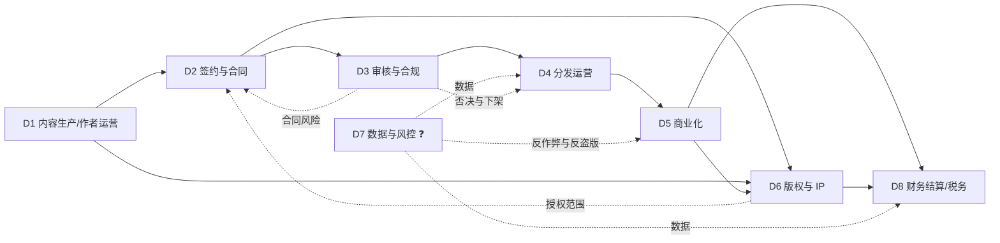
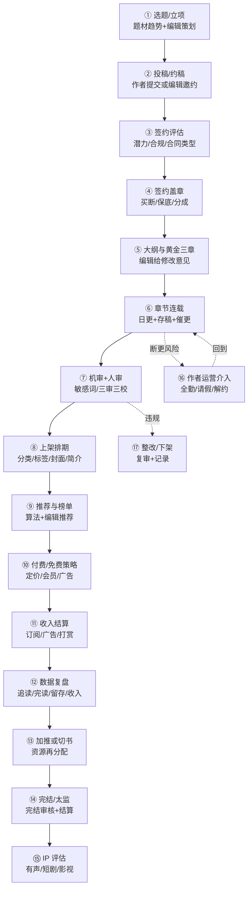
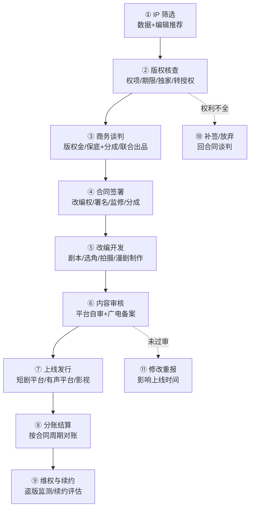
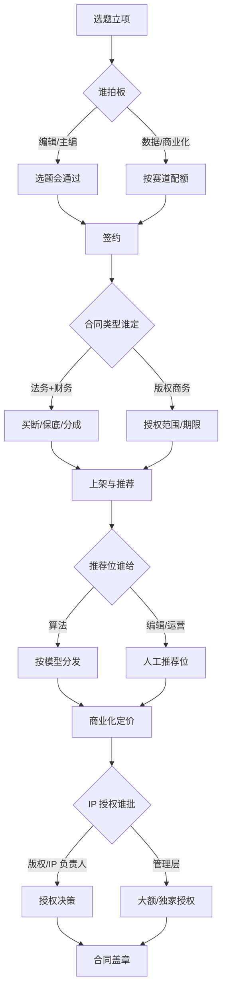

# 网络文学 · 业务域 / 流程 / 活动

> compact 示例：原 domains.md + flow.md + activities.md 合并。

## 1. 业务域

> **声明**：这是按公开信息（平台财报的业务表述、行业报告、监管文件、平台公开的签约/福利政策）**推断**的域划分，**不是客户的组织架构图**。客户的部门名、边界、汇报线一定不同——请拿它去校准。
> 用途：FDE 在画流程图之前，先回答"这家平台由哪几块业务能力组成"，避免把"工序"当"部门"。
> 信心：✅ 有公开源支撑该域存在 ／ ⚠️ 有源但边界/归属不明 ／ ❓ 纯推断
> 来源编号见 `sources.jsonl`；环节级明细见 `activities.md`。

---

## 0. 为什么先切域，再画流程

- 流程图回答"**先后顺序**"；业务域回答"**谁负责、边界在哪、跟谁交接**"。
- 一线被问"你们流程是什么"时，通常只答**自己域内**的流程；跨域部分会被简化。
- 所以先给一张域图，让对方说"我们不是这么分的，A 和 B 是一个部门 / C 是集团管的"——**这句否定比流程细节值钱**。

---

## 1. 八个业务域（工作假设）

| # | 业务域 | 一句话目标 | 主责角色（推断） | 核心流程 | 主要接口 | 成熟度（推断） | 信心 |
|---|---|---|---|---|---|---|---|
| D1 | 内容生产与作者运营 | 持续产出可连载的内容，把作者留住 | 编辑部、作者运营、内容策划 | 选题→约稿→跟稿→催更/全勤→作者分层运营 | D2、D3、D5、D8 | 高（核心） | ✅ |
| D2 | 签约与合同 | 用合同锁定内容与版权，控制法律风险 | 法务/版权商务、编辑、财务 | 签约评估→合同条款→盖章→变更/解约 | D1、D5、D6、D8 | 中高 | ✅ |
| D3 | 审核与合规 | 内容能发、平台不被罚、未成年人受保护 | 审核中心、总编室、法务/政府事务 | 机审→人审→三审三校→抽检→应急下架 | D1、D4、D6 | 高（合规驱动） | ✅ |
| D4 | 分发运营 | 把对的书推给对的人，做曝光与留存 | 运营、算法/推荐、渠道商务 | 上架排期→推荐/榜单→渠道分发→活动 | D1、D5、D7 | 中高 | ⚠️ |
| D5 | 商业化 | 把注意力变成订阅、广告、打赏收入 | 商业化/会员/广告、运营 | 定价→付费转化→广告变现→打赏月票→活动 | D4、D6、D8 | 中高 | ✅ |
| D6 | 版权与 IP 运营 | 把头部内容卖成多形态 IP，管授权与结算 | 版权/IP 运营、商务、法务 | 版权登记→授权谈判→合同→交付→分账 | D2、D5、D8 | 中（依赖头部） | ✅ |
| D7 | 数据与风控 | 数据可信、反作弊、反盗版、防刷量 | 数据/风控、安全、法务 | 埋点→看板→异常识别→处置→复盘 | D4、D5、D6 | 低—中 | ❓ |
| D8 | 财务结算与税务 | 算得清、结得准、报得对 | 财务、结算、税务 | 稿酬计算→对账→发放/代扣→报送→开票 | D1、D2、D5、D6 | 中高 | ✅ |

**为什么是 8 个**：公开材料能明确看到职责痕迹的是 D1—D6 + D8；**D7（数据与风控）是大多数 FDE 项目的落点，但客户是否设独立部门完全未知**，所以单列并标 ❓。

---

## 2. 域间接口图（推断）

**接口上的三个高频断点（推断，需验证）**：
1. **D2↔D6**：签约时签的"全版权"，到 IP 授权时才发现**某项权利没拿到/期限已过**——合同与版权台账不同步。
2. **D3↔D4**：审核通过 ≠ 可以推；推荐/榜单会放大内容风险，**运营与审核的"热度优先级"天然冲突**。
3. **D5↔D8**：广告/打赏/订阅三套收入、三套结算周期，**作者侧只看到一个月度数字**，对账争议高发。

---

## 3. 逐域说明

### D1 内容生产与作者运营
- **目标**：稳定供给连载内容，降低断更率，把有潜力的作者往上推。
- **包含流程**：选题/立项、约稿与投稿、编辑跟稿、全勤/福利发放、作者分层运营（新人/腰部/头部）、作者社群。
- **对外接口**：作者（合同相对方）、编辑（内部）、财务（稿酬）。
- **痛点**：作者是**外部合作方**不是员工，管理靠激励而非指令；断更/太监直接影响用户留存与收入。证据：七猫公开全勤奖与请假规则（每月允许 1 天请假）[S24]。
- **信心**：✅ 域存在；⚠️ 内部人效与分层标准未知。

### D2 签约与合同
- **目标**：用合同锁定内容与版权，明确分成/结算/违约责任。
- **包含流程**：签约评估（题材/潜力/合规）、合同类型选择（买断/保底+分成/纯分成）、条款谈判（授权范围/期限/独家/竞业/优先权）、盖章、变更与解约。
- **对外接口**：法务、财务、版权/IP、作者。
- **痛点**：三类合同（买断/保底/分成）对应**完全不同的会计与现金流处理**；"全版权"与"优先权"极易混（见 glossary）。
- **证据**：七猫公开三类签约模式与保底价格区间 [S24]；网络出版服务单位须有编辑责任制度 [S13]。
- **信心**：✅ 模式存在；❓ 客户合同条款完全未知。

### D3 审核与合规
- **目标**：内容能发、平台不被罚、未成年人受保护、AI 内容可标识。
- **包含流程**：机器敏感词/模型审核→人工复审→三审三校→上线抽检→举报处理→应急下架/整改。
- **对外接口**：编辑、运营、法务/政府事务、监管（属地出版局/网信办）。
- **痛点**：审核标准不可穷举；**误杀与漏放都有成本**；AI 生成内容让"作者责任"与"平台责任"边界变复杂。
- **证据**：网络出版服务须有内容审核责任制度、责任编辑制度、责任校对制度 [S13 第二十三条]；生态治理规定 [S15]；未成年人网络保护条例 [S14]；AI 标识办法 [S19]。
- **信心**：✅ 合规要求明确；❓ 客户审核组织与人效未知。

### D4 分发运营
- **目标**：提高曝光效率、追读率与留存，把内容送到目标读者面前。
- **包含流程**：上架排期（分类/标签/封面/简介）、推荐位分配、榜单运营、渠道分发（APP/小程序/应用商店/海外）、活动/专题。
- **对外接口**：内容（D1）、商业化（D5）、数据（D7）、渠道方。
- **痛点**：推荐位与榜单是**稀缺的注意力分配权**，编辑推荐与算法推荐谁说了算，直接决定作者生态。
- **证据**：头部平台月活与短剧导流 [S09]；2025 年报告称"算法推荐失衡"是行业短板之一 [S03]。
- **信心**：⚠️ 域存在但内部规则不可见。

### D5 商业化
- **目标**：把阅读行为转化为订阅、广告、打赏收入，并控制单位经济。
- **包含流程**：定价与付费策略、会员/包月、广告位与广告主对接、激励视频、打赏/月票、促销活动。
- **对外接口**：分发（D4）、广告主、支付渠道、财务（D8）。
- **痛点**：付费与免费两套目标打架；广告收入占比上升会挤压订阅体验；**打赏/月票涉及未成年人消费限制** [S14]。
- **证据**：2025 年广告 274.49 亿、订阅 159.95 亿 [S01]；知乎 Q4 付费阅读占 51.8% [S16]。
- **信心**：✅ 收入结构；❓ 客户定价与分成。

### D6 版权与 IP 运营
- **目标**：把头部内容授权/开发成有声、短剧、影视、动漫、出版、出海产品，最大化 IP 价值。
- **包含流程**：版权登记与台账、授权谈判、合同、物料交付、改编监修、分账结算、维权。
- **对外接口**：签约（D2）、商业化（D5）、财务（D8）、外部制作方/平台。
- **痛点**：**一书多授权、多形态、多账期**；短剧备案与改编权是两道独立闸 [S12][S21]；AI 漫剧/短剧让授权颗粒度变细。
- **证据**：2025 年 IP 改编 91392 部、增量来自短剧与 AI 漫剧 [S01]；阅文版权运营 31.92 亿元 [S05]。
- **信心**：✅ 域存在；❓ 客户授权台账与分账口径。

### D7 数据与风控
- **目标**：数据可信、反作弊、反盗版、防刷量与防薅羊毛。
- **包含流程**：埋点与指标口径、看板、异常识别（刷量/刷单/刷月票）、盗版监测与下架、风控处置。
- **对外接口**：全部业务域；外部数据服务商/维权机构。
- **痛点**：**指标口径不统一是最大问题**（首订/均订/追读/完读率各自定义）；刷量直接影响榜单与广告结算。
- **证据**：行业报告点名"算法推荐失衡""版权保障机制不健全" [S03]；反洗稿机制 [S10]。
- **信心**：❓ 纯推断（客户是否设独立域未知）。

### D8 财务结算与税务
- **目标**：稿酬/分成算得清、结得准、税报得对。
- **包含流程**：稿酬计算（千字/分成/全勤/保底抵扣）、对账、发放、代扣代缴、平台涉税信息报送、开票。
- **对外接口**：作者（D1）、合同（D2）、商业化（D5）、IP（D6）、税务。
- **痛点**：**保底是预付款**，要抵扣后续分成；免费模式按广告分成结算，口径复杂；2025-06 起平台有涉税信息报送义务 [S20]。
- **证据**：七猫公开保底/分成/全勤规则 [S24]；平台涉税信息报送规定 [S20]。
- **信心**：✅ 义务存在；❓ 客户实际结算周期与系统。

---

## 3.1 域成熟度与外包速览（推断）

| 业务域 | 成熟度 | 是否外包 | 对 FDE 的含义 |
|---|---|---|---|
| D1 内容生产/作者运营 | 高 | 作者是外部合作方 | 不是"管员工"，是"管激励" |
| D2 签约与合同 | 中高 | 自营 | 合同条款是 IP 业务的地基 |
| D3 审核与合规 | 高 | 人审可外包 | 合规驱动，最容易买单 |
| D4 分发运营 | 中高 | 自营 | 推荐与榜单是权力中心 |
| D5 商业化 | 中高 | 广告可能代理 | 付费/免费两套 KPI |
| D6 版权与 IP | 中 | 制作外包 | 台账与分账最乱 |
| D7 数据与风控 | 低—中 | 监测可外包 | 数字化切入点 |
| D8 财务结算与税务 | 中高 | 自营 | 报送带来系统改造 |

---

## 4. 校准问题（拿这张表去问）

1. 你们实际是几个一级部门？D1—D8 哪些合并、哪些拆开、哪些根本不存在？
2. **审核**归总编室还是独立中心？向谁汇报？
3. **版权/IP** 是独立事业部还是挂在编辑部/商业化下？
4. **数据**有没有独立团队？核心看板谁维护？
5. 签约、结算、版权台账分别用**什么系统**（只问类别，不问厂商）？
6. 哪些域是**外包**的（审核、客服、有声制作、短剧制作、维权）？

---

## 2. 流程

> **这是本包最该被改的文件。** 每个节点标了信心等级，文末汇总成待验证清单候选。
> ✅ 有来源 ／ ⚠️ 有来源但可能过时或口径不明 ／ ❓ 我猜的
> 用法：打印出来，逐节点问一线："这个顺序对吗？哪一步其实不是这样？"

---

## 1. 主流程 A：一本书从投稿到变现

### 节点信心表（流程 A）

| # | 节点 | 主要活动 | 输出物 | 信心 | 依据 / 待验证 |
|---|---|---|---|---|---|
| ① | 选题/立项 | 编辑根据榜单、题材趋势、竞品定方向 | 选题单/立项表 | ❓ | 行业通行做法，无公开 SOP；客户是否设"立项会"待验证 |
| ② | 投稿/约稿 | 作者后台投稿或编辑定向约稿 | 稿件/样章 | ✅ | 七猫公开"投稿/签约"政策 [S24] |
| ③ | 签约评估 | 看题材、更新能力、历史成绩、合规风险 | 评估结论 | ❓ | 评估维度与打分表未知 |
| ④ | 签约盖章 | 选合同类型，走法务/用印 | 合同 | ✅ | 三类签约模式公开 [S24]；须有编辑责任制度 [S13] |
| ⑤ | 大纲与黄金三章 | 编辑给结构/节奏/人设意见 | 修改稿 | ❓ | 行业叫法明确，但流程细节未知 |
| ⑥ | 章节连载 | 作者按日更节奏发布，平台催更、发全勤 | 连载章节 | ✅ | 全勤奖与请假规则公开 [S24] |
| ⑦ | 机审+人审 | 敏感词拦截、人工复审、抽检 | 审核记录 | ✅ | 内容审核责任制度 [S13]；生态治理 [S15] |
| ⑧ | 上架排期 | 分类、标签、封面、简介、首发时间 | 上架包 | ⚠️ | 平台公开"上架及推荐流程"存在 [S24]，细则未知 |
| ⑨ | 推荐与榜单 | 算法推荐、编辑推荐位、月票/畅销榜 | 曝光资源 | ❓ | 规则不公开；"算法推荐失衡"被行业报告点名 [S03] |
| ⑩ | 付费/免费策略 | 定章节价格、是否进会员、是否免费转广告 | 定价策略 | ⚠️ | 免费与付费模式并存 [S01][S24] |
| ⑪ | 收入结算 | 订阅分成、广告分成、打赏分成、全勤 | 稿酬单 | ✅ | 分成/保底/全勤规则公开 [S24]；平台报送义务 [S20] |
| ⑫ | 数据复盘 | 追读、完读、留存、ARPU 复盘 | 复盘报告 | ❓ | 指标定义各家不同，无公开口径 |
| ⑬ | 加推或切书 | 资源向头部倾斜或放弃 | 资源调整 | ❓ | 决策规则未知 |
| ⑭ | 完结/太监 | 完结审核、结尾质量判断、最终结算 | 完结状态 | ✅ | 七猫"烂尾完结"影响全勤的规则公开 [S24] |
| ⑮ | IP 评估 | 评估有声/短剧/影视改编潜力 | IP 评估表 | ❓ | 2025 年 IP 改编增量来自短剧和 AI 漫剧 [S01]，但评估标准未知 |
| ⑯ | 作者运营介入 | 断更提醒、请假、解约、心理与社群运营 | 运营记录 | ❓ | 全勤/请假规则公开 [S24]，干预流程未知 |
| ⑰ | 整改/下架 | 违规内容复审、整改、下架、上报 | 处置记录 | ✅ | 发现禁止内容须立即删除、保存记录并报告 [S13 第三十三条] |

---

## 2. 主流程 B：IP 授权 / 短剧改编

### 节点信心表（流程 B）

| # | 节点 | 主要活动 | 输出物 | 信心 | 依据 / 待验证 |
|---|---|---|---|---|---|
| ① | IP 筛选 | 用数据（阅读、完读、讨论度）挑可改编作品 | IP 池 | ❓ | 阅文有"版权助手"类工具 [S06]，客户是否用待验证 |
| ② | 版权核查 | 核对改编权、期限、地域、是否已独家授权 | 权项清单 | ✅ | 著作权法权项与许可合同 [S21] |
| ③ | 商务谈判 | 定版权金、保底+分成、是否联合出品 | 条款清单 | ⚠️ | 行业普遍"保底+分成"，具体比例不公开 ❓ |
| ④ | 合同签署 | 改编权、署名、监修、分成、违约责任 | 授权合同 | ✅ | 著作权许可/转让合同制度 [S21] |
| ⑤ | 改编开发 | 剧本、拍摄/制作、漫剧生产 | 成片/音频 | ⚠️ | 微短剧产业链公开 [S11]；AI 漫剧已工业化 [S05] |
| ⑥ | 内容审核 | 平台自审 + 微短剧备案（分层） | 备案号/上线许可 | ✅ | 微短剧分类分层审核 [S12]；AI 内容标识 [S19] |
| ⑦ | 上线发行 | 短剧平台/有声平台/电视台/海外 | 上线 | ⚠️ | 红果/河马等短剧平台月活数据 [S09] |
| ⑧ | 分账结算 | 按合同周期对账、开票、分成 | 结算单 | ❓ | 账期与分成基数未知 |
| ⑨ | 维权与续约 | 盗版监测、下架、诉讼、续约 | 维权记录 | ❓ | 维权成本与胜诉率未知 |
| ⑩ | 补签/放弃 | 权利不全时补签或放弃 | 决策 | ❓ | 推断 |
| ⑪ | 修改重报 | 未过审时修改重报 | 新版本 | ⚠️ | 备案未过需重报，媒体有类似表述 [S12] |

---

## 2.1 流程覆盖矩阵（8 域 × 本文流程）

| 业务域 | 主流程 A（新书） | 主流程 B（IP） | 审批链 |
|---|---|---|---|
| D1 内容生产/作者运营 | ①—⑥、⑬—⑯ | — | 选题谁拍板 |
| D2 签约与合同 | ③—④ | ②—④ | 合同谁定 |
| D3 审核与合规 | ⑦、⑰ | ⑥、⑪ | 审核/备案谁签 |
| D4 分发运营 | ⑧—⑨ | — | 推荐位谁给 |
| D5 商业化 | ⑩—⑪ | — | 定价谁批 |
| D6 版权与 IP | ⑮ | ①—⑪ | IP 授权谁批 |
| D7 数据与风控 | ⑫ | ① | — |
| D8 财务结算与税务 | ⑪、⑭ | ⑧ | — |

> 空格（—）不是"没有流程"，而是**本文没画**：客户那边一定有，但我没有公开源，留给你现场补。

---

## 3. 审批 / 决策链（另一张图）

**审批链上的四个待验证问题**：
1. **选题谁拍板**：编辑主编会？还是数据/商业化定赛道配额？❓
2. **合同谁定**：法务主导还是版权商务主导？买断/保底的审批权限在哪一级？❓
3. **推荐位谁给**：算法与编辑的权限边界；人工推荐位有没有配额与审批？❓
4. **IP 授权谁批**：多大金额/是否独家需要管理层签？❓

---

## 4. 时间轴：一本书的典型生命周期（推断）

| 阶段 | 时间 | 关键动作 | 证据 |
|---|---|---|---|
| 签约到上架 | 数天—数周 | 评估、盖章、上架排期 | ❓ 推断 |
| 上架到"出均订" | 2—4 周 | 曝光测试、追读验证 | 七猫全勤规则出现"前 2 个月""出均留"等节点 [S24] |
| 稳定连载 | 数月—数年 | 日更、推荐、月票、打赏 | 行业通行 [S24] |
| 完结/太监 | 视成绩 | 完结审核、最终结算 | "烂尾完结"影响全勤的规则 [S24] |
| IP 改编 | 6 个月—数年 | 筛选、授权、制作、备案、上线 | 微短剧备案与制作周期 [S12] |

**推断（请客户确认）**：阅读主业的节奏是"**天**"（日更/审核/榜单），IP 业务的节奏是"**月—年**"（授权/制作/备案/分账）。**用一套项目管理方法管这两件事，一定有一边不适配。**

---

## 5. 汇总：流程断点候选（进 verification-list）

| # | 断点 | 为什么可疑 | 问谁 |
|---|---|---|---|
| 1 | 签约合同与版权台账不同步 | "全版权"签了，但具体权项/期限没进系统 | 法务/版权 |
| 2 | 审核通过 ≠ 推荐安全 | 推荐会放大风险，运营与审核目标冲突 | 审核/运营 |
| 3 | 三套收入三套账期 | 订阅/广告/打赏结算周期不同，作者只看到一个月度数 | 财务/结算 |
| 4 | 免费与付费同书策略 | 同一本书两种商业模式，作者分成口径容易打架 | 商业化/编辑 |
| 5 | AI 辅助写作的责任边界 | 标识义务 vs 作者原创声明 vs 平台审核 | 法务/审核 |
| 6 | 短剧备案主体 | 平台备案还是制作方备案，决定 IP 授权合同条款 | 版权/法务 |

---

## 6. 拿流程图去问的三句话

1. "这个顺序里，**哪一步其实可以并行**？"（流程图常被画成串行）
2. "**哪一个节点会卡最久**？"（找瓶颈，不是找全）
3. "**哪个节点没有系统、靠人记**？"（数字化切口）

---

## 3. 活动表

> **这张表是给一线划的靶子。** 每一行写清"谁做、影响谁、用什么、为什么"，目的是让对方一眼看出"这行不对"。
> 信心：✅ 有公开源支撑 ／ ⚠️ 有源但不完整/可能过时 ／ ❓ 推断
> 工具/系统一列**只写类别，不写厂商名**——我也不知道客户用哪家；标 ❓ 的就是要问的。
> 业务域编号对应 `domains.md`（D1—D8）；来源编号见 `sources.jsonl`。

---

## 0. 怎么读这张表

1. 先看"业务域"和"流程"，判断**归属**对不对（归错部门，后面全错）。
2. 再看"环节做什么"和"业务背景"——这两列最容易被一线改。
3. "工具/系统"是数字化项目的入口：**❓ 越多，机会越大**。
4. 最后看"影响到谁"和"上下游交接"——这里藏着跨部门摩擦。

---

## 1. 活动明细

| 业务域 | 流程 | 环节 | 做什么 | 谁做 | 影响谁 | 工具/系统 | 业务背景 | 多久一次/什么触发 | 常见异常/出错后果 | 上下游交接 | 谁验收/签字 | 是否外包/自营 | 输入→输出 | 信心 | 来源 |
|---|---|---|---|---|---|---|---|---|---|---|---|---|---|---|---|
| D1 | 选题 | 选题/立项 | 看榜单/题材趋势/竞品与站内数据，定新书方向、目标读者、资源档位，输出选题单（题材/字数/更新计划/预估收益）；例外：编辑可凭作者过往成绩开'绿色通道'立项 | 编辑/主编/内容策划 ❓ | D2、D5、D4 | 榜单工具/表格 ❓ | 决定资源押在哪：推荐位与保底都有限，选题错判=双重浪费；2025 年报告点名同质化与题材供需偏差 [S01] | 每周/每月 ❓ | 跟风扎堆、题材同质化；立项过多摊薄资源 | 策划→主编会→编辑；留选题单 | 主编/总编 ❓ | 自营 | 趋势/竞品→选题单 | ❓ | 推断 |
| D2 | 签约 | 签约评估 | 评估题材/更新能力/历史成绩/合规风险，选合同类型（买断/保底+分成/纯分成），核身份证与著作权归属；例外：新人先签试水短约 | 编辑+法务+财务 ❓ | D1、D6、D8 | 作者后台/合同系统 ❓ | 三类合同对应不同现金流与会计处理；平台靠保底/全勤锁定内容供给 [S24] | 按书 | 评估失真导致保底打水漂；合同类型选错 | 编辑→法务/财务→作者；留评估表/合同 | 编辑负责人/法务 ❓ | 自营 | 稿件/数据→签约结论 | ✅ | [S24] |
| D2 | 合同 | 合同条款 | 写清授权范围（信息网络传播权/改编权/有声/短剧/影视）、期限、地域、独家、分成比例、保底抵扣、违约责任，附原创声明与 AI 使用声明 | 法务/版权商务 | 作者、D6、D8 | 合同管理/电子签 ❓ | 全版权/优先权/竞业是三个不同概念 [S21]；AI 参与创作须留声明，生成内容须标识 [S19] | 按书 | 权项漏授、期限冲突、转授权争议 | 法务→作者→盖章归档；留合同+权项清单 | 法务负责人 | 自营 | 条款清单→合同 | ✅ | [S21] |
| D2 | 合同 | 盖章与归档 | 用印、扫描、录入权项台账（作品—权项—期限—被授权方），设到期提醒；合同变更走补充协议 | 行政/法务/合同管理岗 | D6、D8 | OA/合同系统 ❓ | 无台账则 IP 授权时查不到权项；短剧/有声合同分散在个人手里最易漏（模拟访谈见 corrections） | 按书 | 合同丢失、版本混乱、续约漏签 | 法务→档案→版权/财务；留扫描件 | 法务/档案管理员 | 自营 | 合同→盖章件+台账 | ⚠️ | 推断 |
| D1 | 连载 | 编辑跟稿 | 看大纲/细纲/章纲、黄金三章、节奏与人设，给修改意见；卡文时给参考书单与更新计划 | 责编 | 作者、D3、D4 | 编辑后台/批注工具 ❓ | 直接影响书的质量与上架节奏；编辑是作者留存与内容质量的第一道闸 | 每周/按章 ❓ | 修改意见不落地、作者流失 | 编辑↔作者；留批注/修改稿 | 责编/主编 | 自营 | 章节→修改稿 | ❓ | 推断 |
| D1 | 连载 | 催更与全勤 | 监控日更字数与断更，发全勤、批请假（七猫规则：每月允许 1 天，全勤每月最高统计 20 万字）[S24] | 作者运营/编辑 | 作者、D8 | 后台数据+福利系统 ❓ | 全勤奖是留作者的主要手段，也是平台用现金换更新稳定性的杠杆 [S24] | 每天/每月 | 断更、太监、刷字数；全勤成本上升 | 运营→作者→财务；留更新记录/请假单 | 运营负责人 | 自营 | 更新数据→全勤结算 | ✅ | [S24] |
| D1 | 作者运营 | 作者分层运营 | 按成绩/潜力分层（新人/腰部/头部），给流量、培训、签约升级与 IP 推荐；头部作者单独维护 | 作者运营/编辑 | D2、D4、D5 | CRM/社群工具 ❓ | 头部作者稀缺、会跨平台流动；番茄 60 万签约作者中 lv5 以上仅 2900 人 [S23] | 每月/每季 ❓ | 头部作者被竞对挖走；新人无扶持 | 运营→编辑/商业化；留分层名单 | 运营负责人 ❓ | 自营 | 数据→分层与资源包 | ❓ | 推断 |
| D3 | 审核 | 机审/敏感词 | 入库前跑模型+敏感词库拦截高风险内容，输出风险分级与拦截原因；例外：白名单题材走快速通道 | 审核中心/技术 | D1、D4 | 内容审核系统（类）❓ | 人审成本高，机审先过滤；误杀与漏放都要付代价，词库需持续迭代 | 每章/实时 | 误杀正常情节；漏放敏感内容 | 作者→机审→人审；留审核日志 | 审核系统负责人 ❓ | 自营，词库可能外采 ❓ | 文本→拦截/放行 | ✅ | [S13] |
| D3 | 审核 | 人审/三审三校 | 人工复审、抽检、标点与质量检查，签审核单；敏感题材升级终审，AI 内容加查标识 [S19] | 审核员/责编/校对 | D1、D4 | 审核工作台 ❓ | 持证主体须有内容审核责任制度、责任编辑制度、责任校对制度 [S13] | 每章/按批 | 漏审被通报；审核积压拖上架 | 机审→人审→运营；留审核单/签字 | 审核主管/总编 ❓ | 自营/外包混合 ❓ | 机审结果→审核结论 | ✅ | [S13] |
| D3 | 审核 | 举报与应急下架 | 处理用户举报、监管通知，下架/整改/上报并留痕；重大事件同步法务与政府事务 | 审核/法务/政府事务 | 全部 | 举报工单系统 ❓ | 发现禁止内容须立即删除、保存记录并报告 [S13 第三十三条]；处置速度决定处罚轻重 | 事件触发 | 处置不及时被处罚；记录缺失 | 举报→审核→法务→监管；留处置记录 | 法务/总编 | 自营 | 举报/通知→处置单 | ✅ | [S13] |
| D4 | 分发 | 上架排期 | 定分类/标签/封面/简介/首发章与首发时间，做首秀资源包（推荐位+活动+Push） | 运营/编辑 | D5、D1 | 内容管理系统 ❓ | 首发热度影响后续推荐权重；第三方称新人首秀失败多因平台/题材错配（⚠️ S32，未验证） | 按书/每天 | 标签错、封面违规、排期撞车 | 编辑→运营→审核；留上架单 | 运营负责人 | 自营 | 成稿→上架包 | ⚠️ | [S24] |
| D4 | 分发 | 推荐位与榜单 | 分配算法推荐与人工推荐位（新书冷启动/重点书），运营月票/畅销榜，做推荐位效果复盘 | 运营/算法/编辑 | D5、D1 | 推荐系统/榜单后台 ❓ | 注意力分配权：编辑推荐 vs 算法推荐决定作者生态；行业报告点名算法推荐失衡 [S03] | 每天/每周 | 推荐位浪费、榜单被刷、马太效应 | 算法/编辑→运营；留推荐记录 ❓ | 运营/算法负责人 | 自营 | 书+用户画像→曝光 | ❓ | 推断 |
| D4 | 分发 | 渠道分发 | 铺 APP/小程序/应用商店/运营商/海外渠道，按渠道回传做归因与对账 | 渠道商务/运营 | D5、D8 | 渠道后台/归因系统 ❓ | 渠道分成与归因影响收入确认；不同渠道用户画像与付费习惯不同 | 按合同/持续 | 渠道数据对不上、分成被截留 | 商务→财务→数据；留渠道对账单 | 商务/财务 | 混合（渠道外包） | 内容包→渠道上架 | ❓ | 推断 |
| D5 | 商业化 | 付费/免费策略 | 定章节价格、是否进会员、免费转广告或广告转付费，做 A/B 测试与作者沟通 | 商业化/运营/编辑 | D4、D8 | 定价/计费系统 ❓ | 同一本书两种模式 KPI 不同：免费看曝光/完读/广告，付费看首订/均订/留存；用户更倾向看广告换免费 [S03] | 按书/按活动 | 定价过高流失、免费拉低收入、作者分成争议 | 商业化→运营→财务；留定价审批 | 商业化负责人 | 自营 | 数据→定价方案 | ⚠️ | [S01] |
| D5 | 商业化 | 广告变现 | 广告位、激励视频、广告主对接与结算，控制广告加载率与用户投诉 | 广告/商业化团队 | D8、D7 | 广告平台/聚合 SDK（类）❓ | 2025 年行业广告 274.49 亿元 > 订阅 159.95 亿元，广告成第一大收入 [S01]；广告及其他占大众阅读 51.81% [S03] | 每天/每月 | 填充率低、eCPM 波动、广告体验差 | 广告主→平台→财务；留投放/结算单 | 广告负责人 | 混合（代理/直客） ❓ | 流量→广告收入 | ✅ | [S01] |
| D5 | 商业化 | 打赏与月票 | 虚拟道具购买、月票投票、榜单激励；未成年人消费限制与退款处理 [S14] | 运营/商业化 | D4、D8、D3 | 支付/虚拟币系统 ❓ | 情绪消费+榜单机制；未成年人消费限制是硬要求，退款是高发纠纷 [S14] | 每天/每月 | 未成年人退款、刷票、洗钱风险 | 用户→平台→作者/财务；留流水 | 运营/财务 | 自营 | 付费→道具→分成 | ⚠️ | [S14] |
| D6 | IP | 版权登记与台账 | 登记权属与授权记录、到期提醒、权项校验（是否重复/超范围授权）；一书多授权分别建账 | 版权/IP 运营/法务 | D2、D8 | 版权管理系统 ❓ | 一书多授权、多形态、多账期；2025 年 IP 改编 91392 部、增量来自短剧和 AI 漫剧 [S01] | 按书/持续 | 权项冲突、到期未续、重复授权 | 法务→版权→商务；留台账 | 版权负责人 | 自营 | 合同→权项台账 | ❓ | 推断 |
| D6 | IP | 有声授权 | 授权音频平台或自建录制，谈授权金/保底+分成/联合出品，做音频监修与分账 | 版权商务 | D8、有声平台 | 版权合同/分账系统 ❓ | 有声是稳定、低单价的 IP 变现；2025 年有声阅读市场 134 亿元 [S18] | 按项目 | 授权价过低、盗版音频、分成对不上 | 商务→制作方→财务；留授权合同 | 版权负责人 | 混合（制作外包） | 作品→有声授权 | ⚠️ | [S18] |
| D6 | IP | 短剧改编与备案 | 授改编权/参与出品，配合制作与备案（按投资额分层 [S12]），做剧本与成片监修 | 版权/IP+法务+外部制作方 | D8、广电 | 备案系统/项目管理系统 ❓ | 短剧是 2025 年 IP 增量主来源 [S01]；备案是硬闸，未审核备案不得上网传播 [S12] | 按项目 | 备案不通过、改编超授权范围、上线延期 | 平台→制作方→广电；留备案号/合同 | 版权/法务 | 混合（制作外包） | 小说→剧本→备案→上线 | ✅ | [S12][S01] |
| D6 | IP | 出海与翻译 | 选书、AI 翻译+人工校对、海外平台上架与投放（RocNovel/FlareFlow 类），按语种做本地化 | 出海团队/翻译方 | D8、海外平台 | 翻译/多语种CMS（类）❓ | AI 翻译显著扩大出海总量；2025 年海外市场 69.83 亿元 [S01]；WebNovel AI 翻译累计超 3 万部 [S34] | 按书/按批 | 翻译质量差、文化折扣、合规差异 | 内容→翻译→海外运营；留术语库/质检记录 | 出海负责人 ❓ | 混合（翻译外包） | 中文→多语种→海外收入 | ⚠️ | [S01][S06] |
| D7 | 数据 | 数据复盘 | 追读/完读/留存/收入看板，复盘资源效果；统一指标口径，出日报/周报/月报 | 数据团队/运营 | D1、D4、D5 | BI/埋点系统（类）❓ | 口径不统一是最常见争议；榜单/推荐效果要用统一口径复盘 [S03] | 每天/每周/每月 | 口径打架、数据延迟、刷量污染 | 数据→运营/管理层；留看板/复盘报告 | 数据负责人 ❓ | 自营/外包 ❓ | 埋点→看板→决策 | ❓ | [S03] |
| D7 | 风控 | 反作弊/反盗版 | 识别刷量刷票、监测盗版、下架与诉讼；对接反洗稿联盟与维权机构 [S10] | 风控/安全/法务 | D4、D5、D6 | 风控规则引擎/监测服务 ❓ | 刷量影响榜单与广告结算；洗稿与盗版是行业治理重点 [S10] | 实时/每日 | 误封、维权成本高、取证难 | 风控→运营/法务；留处置记录 | 风控/法务负责人 ❓ | 混合（监测外包） | 行为/盗版线索→处置 | ❓ | [S10] |
| D8 | 结算 | 稿酬结算 | 算千字/分成/全勤/保底抵扣，对账后发放；支持多合同类型与多结算周期 | 结算/财务 | 作者、D2、D5 | 结算系统/ERP ❓ | 保底是预付款、要抵扣后续分成 [S24]；结算错误是作者投诉与流失的主因 | 每月/每季 | 算错、重复发、保底坏账 | 业务→结算→财务→作者；留结算单 | 财务负责人 | 自营 | 收入/字数→稿酬单 | ✅ | [S24] |
| D8 | 税务 | 代扣与平台报送 | 代扣个税、开具发票、向税务机关报送平台内作者收入信息 [S20] | 财务/税务 | 作者、税务 | 税务系统/发票系统 ❓ | 2025-06 起平台有涉税信息报送义务，结算系统要能输出'人—收入—期间'[S20] | 每月/每季 | 报送口径错、作者税负争议、滞纳金 | 结算→税务→平台报送；留申报记录 | 财务/税务负责人 | 自营 | 稿酬→代扣→报送 | ✅ | [S20] |
| D3 | 合规 | AI 辅助写作合规 | 判断 AI 参与程度、要求标识、检测洗稿与抄袭，留存 AI 使用声明与检测记录 | 法务/审核/编辑 | 作者、D6 | AI 检测/查重工具（类）❓ | AI 生成内容须标识 [S19]；16 家平台已签反洗稿公约、建反洗稿联盟 [S10] | 按书/按批次 | 标识缺失、洗稿争议、原创声明失真 | 作者申报→审核→法务；留 AI 使用声明 | 法务/总编 ❓ | 自营/混合 ❓ | AI 稿→检测→标识/退回 | ✅ | [S19][S10] |

---

## 2. 覆盖检查：任务要求的 17 个场景落在哪几行

| # | 必覆盖场景 | 对应行 | 是否覆盖 |
|---|---|---|---|
| 1 | 选题/立项 | 第 1 行 | ✅ |
| 2 | 签约（买断/保底/分成） | 第 2 行（签约评估） | ✅ |
| 3 | 合同条款 | 第 3 行 | ✅ |
| 4 | 编辑跟稿 | 第 5 行 | ✅ |
| 5 | 审稿/敏感词 | 第 8、9 行 | ✅ |
| 6 | 排期上架 | 第 11 行 | ✅ |
| 7 | 推荐位/榜单 | 第 12 行 | ✅ |
| 8 | 付费/免费策略 | 第 14 行 | ✅ |
| 9 | 广告分成 | 第 15 行 | ✅ |
| 10 | 打赏/月票 | 第 16 行 | ✅ |
| 11 | 渠道分发 | 第 13 行 | ✅ |
| 12 | 版权授权（有声/短剧/影视） | 第 18、19 行 | ✅（影视化并入短剧行，单列待客户确认） |
| 13 | 出海翻译 | 第 20 行 | ✅ |
| 14 | 稿酬结算/税务 | 第 23、24 行 | ✅ |
| 15 | 数据复盘 | 第 21 行 | ✅ |
| 16 | 作者运营/防断更 | 第 6、7 行 | ✅ |
| 17 | AI 辅助写作合规 | 第 25 行 | ✅ |

---

## 3. 外包 vs 自营速览（推断，需客户确认）

| 环节 | 我的判断 | 依据 | 要问什么 |
|---|---|---|---|
| 内容生产 | 自营（作者是合作方，不是外包） | 签约关系 [S24] | 是否用工作室供稿 |
| 编辑/审核 | 自营为主，审核可能外包 | 审校制度要求 [S13] | 外包比例、外包方资质 |
| 机审系统 | 外采 | 技术门槛 | 用哪类系统（只问类别） |
| 有声制作 | 外包为主 | 行业通行 ❓ | 是否联合出品 |
| 短剧制作 | 外包为主 | 行业通行 [S11] | 是否参与投资 |
| 出海翻译 | 混合（AI+人工外包） | AI 翻译已规模化 [S01] | 人工校对谁做 |
| 反盗版/维权 | 外包（律所/监测） | 行业通行 ❓ | 年预算与胜诉率 |
| 结算/税务 | 自营 | 平台报送义务 [S20] | 是否用外部代账 |

---

## 4. 谁验收/签字：角色速览（推断）

| 环节 | 验收/签字角色（推断） | 信心 |
|---|---|---|
| 选题立项 | 主编/总编 | ❓ |
| 签约合同 | 法务负责人 + 用印审批 | ⚠️ |
| 上架排期 | 运营负责人 | ❓ |
| 推荐位 | 运营/算法负责人 | ❓ |
| 审核结论 | 审核主管/总编 | ❓ |
| 稿酬结算 | 财务负责人 | ✅（结算责任在财务是通行做法） |
| 短剧备案 | 版权/法务 + 制作方 | ❓ |
| IP 授权 | 版权负责人；大额需管理层 | ❓ |

---

## 5. 常见异常模式库（拿去问一线"你们最常遇到哪个"）

| 异常 | 发生在 | 后果 | 现有应对（推断） |
|---|---|---|---|
| 断更/太监 | D1 连载 | 用户流失、收入下滑 | 催更、扣全勤、解约 [S24] |
| 审核误杀 | D3 审核 | 作者投诉、上架延迟 | 人工复审、白名单 ❓ |
| 漏放敏感内容 | D3 审核 | 监管通报、下架整改 | 抽检、应急下架 [S13] |
| 推荐位浪费 | D4 分发 | 曝光成本上升 | 数据复盘、A/B 测试 ❓ |
| 刷榜/刷量 | D7 风控 | 榜单失真、广告结算争议 | 风控规则、清榜 ❓ |
| 保底坏账 | D8 结算 | 预付收不回 | 合同条款、分期发放 ❓ |
| 权项冲突/过期 | D6 IP | 重复授权、法律纠纷 | 版权台账、到期提醒 ❓ |
| 备案被退 | D6 短剧 | 上线延期、违约 | 修改重报 [S12] |
| 稿酬算错 | D8 结算 | 作者投诉、重复付款 | 对账、双人复核 ❓ |
| AI 标识缺失 | D3 合规 | 合规风险、下架 | 使用声明、检测 [S19] |

---

## 6. 16 列逐列说明：为什么要这一列

| 列 | 为什么要问 | 一线最容易改的地方 |
|---|---|---|
| 业务域 | 判断归属对不对 | "这归我们？不归" |
| 流程 | 判断属于哪条主流程 | 流程名与内部叫法不一致 |
| 环节 | 具体动作 | 合并/拆分 |
| 做什么 | 动作内容 | 细节与例外 |
| 谁做 | 岗位/部门 | 实际是兼职/外包 |
| 影响谁 | 上下游与外部 | 漏掉监管/作者 |
| 工具/系统 | 数字化切入点 | "我们还在用 Excel" |
| 业务背景 | 为什么这么做 | 历史原因/合规原因 |
| 多久一次/什么触发 | 频率与触发条件 | 事件驱动而非周期 |
| 常见异常/出错后果 | 痛点所在 | 真实高频异常 |
| 上下游交接 | 接口与单据 | 口头交接/微信群 |
| 谁验收/签字 | 责任人与审批 | 实际没人签字 |
| 是否外包/自营 | 成本与边界 | 混合模式 |
| 输入→输出 | 数据流 | 输出物不存在 |
| 信心 | 我有多确定 | 把 ❓ 改 ✅ |
| 来源 | 依据 | 补内部文件 |

---

## 7. 表后：三个最该拿去问的问题

1. **这张表里哪些行在你们公司根本不存在？**（比如"选题会""推荐位审批""版权台账"）
2. **哪几行的"谁做"是错的？**（尤其：审核归谁、结算归谁、IP 授权归谁）
3. **"工具/系统"列里，哪些是 Excel 在撑？**——Excel 最多的地方，就是最值得做的数字化切口。

---

## 8. 关键环节展开（带真实例子）

> 上一张表回答"有哪些环节"；这一节回答"**最关键的 10 个环节具体怎么跑、有什么真实例子、哪里最容易错**"。
> 例子只来自实际打开过的来源；找不到公开源的写「未找到公开源，待客户确认」，不编比例。
> 这一节是见客户时最该带的部分：每个环节末尾都有一句「我画了…您帮我改」式问法。

### 8.1 签约：买断 / 保底 / 分成

- **场景**：作者投稿或编辑约稿后，平台评估是否签、签哪种合同；新人、腰部、头部、工作室的合同不同。
- **谁做 / 怎么做**：编辑初评 → 法务/财务核条款 → 用印归档。核心是先把"合同类型"定下来，再谈授权范围与分成。三类合同：买断（一次性买走）、保底+超保底分成（预付+抵扣+超额分成）、纯分成（无预付）。
- **真实例子**：七猫公开三类签约模式，保底千字 20—1000 元，并明确禁止"工作室"投稿（定义为"写同一本书的不止一个作者"）[S24]；番茄签约作者超 60 万、lv5 以上 2900 人、金番作者 39 人，2024 年 10 月前累计超 50 万作者获收入，9374 位年收入超 3 万元、3228 位超 10 万元 [S23]；阅文 2026H1 新增 24 万作家、46 万部作品，新签约且收入超百万元的作家中 30 岁以下占 57% [S28]。
- **常见坑 / 差异**：① 把"保底"当"买断"——保底是预付款，后续分成要抵扣 [S24]；② 合同写"全版权"却没列具体权项，IP 授权时才发现缺权 [S21]；③ 只按单一合同类型设计结算系统，遇到三种合同并存就手工补。
- **可以怎么问客户**：
  > "我按三类合同画了签约流程：买断、保底+分成、纯分成。**您帮我把三类各占多少、保底怎么抵扣、全版权到底包含哪些权项填上**？"

### 8.2 审核与敏感词

- **场景**：每一章入库前、每次推荐/上架前、每次被举报或监管通知后。
- **谁做 / 怎么做**：机审（模型+词库）先拦截 → 人审复审 → 三审三校/抽检 → 违规处置并留痕。持证主体须有内容审核责任制度、责任编辑制度、责任校对制度。
- **真实例子**：网络出版服务单位发现禁止内容须立即删除、保存记录并报告 [S13]；内容生态治理规定要求平台对违法与不良信息负责 [S15]；AI 生成合成内容有标识义务（2025 年 3 月四部门办法）[S19]；16 家平台发布《网络文学行业反洗稿自律公约》，建立反洗稿联盟与认定流程 [S10]。
- **常见坑 / 差异**：① 机审误杀导致作者投诉、上架延迟；② 漏放敏感内容被通报；③ 人审外包后质检与回溯断链；④ "AI 辅助"与"AI 生成"边界不清，标识漏做 [S19]。
- **可以怎么问客户**：
  > "我把审核画成'机审→人审→三审三校→抽检'。**您告诉我哪几步外包、机审误杀率大概多少、AI 生成内容怎么标识、洗稿怎么认定**？"

### 8.3 上架与推荐位 / 首秀

- **场景**：新书过审后定首发时间；首秀期决定给多少资源；后续按数据决定加推或切书。
- **谁做 / 怎么做**：编辑定上架包（分类/标签/封面/简介/首发章）→ 运营给首秀资源（人工推荐位+活动+Push）→ 算法接长尾分发 → 数据复盘。人工推荐位通常是稀缺资源，需要配额与审批。
- **真实例子**：行业报告点名"算法推荐失衡、同质化内容"是短板 [S03]；2025 年 9 月番茄 MAU 2.45 亿、七猫 7656 万、掌阅约 5000 万 [S09]——头部平台的推荐位直接决定一本书的生死；第三方称新人首秀失败 73% 源于"平台/题材错配"（⚠️ 二次汇总，未获官方确认）[S32]。
- **常见坑 / 差异**：① 只画算法，不画人工推荐位的配额与审批；② 首秀资源包没有验收标准，给没给说不清；③ 推荐与审核目标冲突——推荐会放大内容风险。
- **可以怎么问客户**：
  > "我把'上架→首秀→推荐位→加推/切书'画成一条线，但人工推荐位谁批、配额多少、首秀达标线是多少我全是猜的。**您帮我把这条线改对**。"

### 8.4 付费 vs 免费策略

- **场景**：一本书上架时决定付费、免费还是混合；运营期会做"免费转付费/付费转免费"的调整。
- **谁做 / 怎么做**：商业化/运营出策略 → 编辑评估内容 → 财务核分成 → 上线做 A/B 测试。付费看首订/均订/留存，免费看曝光/追读/完读/广告效率，**两套 KPI**。
- **真实例子**：2025 年行业营收 574.72 亿元中，广告 274.49 亿 > 订阅 159.95 亿 > 版权 117.01 亿 [S01]；数字阅读用户"更习惯看广告换免费"的比例在上升 [S03]；阅文 2026H1 在线业务 -7.3%，原因包括"微信生态自营产品的免费阅读内容比例增加、内容分发从阅读转向短剧和 AI 漫剧"[S33]；掌阅海外阅读按区域差异化落地"按章付费、会员订阅、广告增值"[S30]。
- **常见坑 / 差异**：① 同一本书两种模式，作者分成口径打架；② 免费转付费后老读者权益；③ 只算收入不算用户流失。
- **可以怎么问客户**：
  > "我把书分成'纯付费/纯免费/混合'三类，混合类的作者分成规则我空着。**您帮我填：什么书做混合、混合书的稿酬怎么算？**"

### 8.5 广告分成

- **场景**：免费书的每一次曝光/点击/激励视频都可能产生广告收入；月末结算时按规则分给作者。
- **谁做 / 怎么做**：广告/商业化团队接广告主与聚合 SDK → 运营控广告位与加载率 → 数据核对 eCPM/填充率 → 财务按作者维度结算。
- **真实例子**：2025 年行业广告收入 274.49 亿元、占 47.8%，已是第一大收入 [S01]；数字阅读报告口径下"广告及其他"占大众阅读 51.81% [S03]；免费平台靠 MAU 撑广告库存——番茄 2.45 亿、七猫 7656 万（2025-09）[S09]。
- **常见坑 / 差异**：① 填充率/eCPM 波动导致作者收入不稳；② 广告加载率太高引发用户投诉；③ 作者侧看不到"曝光—广告—分成"的链路，只收到一个月度数。
- **可以怎么问客户**：
  > "我把广告变现画成'广告位/激励视频→广告主结算→按作者分成'。**您告诉我作者广告分成的口径是什么（按阅读时长/曝光/有效阅读）、结算周期多久？**"

### 8.6 打赏 / 月票

- **场景**：读者为喜欢的书/作者付费打赏，或用月票投票冲榜；榜单结果反向影响推荐与曝光。
- **谁做 / 怎么做**：产品做虚拟道具与支付 → 运营做榜单与活动 → 财务分成结算 → 风控防刷票；未成年人消费必须限制。
- **真实例子**：未成年人网络保护条例要求合理限制不同年龄未成年人的单次与单日消费，不得提供与其民事行为能力不符的付费服务 [S14]；平台涉税报送要求覆盖"平台内从业人员"的收入信息，打赏/分成也在口径内 [S20]。
- **常见坑 / 差异**：① 未成年人退款纠纷；② 刷票/刷榜污染榜单；③ 打赏分成比例不透明，作者不信任；④ **月票/打赏的具体规则各家不公开——未找到公开源，待客户确认**。
- **可以怎么问客户**：
  > "我把打赏和月票画成'付费→道具→分成+榜单'，但分成比例、榜单规则、退款流程都是空的。**您帮我填这三块，尤其是未成年人退款怎么处理。**"

### 8.7 有声 / 短剧 / 影视版权授权

- **场景**：一本书数据跑出来后，版权方评估改编价值 → 谈判授权 → 签合同 → 交付物料/监修 → 上线分账。
- **谁做 / 怎么做**：版权/IP 运营筛书 → 商务谈判（授权金/保底+分成/联合出品）→ 法务审改编权与期限 → 制作方开发 → 平台监修 → 财务分账。短剧还要过备案。
- **真实例子**：2025 年 IP 改编 91392 部、+9.78%，增量主要来自短剧和 AI 漫剧 [S01]；微短剧 2024-06 起分类分层审核（投资 100 万元以上由总局审核、30 万—100 万元由省级广电审核、30 万元以下由平台管理）[S12]；2024 年微短剧市场 504.4 亿元、用户 5.76 亿 [S11]；有声阅读市场 2025 年 134 亿元、音频年度付费用户 1.88 亿户 [S18]；阅文 2026H1 版权运营收入 16.1 亿元（+41.9%）、短剧超 90 部（《隐身侍卫》播放破 50 亿）[S28][S34]；知乎盐言故事已有 7 部短剧上线（《错嫁有喜》播放破 30 亿）[S31]。
- **常见坑 / 差异**：① 授权范围与期限冲突（一书多授权）；② 短剧备案主体不清（平台备还是制作方备）；③ 分账基数与账期不透明；④ 监修责任没写进合同。
- **可以怎么问客户**：
  > "我画了'筛书→授权→制作→备案→上线→分账'六步，但授权台账、备案主体、分账周期都是空的。**您拿一本已授权的书帮我把这六步填上。**"

### 8.8 出海翻译

- **场景**：选书 → AI 翻译 → 人工校对 → 海外平台上架 → 投放获客 → 按地区结算。
- **谁做 / 怎么做**：出海团队选书 → 翻译（AI+人工）→ 本地化（封面/简介/题材适配）→ 海外运营投放 → 财务结算。翻译质量与本地合规是两条硬约束。
- **真实例子**：2025 年海外市场 69.83 亿元、+45.03%，出海作品 93.31 万部，AI 翻译显著扩大出海总量 [S01]；阅文 WebNovel 累计 AI 翻译作品超 3 万部、小语种收入同比 +160% [S34]；中文在线以 RocNovel 做"内容—素材—投放—定价"AI 闭环，FlareFlow 注册超 5200 万、上线近 7000 部（AI 剧集占比超 10%）[S29]；掌阅 iDrama 把国内 AI 短剧工业化模式复制出海 [S30]。
- **常见坑 / 差异**：① 把"翻译量"当"出海收入"；② 文化折扣导致题材错配；③ 各语种合规差异；④ AI 翻译质量不稳、人工校对成本被低估。
- **可以怎么问客户**：
  > "我画了两条出海路径：自建海外 APP、授权给海外平台。**您帮我选一条，并告诉我 AI 翻译占多少、人工校对谁做、按哪个地区先跑。**"

### 8.9 稿酬结算 / 税务

- **场景**：每月/每季结算稿酬；年终或政策变化时处理个税与平台报送。
- **谁做 / 怎么做**：业务侧出结算数据（字数/分成/全勤/保底抵扣）→ 财务对账 → 代扣个税 → 发放 → 向税务机关报送平台内作者收入信息。多合同类型、多结算周期并存时最容易错。
- **真实例子**：七猫公开保底+分成、全勤奖（每月最高统计 20 万字、每月允许 1 天请假）等规则 [S24]；2025-06 起《互联网平台企业涉税信息报送规定》要求平台报送平台内经营者/从业人员身份与收入信息 [S20]；阅文 2026H1 因附属公司补缴 2020—2022 年所得税及滞纳金约 3 亿元，直接压掉当期利润 [S33]——**补税不是财务小事**。
- **常见坑 / 差异**：① 保底抵扣算错导致重复付款；② 多平台收入合并报税口径；③ 含税/不含税没写清；④ 结算系统不出"人—收入—期间"报表，报送靠手工。
- **可以怎么问客户**：
  > "我把稿酬结算画成'月结+保底抵扣+全勤另发+代扣代缴+平台报送'。**您帮我把结算周期、抵扣规则、报送口径填上**，特别是作者多平台收入怎么处理。"

### 8.10 作者运营与断更 / 全勤

- **场景**：作者日常更新监控、断更/卡文干预、全勤发放、分层运营与流失预警。
- **谁做 / 怎么做**：作者运营/责编看更新数据 → 断更提醒/请假审批 → 全勤结算 → 分层给资源（流量/培训/签约升级）→ 头部作者单独维护。作者是外部合作方，靠激励而非指令。
- **真实例子**：七猫公开全勤奖规则（日更门槛、每月允许 1 天请假、烂尾完结不发完结月全勤）[S24]；番茄 60 万签约作者、lv5 以上仅 2900 人，收入分层明显（9374 位年收入超 3 万、3228 位超 10 万）[S23]；阅文 2026H1 新增 24 万作家、新签约百万收入作家 30 岁以下占 57% [S28]。
- **常见坑 / 差异**：① 断更与"太监"判定标准不一；② 全勤成本随供给扩张上升；③ 刷字数/水文；④ 头部作者被竞对挖走，平台没有预警。
- **可以怎么问客户**：
  > "我把作者运营画成'监控更新→断更提醒→全勤结算→分层给资源'。**您告诉我断更率多少、全勤成本占内容成本多少、头部作者怎么留？**"
