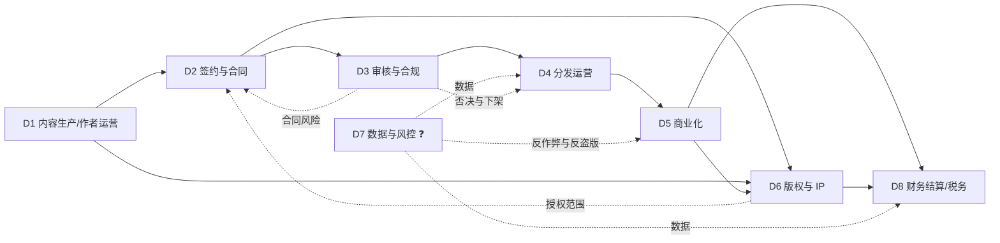

# 网络文学 · 业务域划分（示例运行 · 公开源草稿）

> **声明**：这是按公开信息（平台财报的业务表述、行业报告、监管文件、平台公开的签约/福利政策）**推断**的域划分，**不是客户的组织架构图**。客户的部门名、边界、汇报线一定不同——请拿它去校准。
> 用途：FDE 在画流程图之前，先回答"这家平台由哪几块业务能力组成"，避免把"工序"当"部门"。
> 信心：✅ 有公开源支撑该域存在 ／ ⚠️ 有源但边界/归属不明 ／ ❓ 纯推断
> 来源编号见 `sources.jsonl`；环节级明细见 `activities.md`。

---

## 0. 为什么先切域，再画流程

- 流程图回答"**先后顺序**"；业务域回答"**谁负责、边界在哪、跟谁交接**"。
- 一线被问"你们流程是什么"时，通常只答**自己域内**的流程；跨域部分会被简化。
- 所以先给一张域图，让对方说"我们不是这么分的，A 和 B 是一个部门 / C 是集团管的"——**这句否定比流程细节值钱**。

---

## 1. 八个业务域（工作假设）

| # | 业务域 | 一句话目标 | 主责角色（推断） | 核心流程 | 主要接口 | 成熟度（推断） | 信心 |
|---|---|---|---|---|---|---|---|
| D1 | 内容生产与作者运营 | 持续产出可连载的内容，把作者留住 | 编辑部、作者运营、内容策划 | 选题→约稿→跟稿→催更/全勤→作者分层运营 | D2、D3、D5、D8 | 高（核心） | ✅ |
| D2 | 签约与合同 | 用合同锁定内容与版权，控制法律风险 | 法务/版权商务、编辑、财务 | 签约评估→合同条款→盖章→变更/解约 | D1、D5、D6、D8 | 中高 | ✅ |
| D3 | 审核与合规 | 内容能发、平台不被罚、未成年人受保护 | 审核中心、总编室、法务/政府事务 | 机审→人审→三审三校→抽检→应急下架 | D1、D4、D6 | 高（合规驱动） | ✅ |
| D4 | 分发运营 | 把对的书推给对的人，做曝光与留存 | 运营、算法/推荐、渠道商务 | 上架排期→推荐/榜单→渠道分发→活动 | D1、D5、D7 | 中高 | ⚠️ |
| D5 | 商业化 | 把注意力变成订阅、广告、打赏收入 | 商业化/会员/广告、运营 | 定价→付费转化→广告变现→打赏月票→活动 | D4、D6、D8 | 中高 | ✅ |
| D6 | 版权与 IP 运营 | 把头部内容卖成多形态 IP，管授权与结算 | 版权/IP 运营、商务、法务 | 版权登记→授权谈判→合同→交付→分账 | D2、D5、D8 | 中（依赖头部） | ✅ |
| D7 | 数据与风控 | 数据可信、反作弊、反盗版、防刷量 | 数据/风控、安全、法务 | 埋点→看板→异常识别→处置→复盘 | D4、D5、D6 | 低—中 | ❓ |
| D8 | 财务结算与税务 | 算得清、结得准、报得对 | 财务、结算、税务 | 稿酬计算→对账→发放/代扣→报送→开票 | D1、D2、D5、D6 | 中高 | ✅ |

**为什么是 8 个**：公开材料能明确看到职责痕迹的是 D1—D6 + D8；**D7（数据与风控）是大多数 FDE 项目的落点，但客户是否设独立部门完全未知**，所以单列并标 ❓。

---

## 2. 域间接口图（推断）

**接口上的三个高频断点（推断，需验证）**：
1. **D2↔D6**：签约时签的"全版权"，到 IP 授权时才发现**某项权利没拿到/期限已过**——合同与版权台账不同步。
2. **D3↔D4**：审核通过 ≠ 可以推；推荐/榜单会放大内容风险，**运营与审核的"热度优先级"天然冲突**。
3. **D5↔D8**：广告/打赏/订阅三套收入、三套结算周期，**作者侧只看到一个月度数字**，对账争议高发。

---

## 3. 逐域说明

### D1 内容生产与作者运营
- **目标**：稳定供给连载内容，降低断更率，把有潜力的作者往上推。
- **包含流程**：选题/立项、约稿与投稿、编辑跟稿、全勤/福利发放、作者分层运营（新人/腰部/头部）、作者社群。
- **对外接口**：作者（合同相对方）、编辑（内部）、财务（稿酬）。
- **痛点**：作者是**外部合作方**不是员工，管理靠激励而非指令；断更/太监直接影响用户留存与收入。证据：七猫公开全勤奖与请假规则（每月允许 1 天请假）[S24]。
- **信心**：✅ 域存在；⚠️ 内部人效与分层标准未知。

### D2 签约与合同
- **目标**：用合同锁定内容与版权，明确分成/结算/违约责任。
- **包含流程**：签约评估（题材/潜力/合规）、合同类型选择（买断/保底+分成/纯分成）、条款谈判（授权范围/期限/独家/竞业/优先权）、盖章、变更与解约。
- **对外接口**：法务、财务、版权/IP、作者。
- **痛点**：三类合同（买断/保底/分成）对应**完全不同的会计与现金流处理**；"全版权"与"优先权"极易混（见 glossary）。
- **证据**：七猫公开三类签约模式与保底价格区间 [S24]；网络出版服务单位须有编辑责任制度 [S13]。
- **信心**：✅ 模式存在；❓ 客户合同条款完全未知。

### D3 审核与合规
- **目标**：内容能发、平台不被罚、未成年人受保护、AI 内容可标识。
- **包含流程**：机器敏感词/模型审核→人工复审→三审三校→上线抽检→举报处理→应急下架/整改。
- **对外接口**：编辑、运营、法务/政府事务、监管（属地出版局/网信办）。
- **痛点**：审核标准不可穷举；**误杀与漏放都有成本**；AI 生成内容让"作者责任"与"平台责任"边界变复杂。
- **证据**：网络出版服务须有内容审核责任制度、责任编辑制度、责任校对制度 [S13 第二十三条]；生态治理规定 [S15]；未成年人网络保护条例 [S14]；AI 标识办法 [S19]。
- **信心**：✅ 合规要求明确；❓ 客户审核组织与人效未知。

### D4 分发运营
- **目标**：提高曝光效率、追读率与留存，把内容送到目标读者面前。
- **包含流程**：上架排期（分类/标签/封面/简介）、推荐位分配、榜单运营、渠道分发（APP/小程序/应用商店/海外）、活动/专题。
- **对外接口**：内容（D1）、商业化（D5）、数据（D7）、渠道方。
- **痛点**：推荐位与榜单是**稀缺的注意力分配权**，编辑推荐与算法推荐谁说了算，直接决定作者生态。
- **证据**：头部平台月活与短剧导流 [S09]；2025 年报告称"算法推荐失衡"是行业短板之一 [S03]。
- **信心**：⚠️ 域存在但内部规则不可见。

### D5 商业化
- **目标**：把阅读行为转化为订阅、广告、打赏收入，并控制单位经济。
- **包含流程**：定价与付费策略、会员/包月、广告位与广告主对接、激励视频、打赏/月票、促销活动。
- **对外接口**：分发（D4）、广告主、支付渠道、财务（D8）。
- **痛点**：付费与免费两套目标打架；广告收入占比上升会挤压订阅体验；**打赏/月票涉及未成年人消费限制** [S14]。
- **证据**：2025 年广告 274.49 亿、订阅 159.95 亿 [S01]；知乎 Q4 付费阅读占 51.8% [S16]。
- **信心**：✅ 收入结构；❓ 客户定价与分成。

### D6 版权与 IP 运营
- **目标**：把头部内容授权/开发成有声、短剧、影视、动漫、出版、出海产品，最大化 IP 价值。
- **包含流程**：版权登记与台账、授权谈判、合同、物料交付、改编监修、分账结算、维权。
- **对外接口**：签约（D2）、商业化（D5）、财务（D8）、外部制作方/平台。
- **痛点**：**一书多授权、多形态、多账期**；短剧备案与改编权是两道独立闸 [S12][S21]；AI 漫剧/短剧让授权颗粒度变细。
- **证据**：2025 年 IP 改编 91392 部、增量来自短剧与 AI 漫剧 [S01]；阅文版权运营 31.92 亿元 [S05]。
- **信心**：✅ 域存在；❓ 客户授权台账与分账口径。

### D7 数据与风控
- **目标**：数据可信、反作弊、反盗版、防刷量与防薅羊毛。
- **包含流程**：埋点与指标口径、看板、异常识别（刷量/刷单/刷月票）、盗版监测与下架、风控处置。
- **对外接口**：全部业务域；外部数据服务商/维权机构。
- **痛点**：**指标口径不统一是最大问题**（首订/均订/追读/完读率各自定义）；刷量直接影响榜单与广告结算。
- **证据**：行业报告点名"算法推荐失衡""版权保障机制不健全" [S03]；反洗稿机制 [S10]。
- **信心**：❓ 纯推断（客户是否设独立域未知）。

### D8 财务结算与税务
- **目标**：稿酬/分成算得清、结得准、税报得对。
- **包含流程**：稿酬计算（千字/分成/全勤/保底抵扣）、对账、发放、代扣代缴、平台涉税信息报送、开票。
- **对外接口**：作者（D1）、合同（D2）、商业化（D5）、IP（D6）、税务。
- **痛点**：**保底是预付款**，要抵扣后续分成；免费模式按广告分成结算，口径复杂；2025-06 起平台有涉税信息报送义务 [S20]。
- **证据**：七猫公开保底/分成/全勤规则 [S24]；平台涉税信息报送规定 [S20]。
- **信心**：✅ 义务存在；❓ 客户实际结算周期与系统。

---

## 3.1 域成熟度与外包速览（推断）

| 业务域 | 成熟度 | 是否外包 | 对 FDE 的含义 |
|---|---|---|---|
| D1 内容生产/作者运营 | 高 | 作者是外部合作方 | 不是"管员工"，是"管激励" |
| D2 签约与合同 | 中高 | 自营 | 合同条款是 IP 业务的地基 |
| D3 审核与合规 | 高 | 人审可外包 | 合规驱动，最容易买单 |
| D4 分发运营 | 中高 | 自营 | 推荐与榜单是权力中心 |
| D5 商业化 | 中高 | 广告可能代理 | 付费/免费两套 KPI |
| D6 版权与 IP | 中 | 制作外包 | 台账与分账最乱 |
| D7 数据与风控 | 低—中 | 监测可外包 | 数字化切入点 |
| D8 财务结算与税务 | 中高 | 自营 | 报送带来系统改造 |

---

## 4. 校准问题（拿这张表去问）

1. 你们实际是几个一级部门？D1—D8 哪些合并、哪些拆开、哪些根本不存在？
2. **审核**归总编室还是独立中心？向谁汇报？
3. **版权/IP** 是独立事业部还是挂在编辑部/商业化下？
4. **数据**有没有独立团队？核心看板谁维护？
5. 签约、结算、版权台账分别用**什么系统**（只问类别，不问厂商）？
6. 哪些域是**外包**的（审核、客服、有声制作、短剧制作、维权）？
