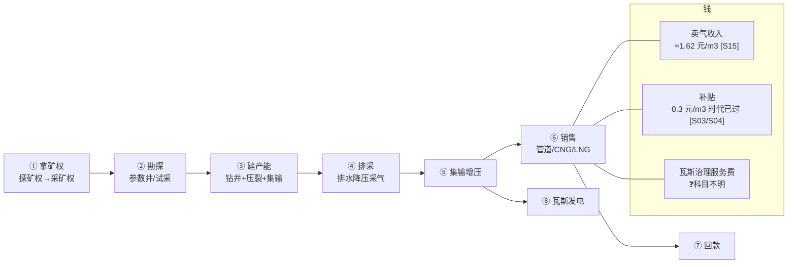

# 第 1 步产出：价值链草图（手绘复刻）

> 用时约 2.5h。来源：`../value-chain.md` + `../sources.jsonl`。
> 目标不是画全，是**画出"钱从哪来、成本压在哪、哪一步会卡死"**。

## 1. 草图

## 2. 三条钱流（我理解的）

| # | 谁付钱 | 付给谁 | 单价/口径 | 信心 |
|---|---|---|---|---|
| 1 | 工业/城燃/电厂 | 煤层气公司 | 出厂价，市场化定价 [S01]；样本约 1.62 元/m³ [S15] | ⚠️ 样本非行业均价 |
| 2 | 财政部（+地方） | 煤层气公司 | 2016 版 0.3 元/m³ [S03]；2025 版改梯级奖补 [S04/S05] | ⚠️ 现行机制未拿到原文 |
| 3 | 煤矿企业 | 煤层气公司 | 瓦斯治理服务费，按什么计 ❓ | ❓ 只知道存在 [S15] |

## 3. 成本压在哪儿（排序是猜的）

1. 折旧摊销（井+管线+站场）❓
2. 钻井与压裂 ❓
3. 电费与增压能耗 ❓
4. 修井检泵 ❓
5. 采出水处理（环评有硬要求 [S14]）⚠️
6. 财务费用（蓝焰 2025 为 0.98 亿元 [S15]）✅

## 4. 五个我填不出来的数字（下一步要问）

| # | 缺的数 | 为什么重要 |
|---|---|---|
| 1 | 客户"产量"的定义 | 决定所有单位成本的分母 |
| 2 | 实际实现气价 | 收入侧唯一硬变量 |
| 3 | 补贴在报表哪一行 | 财务模型对不对得上 |
| 4 | 单井日产中位数 | 判断资产质量 |
| 5 | 采出水处理单价 | 常被漏掉的持续成本 |

## 5. 第 1 步结束时的一句话总结（给客户）

> "我理解这是一门**先垫 6 亿建 1 亿方产能、再靠 0.5 元/方毛利和补贴慢慢收回**的生意，所以最怕两件事：单井产量不达预期、补贴规则变。**这个理解对吗？**"
