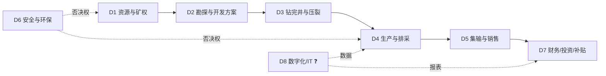

# 第 3 步产出：业务域 + 活动明细（示例）

> 用途：让人一眼看到 v0.2 新增方法的产出形态。
> 场景：仍是山西某省属煤层气公司（画像 B），FDE 单人，第三步去现场。
> 完整版见 `../domains.md`、`../activities.md`。

---

## 1. 我画的八个业务域（先被否这一层）

**我预判会被改的 3 处**：
1. D1/D2 可能是一个部门（"勘探开发部"）。
2. D5 的"销售"可能在集团层面，不在区块公司。
3. D8 可能根本不存在独立部门。

**开场话术**：
> "我按公开信息把贵司拆成八块能力，画得比较粗。**您先帮我看这个分法对不对——哪两块其实是一个部门？哪一块我漏了？**"

---

## 2. 活动表样例（8 行，从 36 行里挑的）

| 业务域 | 流程 | 环节/活动 | 当前环节做什么 | 谁做 | 影响到谁 | 工具/系统 | 业务背景 | 输入→输出 | 信心 | 来源 |
|---|---|---|---|---|---|---|---|---|---|---|
| D4 | 排采 | 排采制度制定 | 定产水/定井底流压、压降速度、套压区间 | 技术组 ❓ | 一线排采工 | 制度文件/Excel ❓ | "连续、稳定、缓慢、长期"，不定产气 | 储层参数→制度 | ✅ | [S26] |
| D4 | 排采 | 日常排采监控 | 看套压/日产气/日产水/泵况，调频调压 | 排采工 ❓ | D5、D7 | 人工抄表或 SCADA ❓ | 数据质量决定优化空间 | 仪表→日报 | ⚠️ | [S15] |
| D4 | 生产 | 修井/检泵 | 停产检修、换泵、解堵 | 修井队 ❓ | D5、D7 | 作业票/工单 ❓ | 井多产低，运维成本敏感 | 故障→复产 | ❓ | 推断 |
| D4 | 生产 | 产量/销量/利用量统计 | 按口径汇总上报 | 计划统计岗 ❓ | D7、监管 | 报表系统 ❓ | **三口径陷阱高发** | 日报→月报 | ⚠️ | [S06][S15] |
| D5 | 销售 | 计量交接与结算 | 与客户/管网交接计量、开票、回款 | 销售公司 ❓ | D7、客户 | 计量系统/ERP ❓ | 出厂价市场化 | 交接单→回款 | ❓ | [S01][S25] |
| D7 | 补贴 | 补贴申报与清算 | 按利用量/增幅申报、配合核查 | 财务 ❓ | 财政部/地方 | 申报系统 ❓ | 2025 改"梯级奖补" | 计量数据→到账 | ⚠️ | [S04][S05] |
| D7 | 税务 | 增值税优惠处理 | 申请即征即退/先征后退 | 税务岗 ❓ | 税务局 | 电子税务局 ❓ | 2025-11 起取消先征后退 | 销售数据→税负 | ⚠️ | [S15][S28] |
| D8 | 数据 | 单井数据采集 | 采集套压/日产/泵况 | 采气区/信息中心 ❓ | D4、D7 | 人工抄表或 SCADA ❓ | 井数多、人工成本高 | 仪表→数据库 | ❓ | [S14] |

**挑这 8 行的理由**：全部落在 D4/D5/D7/D8——也就是 FDE 最可能做方案的地方；且 6 行是 ⚠️/❓，容易被改。

---

## 3. 现场怎么用

1. **先给域图，不给活动表**（域图一眼能看懂，活动表会让人进入"审阅模式"）。
2. 让对方改域图：划掉、合并、补一个框。
3. 再给活动表，只问三列：**"谁做"、"用什么"、"这一步是不是这样"**。
4. 记录"被改的格子"，不要辩解。

**话术**：
> "这张表里我最不确定的是'谁做'和'用什么系统'——**您直接在上面改，我回去重画。**"

---

## 4. 记录模板（现场填）

| # | 我的写法 | 被改成 | 谁改的 | 类型（归属/工具/口径/漏项） |
|---|---|---|---|---|
| 1 | D1 与 D2 是两个域 | | | 归属 |
| 2 | 排采制度由技术组定 | | | 归属 |
| 3 | 日常监控用 SCADA | | | 工具 |
| 4 | 补贴由本公司申报 | | | 口径 |
| 5 | 没有 D8 | | | 漏项 |

**判断标准**：如果 5 行里被改 ≥3 行，说明这张表"具体到值得改"；如果对方说"差不多都对"，说明你问得太客气了。

---

## 5. 这一步的产出（和前后步骤怎么接）

| 步骤 | 产出 | 下一步 |
|---|---|---|
| 域图被改 | 客户的真实部门边界 | 回填 `domains.md` 的 G1—G6 |
| 活动表被改 | 谁做/用什么 的真实版本 | 回填 `activities.md` 的 ❓ 行 |
| 断点被确认 | 3—5 个真实痛点 | 进 `verification-list.md` 或 `brief.md` |
