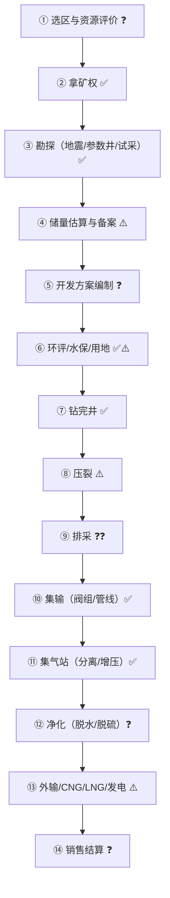

# 第 3 步产出：流程图（满 ❓ 版）

> 目标：**故意画满 ❓**，因为被改的地方越多，说明问题问得越准。
> ✅ 有来源 ／ ⚠️ 有来源但可能过时 ／ ❓ 我猜的

## 1. 主流程

## 2. 节点信心一览

| 节点 | 信心 | 依据 | 我要问什么 |
|---|---|---|---|
| ① 选区 | ❓ | 无公开源 | 客户自己选区还是买现成区块？ |
| ② 矿权 | ✅ | 故县出让公告 [S13] | 客户是探矿权还是采矿权？ |
| ③ 勘探 | ✅ | 储量规范定义 [S12] | 参数井几口？试采多久？ |
| ④ 储量备案 | ⚠️ | 规范是报批稿 [S12] | 备案和开发方案谁先谁后？ |
| ⑤ 开发方案 | ❓ | 只知道有这个词 [S14] | 谁批？批什么？ |
| ⑥ 前置审批 | ✅⚠️ | 柿庄南环评 [S14] | 水保/林地是不是单独一批？ |
| ⑦ 钻完井 | ✅ | 柿庄南 1709 口井 [S14] | 井型比例？ |
| ⑧ 压裂 | ⚠️ | 深层靠压裂 [S19] | 分段数、排量、成本？ |
| ⑨ 排采 | ❓❓ | 只有"精细排采"一词 [S19] | **定压还是定产？套压区间？** |
| ⑩ 集输 | ✅ | 管线 1754 km [S14] | 自建还是共享？ |
| ⑪ 集气站 | ✅ | 6 座 [S14] | 增压机谁维护？ |
| ⑫ 净化 | ❓ | 环评只提"分离" | 有没有脱硫/脱碳？ |
| ⑬ 外输 | ⚠️ | 出厂价市场化 [S01] | 管道/CNG/LNG 各占多少？ |
| ⑭ 销售 | ❓ | 无合同样本 | 长协还是现货？结算周期？ |

## 3. 审批链（更没底）

## 4. 画完之后的自我检查

| 检查项 | 结果 |
|---|---|
| 有没有把"工序"和"审批"分开画？ | ✅ 分了两张 |
| 有没有标出谁负责？ | ❌ 只有部门名，没有人 |
| 有没有标时间？ | ❌ 没有，除了柿庄南 7 年样本 |
| 有没有标数据流？ | ❌ 没有 |
| ❓ 占比 | 5/14 ≈ 36%（⑨ 有两个 ❓ 不重复计节点），达到目标（≥25%） |

## 5. 明天要带去被否定的 5 个点

1. ⑨ 排采制度——我最没底，也最影响方案。
2. ⑤ 开发方案谁批——决定我找谁对接。
3. ④ 储量备案与开发方案顺序——决定项目时间轴。
4. ⑫ 净化工艺——决定我画的地面工程对不对。
5. 审批链是否串行——我画成串行，实际大概率并行。
