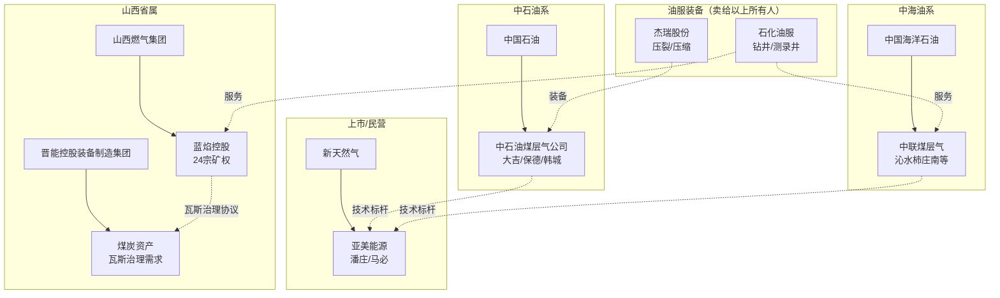

# 关键玩家（v0.1 · 12 家）

> 口径提醒：**"煤层气业务体量"几乎没人单独披露**。本表把"公司整体数据"和"煤层气相关事实"分开写，不要混用。
> 近 12 个月 = 2025-10 至 2026-10。没有公开动作的写"待验证"，不编。

---

## 1. 玩家总表

| # | 玩家 | 角色 | 上市状态 | 主要区块/业务 | 近 12 个月公开动作 | source | 信度 |
|---|---|---|---|---|---|---|---|
| 1 | 中石油煤层气有限责任公司 | 上游·深层煤层气龙头 | 非上市（中国石油子公司） | 鄂尔多斯盆地东缘大吉气田（大宁—吉县）、保德、韩城等 | 深层煤岩气持续上产被行业媒体作为"增长极"讨论；鄂东 2030 年 180 亿 m³ 行动方案承担主力 | S21、S19 | ⚠️（区块清单待验证） |
| 2 | 中国石油天然气股份有限公司 | 上游·母公司/多区块 | A+H（601857/0857） | 煤层气为其非常规气板块之一；长庆、华北等油田亦有煤层气/煤系气业务 | 无单独煤层气披露；年报"行业情况"可作背景 | S15（提及"国内大型油气企业"） | ❓ |
| 3 | 中联煤层气有限责任公司 | 上游·沁水盆地主力 | 非上市（中国海油全资） | 沁水盆地柿庄南等区块；1996 年成立的全国性煤层气专业公司 | 2019 年中海油以约 53.35 亿元收购 100% 股权（历史，非近 12 个月） | S23、S14 | ⚠️（股权为 2019 年状态） |
| 4 | 中国海洋石油有限公司 | 上游·母公司 | A+H（600938/0883） | 通过中联煤层气持有煤层气资产 | 无单独煤层气披露 | S23 | ⚠️ |
| 5 | 山西蓝焰控股股份有限公司 | 上游+瓦斯治理服务 | 深交所（000968） | 晋城、长治、晋中、太原、吕梁；24 宗矿业权、2799.35 km²、累计探明 531.91 亿 m³；武乡南、和顺横岭深部试验 | 2026-04-28 披露 2025 年报：销量 12.25 亿 m³（−2.93%）、营收 21.10 亿元（−6.87%）、归母净利 3.35 亿元（−22.90%）、毛利率 31.35% | S15 | ✅ |
| 6 | 新疆鑫泰天然气股份有限公司（新天然气） | 上游·跨区域组合 | 上交所（603393） | 潘庄、马必（山西）、紫金山（勘探）、喀什北（常规气）、丹寨（页岩气）、三塘湖（煤）、庆阳（深部煤制气先导） | 2026-03-27 披露 2025 年报：营收 39.24 亿元、归母净利 8.07 亿元；并表全口径天然气产量 24.13 亿 m³（+9.98%）；潘庄 63 km² 连续四年稳产 10 亿 m³；马必 9.51 亿 m³（+9.31%） | S16 | ⚠️（媒体转述年报） |
| 7 | 亚美能源控股有限公司（AAG Energy） | 上游·潘庄/马必运营主体 | 新天然气通过香港利明**间接持股 100%**（收购前为香港上市公司，现上市状态待验证） | 潘庄、马必区块；与"中方合作伙伴"签 PSC 销售合作协议 | 通过新天然气年报披露产量与售价；PSC 下中方伙伴负责开票/纳税/申报补贴 | S25 | ⚠️ |
| 8 | 山西焦煤能源集团股份有限公司 | 下游/协同·煤炭企业（瓦斯治理需求方） | 深交所（000983） | 炼焦煤为主；高瓦斯/突出矿井的瓦斯抽采与利用 | **待验证**（年报页需 JS 渲染，本次未取得可读原文） | — | ❓ |
| 9 | 烟台杰瑞石油服务集团股份有限公司 | 油服与装备 | 深交所（002353） | 钻完井设备、压裂成套装备、压缩机组（明确用于煤层气集输、煤层气发电） | 2026-04-17 年报摘要：电驱压裂设备国内领先；天然气设备板块含煤层气集输/发电场景 | S17 | ✅ |
| 10 | 中石化石油工程技术服务股份有限公司 | 油服 | A+H（600871/1033） | 钻井、测录井、井下特种作业；煤层气被列入测录井远程测控推广场景 | 2026-03 年报：营收 807.12 亿元、归母净利 6.59 亿元；钻井进尺 1115 万米 | S18 | ✅ |
| 11 | 山西燃气集团有限公司 | 省属燃气平台·蓝焰控股股东 | 非上市 | 2023 年起为蓝焰控股控股股东（持股 40.05%） | 无独立披露 | S15 | ✅（股权事实） |
| 12 | 晋能控股装备制造集团有限公司（原晋煤集团） | 省属能源集团·前控股股东 | 非上市 | 2020 年更名；2023 年以蓝焰 40.05% 股份增资山西燃气集团 | 无独立披露 | S15 | ✅（股权事实） |

补充区域玩家（**均待验证，不进总表**）：贵州乌江能源/贵州煤层气（2025 年贵州产量 10.6 亿 m³，S22）、新疆阜康矿区开发主体（2026 年 8 月日抽采超 80 万 m³，S19）、四川筠连区块（S19 提及商业开发）。

---

## 2. 逐个说清楚（FDE 会遇到的四类玩家）

### 2.1 国家队上游（中石油煤层气、中联煤层气）

- **中石油煤层气**：深层煤岩气的定义者。大吉气田资源量估算约 6000 亿 m³，先导性试验 2019 年开始建设；标杆井吉深 10-8 平 01 井 2022 年 5 月开钻、当年 12 月压裂试气，2023 年 1 月投产，累计产气突破 7000 万 m³、日产稳定 4.5 万 m³ 以上、连续稳产 29 个月（S21 ⚠️ 企业口径）。
- **中联煤层气**：1996 年由国务院批准组建的第一家全国性煤层气专业公司，原煤炭部、地矿部、中石油各出资 1/3；股权多次变更，2019 年被中海油以约 53.35 亿元收购 100%（S23 ⚠️ 媒体）。
- **对 FDE 的含义**：这两家的技术路线（水平井 + 大规模压裂 + 精细排采）是行业标杆，但**它们的单井产量不可直接套用到客户区块**——中国能源报引述专家的原话就是"不能把少数高产井的经验简单推广到所有区块"（S19 ⚠️）。这句话本身就是很好的访谈切口。

### 2.2 省属/地方国企（蓝焰、山西燃气、晋能控股）

- **蓝焰控股是唯一 A 股纯煤层气地面开发标的**，财务数据可当行业样本：2025 年销量 12.25 亿 m³、营收 21.10 亿元、毛利率 31.35%（S15 ✅）。
- 它的商业模式比"卖气"更宽：**煤层气销售 93.88% + 气井建造工程 4.62% + 运输等其他 1.50%**；同时"与有关煤炭企业签订瓦斯治理协议，有偿提供瓦斯抽采服务"（S15 ✅）。**瓦斯治理服务费在收入表里看不到单列科目**——这是财务口径与业务口径的差异，必问。
- 三大技术体系：采煤采气一体化、中深部及深部煤层气开发、采空区及过采空区煤层气抽采（S15 ✅）。这三个词可以直接拿去和一线对话。
- 控股股东变更链：太原煤气化（2000 上市）→ 晋煤集团/晋控装备（2016 重组）→ 山西燃气集团（2023）（S15 ✅）。**理解这条链，才能理解山西煤层气为什么是"省属燃气平台 + 煤企"的结构**。
- **对 FDE 的含义**：如果客户是山西地方国企，它的 KPI 里一定同时有"产量""安全（瓦斯治理）""省内保供"三个目标，且互相拉扯。

### 2.3 跨区域/民营组合（新天然气、亚美能源）

- 新天然气的资产包很杂：潘庄、马必（煤层气）、紫金山（勘探）、喀什北（常规气）、丹寨（页岩气）、三塘湖（煤炭）、庆阳（深部煤制气先导）（S16 ⚠️）。
- **潘庄 63 km² 连续四年稳产 10 亿 m³** 是"小而肥"区块的标杆；马必 2025 年 9.51 亿 m³、同比 +9.31%（S16 ⚠️）。
- **对 FDE 的含义**：这类客户的决策逻辑是"资产组合 + 现金流"，不是单一煤层气逻辑；谈数字化/生产优化时，要能对上"单位操作成本""单井 EUR"这类组合层指标。

### 2.4 油服与装备（杰瑞、石化油服）

- 杰瑞：钻完井设备、压裂成套装备、固井、连续油管；压缩机组明确用于**煤层气集输、LNG 液化工厂、煤层气发电、调压站**（S17 ✅）。
- 石化油服：钻井、测录井、井下特种作业；2026 年计划"在地热、煤层气等市场逐步推广远程测控施工模式"（S18 ✅）。**这是"数字化在煤层气落地"的少数公开表述，值得追。**
- **对 FDE 的含义**：这两家是**客户的上游供应商**，不是客户。但它们披露的技术方向（电驱压裂、远程测控、压缩机智能化）就是客户现场正在发生的变化。

---

## 3. 竞争格局（推断，需客户校准）

| 判断 | 依据 | 信心 |
|---|---|---|
| 上游是"两桶油 + 省属国企 + 少量民营"的三层结构 | 中石油煤层气/中联（国家队）、蓝焰/新天然气（省属与上市民企） | ❓ 推断 |
| 山西一省占全国产量约 81%，格局高度集中 | S15、S20、S22 三个来源一致 | ✅ |
| 深层煤层气是 2026—2030 的主要增量，且由中石油领跑 | S19（鄂东 180 亿 m³、深层 160 亿 m³+）、S21（大吉） | ⚠️ |
| 油服/装备环节集中度高于上游，且煤层气只是其一个小场景 | 杰瑞、石化油服均未单列煤层气收入 | ❓ 推断 |
| 中游（管网）由国家管网与省级管网主导，煤层气公司议价能力弱 | S09/S10 的公平开放框架 + 蓝焰引入"管网通" | ❓ 推断 |

---

## 4. 我明确不知道的（请客户补）

1. **中联煤层气当前股权**：2019 年被中海油 100% 收购，之后是否有变化——待验证。
2. **亚美能源是否仍独立上市**：新天然气收购后港股状态未核实。
3. **山西焦煤的瓦斯抽采/利用量**：本次没取得可读年报原文。
4. **各家的单井日产、递减率、单位操作成本**：全部未公开。
5. **贵州/新疆/四川的本地主导企业**：只有产量数字，没有主体信息。
6. **"煤层气"在杰瑞/石化油服收入中的占比**：未披露，不要估算。

---

## 5. 玩家关系图（推断，方框内为角色）

**读图要点**：
- 上游三类主体（央企专业公司、省属燃气平台、上市/民营）之间**不是纯竞争**，大量存在"合作区块、瓦斯治理协议、技术服务"关系。
- 油服装备企业向所有主体供货，所以它的年报是观察行业景气度的**领先指标**（S17、S18）。
- 煤炭企业（如晋能控股装备制造集团下属矿井）既是煤层气公司的**合作方**，也是**瓦斯治理的付款方**（S15）。

---

## 6. 四类客户画像（FDE 上场前先判断是哪一类）

| 画像 | 典型特征 | 最痛的事 | FDE 的第一句话 |
|---|---|---|---|
| A. 央企专业煤层气公司 | 区块多、技术强、有研究院；深层/中浅层并行 | 老井递减、单井产量分布不均、多区块管理 | "我们能不能先把各区块的单井产量分布拉出来，而不是只看平均值？" |
| B. 省属燃气/能源平台 | 矿权多、与煤企关系复杂、承担省内保供 | 采煤采气协调、补贴与气价双约束、投资回报 | "您这儿'产量'和'保供'哪个是一票否决？" |
| C. 煤炭企业（瓦斯治理侧） | 抽采达标是生产前置；瓦斯利用是成本中心或小收入 | 抽采达标考核、瓦斯利用率、浓度波动 | "抽采达标的数据，现在是按月报还是实时看？" |
| D. 上市/民营资产组合 | 多区块、多气种、看现金流与 IRR | 单井经济性、资产组合优化、融资 | "这个区块在组合里是'现金流'还是'增长'？" |

**用法**：这四类的 KPI、系统现状、决策链差异极大。**先判断画像，再决定看哪几个文件**——用 A 的画法去套 C，一定被否定。

---

## 7. 从玩家行为反推的 4 个行业信号（推断）

| 信号 | 证据 | 含义 |
|---|---|---|
| 深层是唯一确定的增量 | 鄂东 2030 年 180 亿 m³、深层 160 亿 m³+（S19 ⚠️）；大吉标杆井（S21 ⚠️） | 客户若在鄂东，2026—2030 的核心矛盾是"深层单井产量能否复制" |
| 中浅层进入"稳产+控递减"阶段 | 蓝焰 2025 销量同比 −2.93%（S15 ✅） | 存量资产的生产优化（排采、间开、修井）比新建产能更现实 |
| 价格与补贴双重挤压毛利 | 蓝焰毛利率同比 −4.33 pct（S15 ✅） | "降本"比"增产"更容易被客户接受 |
| 管网规则在 2025—2026 年被重写 | 发改委第 33、35 号令（S09、S10 ✅） | 出现"制度信息差"窗口，FDE 可以此建立专业感 |

---

## 8. 怎么快速核实一个玩家

1. 打开巨潮资讯网/交易所公告页，搜公司代码，取最近一份**年报**的"行业情况"与"主要业务"章节——这是最便宜、最可引用的资料。
2. 看年报"矿业权/储量"表：宗数、面积、探明储量。**这是硬信息，比新闻可靠**（蓝焰样本见 S15）。
3. 看"营业收入构成"：有没有单列煤层气？没有就说明该业务占比不重大，**不要估算比例**。
4. 看"控股股东/实际控制人"：判断是央企、省属还是民营（决定决策链长度）。
5. 搜索"公司名 + 区块 + 环评/出让/招标"：地方政府网站常有意外的一手信息。

## 9. 待补充玩家池（本次未及核实）

| 候选 | 为什么值得看 | 状态 |
|---|---|---|
| 贵州乌江能源集团 / 贵州煤层气相关主体 | 2025 年贵州产量 10.6 亿 m³，全国第三（S22） | ❓ 未核实主体 |
| 新疆煤层气开发主体（阜康矿区） | 2026 年 8 月日抽采量超 80 万 m³（S19） | ❓ 未核实 |
| 四川筠连区块开发主体 | 已实现商业开发（S19） | ❓ 未核实 |
| 中澳煤层气（Sino Gas & Energy） | 曾为外资合作区块运营方 | ❓ 未核实是否仍活跃 |
| 中国煤层气（港股） | 港股煤层气标的 | ❓ 未核实 |
| 科瑞/三一/其他压裂与排采设备商 | 煤层气专用排采设备 | ❓ 未核实 |
