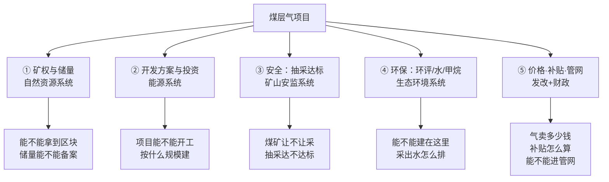

# 监管文件目录（v0.1 · 只到"知道去哪查"的程度）

> 用途：FDE 不需要读懂条文，但必须知道**客户哪句话背后是哪份文件**。
> 判读方式：客户说"这个要报批""这个不能干""这个能拿钱"——在右列找对应文件，再决定要不要深读。
> 信度：✅ 我打开了原文 ／ ⚠️ 打开了但只是新闻/转载/摘要 ／ ❓ 未找到可打开的公开源（见文末）

---

## 0. 一张图：五条监管线

---

## 1. 矿权与储量

| 名称 | 发布机关 | 文号/年份 | 管什么 | 对 FDE 客户意味着什么 | 链接 | 信度 |
|---|---|---|---|---|---|---|
| 中华人民共和国矿产资源法 | 全国人大常委会 | 2024 年修订（现行） | 矿权设立、出让、转让、保护 | 区块合法性总依据；客户说"我们有矿权"时问"探矿权还是采矿权" | 见 S13 引用 | ⚠️（未读原文） |
| 矿业权出让交易规则 | 自然资源部 | 自然资规〔2023〕1号 | 招拍挂出让流程 | 拿新区块要走交易平台 | 见 S13 引用 | ⚠️ |
| 山西省沁水盆地故县区块煤层气探矿权挂牌出让公告 | 山西省自然资源厅 | 晋自然资事业出让公告〔2025〕18号，2025-12-03 | 具体区块出让条件 | **一手样本**：291.68 km²、勘查程度"预探"、出让 5 年、起始价 204.4 万元、起始出让收益率 0.3%、竞买人净资产≥5 亿元 | [S13](http://ky.m.mnr.gov.cn/kyqcrgg_646/tkq/202512/t20251204_10093222.html) | ✅ |
| 煤层气储量估算规范 | 自然资源部 | DZ/T 0216（报批稿，代 DZ/T 0216-2010） | 探明/控制/预测储量条件、储量起算标准、参数定义 | 客户说"我们有 500 亿方储量"时，要问是**地质储量还是可采储量**、哪一级 | [S12](http://gi.mnr.gov.cn/202003/P020200319568909331268.pdf) | ⚠️（报批稿） |
| 矿业权出让收益征收办法 | 财政部/自然资源部/税务总局 | 年份待验证 | 出让收益怎么缴（一次性/逐年收益率） | 影响项目前期现金流 | — | ❓ |

## 2. 开发方案与投资管理

| 名称 | 发布机关 | 文号/年份 | 管什么 | 对 FDE 客户意味着什么 | 链接 | 信度 |
|---|---|---|---|---|---|---|
| 国务院办公厅关于进一步加快煤层气（煤矿瓦斯）抽采利用的意见 | 国务院办公厅 | 国办发〔2013〕93号 | 价格、补贴、矿权、发电、投资项目管理总纲 | "煤层气开发、输送、利用项目实行审批、核准或备案制"——客户项目卡在哪个环节，常在这条 | [S01](https://www.gov.cn/zwgk/2013-09/22/content_2492302.htm) | ✅ |
| 煤层气产业政策 | 国家能源局 | 2013 年 | 准入条件、勘探开发布局、就近利用余气外输 | 解释"为什么客户必须先拿矿权、还要有工程技术实力" | [S02](http://www.nea.gov.cn/2013-03/11/c_132225130.htm) | ✅ |
| 煤层气（煤矿瓦斯）开发利用"十三五"规划 | 国家能源局 | 2016 年 | 目标、布局、保障措施 | 历史目标，用于理解"五年规划目标多次落空"的行业记忆 | [S06](http://fgw.shandong.gov.cn/art/2018/5/7/art_91485_7329797.html) | ✅ |
| 煤炭工业发展"十五五"规划 | 国家发展改革委、国家能源局 | 2026 年（据媒体转述） | 2030 年煤层气 260 亿 m³、瓦斯利用 65 亿 m³ | 客户"十五五"规划的上级依据 | [S19](https://paper.people.com.cn/zgnyb/pc/content/202609/28/content_30183973.html) | ⚠️（仅媒体转述） |
| 鄂尔多斯盆地东部区域煤层气增储上产行动方案（2026—2030年） | 国家能源局 | 2026 年（据媒体转述） | 2030 年鄂东 180 亿 m³，深层 160 亿 m³ 以上 | 如果客户在鄂东，这是硬指标来源 | [S19](https://paper.people.com.cn/zgnyb/pc/content/202609/28/content_30183973.html) | ⚠️ |

## 3. 安全监管（瓦斯防治 / 抽采达标）

| 名称 | 发布机关 | 文号/年份 | 管什么 | 对 FDE 客户意味着什么 | 链接 | 信度 |
|---|---|---|---|---|---|---|
| 煤矿瓦斯抽采达标暂行规定 | 安监总局、发改委、能源局、煤监局 | 安监总煤装〔2011〕163号，2011-10-16 | "先抽后采、综合治理"、抽采达标考核 | 煤矿客户的**生产前置条件**；煤层气公司的"瓦斯治理服务"生意就长在这条上 | [S11](https://www.mem.gov.cn/gk/gwgg/agwzlfl/gfxwj/2011/201110/t20111021_243060.shtml) | ✅（通知本体） |
| 国务院办公厅关于进一步加强煤矿瓦斯防治工作的若干意见 | 国务院办公厅 | 国办发〔2011〕26号 | 瓦斯防治总体要求 | 早于 93 号文的上一版总纲 | 见 S06 引用 | ⚠️ |
| 煤矿安全规程 | 应急管理部（原安监总局） | 2016 年版及修订 | 矿井安全基本要求 | 井下抽采相关作业的强制规程 | — | ❓ |
| 防治煤与瓦斯突出细则 | 国家煤矿安监局 | 2019 年 | 突出矿井的防治措施 | 高瓦斯/突出矿井客户的技术红线 | — | ❓ |
| 煤矿瓦斯等级鉴定暂行办法 | 国家煤矿安监局等 | 2011 年 | 矿井瓦斯等级划分 | 决定客户是"高瓦斯"还是"突出"矿井 | 见 S11 同批文件引用 | ⚠️ |

## 4. 环保（环评 / 水 / 甲烷）

| 名称 | 发布机关 | 文号/年份 | 管什么 | 对 FDE 客户意味着什么 | 链接 | 信度 |
|---|---|---|---|---|---|---|
| 建设项目环境影响评价分类管理名录（2021 年版） | 生态环境部 | 2021 年 | 什么项目编报告书/报告表 | **年产能 1 亿 m³ 及以上、或涉及环境敏感区的煤层气开采要编报告书**（据地方环评文件引用） | — | ⚠️（未读原文，靠 S14 反推） |
| 沁水盆地柿庄南区块东区煤层气开发项目环评批复 | 山西省生态环境厅 | 晋环审批函〔2022〕17号，2022-03-23 | 具体项目环保要求 | **一手样本**：采出水处理、泉域/水源地禁采区、防渗系数、井场/管线避让；项目总投资 55.59 亿元、环保投资约 8680 万元 | [S14](https://sthjt.shanxi.gov.cn/zwgk/hjpj/hpwjspjdgg/202203/t20220323_5543041.shtml) | ✅ |
| 甲烷排放控制行动方案 | 生态环境部等（11 部门） | 2023 年 11 月 | 放空/火炬管控、瓦斯利用目标 | 客户"放空量""火炬"指标的政策来源；2025 年煤矿瓦斯利用量目标 60 亿 m³ | [S24](http://tanpaifang.com/zhengcefagui/2023/1108101904_3.html) | ⚠️（转载站） |
| 生产建设项目水土保持方案审批 | 水利部门 | 待验证 | 管线/道路/井场的水土保持 | 黄土高原/山区项目常见卡点 | — | ❓ |
| 排污许可（采出水/锅炉） | 生态环境部门 | 待验证 | 排放许可与总量 | 采出水达标排放/回用的前提 | — | ❓ |

## 5. 价格、补贴与发电

| 名称 | 发布机关 | 文号/年份 | 管什么 | 对 FDE 客户意味着什么 | 链接 | 信度 |
|---|---|---|---|---|---|---|
| 国办发〔2013〕93号（价格与发电部分） | 国务院办公厅 | 2013 年 | ①放开出厂价 ②进城市管网按不低于同等热值天然气价 ③瓦斯发电富余电量电网全部收购 ④适时提高上网标杆电价 | 客户的**收入侧定价规则**都在这里；"不低于同等热值"是谈判依据 | [S01](https://www.gov.cn/zwgk/2013-09/22/content_2492302.htm) | ✅ |
| 关于"十三五"期间煤层气（瓦斯）开发利用补贴标准的通知 | 财政部 | 财建〔2016〕31号，2016-02-14 | 中央财政补贴 0.2→0.3 元/m³ | 上一代补贴口径；**客户内部测算模板可能还停在这里** | [S03](http://m.mof.gov.cn/czxw/201602/t20160226_1787180.htm) | ✅ |
| 清洁能源发展专项资金管理办法 | 财政部 | 财建〔2025〕35号，2025-03-03 | 现行非常规气奖补制度 | **现行规则**：梯级奖补、取暖季增量、竞争性分配、2025—2029 有效；"量补"改"效补" | [S04](https://www.xjqt.gov.cn/p232/zcfgwjczj/20250710/374627.html) | ✅（通知；附件正文未取） |
| 煤层气发电上网电价政策 | 国家发展改革委 | 待验证 | 瓦斯发电上网标杆电价 | 发电业务收入测算依据 | — | ❓ |
| 天然气门站价格政策 | 国家发展改革委 | 待验证 | 门站价形成机制 | 与煤层气出厂价、管输费的关系 **我必须承认没核实清楚** | — | ❓ |

## 6. 管网接入

| 名称 | 发布机关 | 文号/年份 | 管什么 | 对 FDE 客户意味着什么 | 链接 | 信度 |
|---|---|---|---|---|---|---|
| 油气管网设施公平开放监管办法 | 国家发展改革委 | 第33号令，2025-09-29 公布，2025-11-01 施行 | 管网运营企业须公平、无歧视向符合条件用户提供输送/储存/接卸/气化服务 | 客户"气进不了管网/被拒"时，这是维权与谈判依据 | [S09](https://www.gov.cn/gongbao/2025/issue_12426/202511/content_7049747.html) | ✅ |
| 石油天然气基础设施规划建设与运营管理办法 | 国家发展改革委 | 第35号令，2025-10-30 公布，2026-01-01 施行 | 基础设施规划、接入、运销分离、运营监管 | 2026 年起的新规则；客户内部制度可能还没同步——**这是很好的"信息差"切入点** | [S10](https://www.gov.cn/zhengce/202511/content_7049196.htm) | ✅ |

---

## 7. 客户嘴里的话 → 对应文件（速查）

| 客户说 | 大概率对应 |
|---|---|
| "这个区块是预探，还没到开发" | S13（勘查程度）、S12（储量分级） |
| "要先抽后采 / 抽采不达标不能采" | S11 |
| "我们跟煤矿有协议，帮他治理瓦斯" | S11 + S01 第（十）条 + S15（蓝焰模式） |
| "先采气后采煤" / "5 年内要建井" | S01 第（十）条（**5 年窗口是关键判据**） |
| "环评批复里定了禁采区" | S14 |
| "补贴现在不是 0.3 元了" | S04 + S05 |
| "气进不了管网" | S09、S10 |
| "十五五要干到 260 亿方" | S19（转述《煤炭工业发展"十五五"规划》） |

---

## 8. 怎么持续更新（几个固定动作）

1. 国家能源局政策文件库（zfxxgk.nea.gov.cn）按"煤层气"检索，看最近 12 个月。
2. 财政部（mof.gov.cn）搜"清洁能源发展专项资金"。
3. 自然资源部矿业权市场（ky.mnr.gov.cn）看本省区块出让公告——**这是最诚实的"行业在往哪走"的信号**。
4. 省级生态环境厅"审批决定公告"看本区域最近批了什么项目。
5. 上交所/深交所/巨潮看纯煤层气标的年报（本包用蓝焰 2025 年报）——**年报里的"行业情况"章节是最便宜的行业综述**。

---

## 9. 我明确没找到公开源的文件（不许编）

| 文件 | 状态 | 处理 |
|---|---|---|
| 《煤矿安全规程》官方全文链接 | ❓ 未打开 | 需要时从应急管理部官网检索，不在此处编 URL |
| 《防治煤与瓦斯突出细则》官方原文 | ❓ 未打开（地方转载页 502） | 同上 |
| 环境影响评价分类管理名录官方原文 | ❓ 未读 | 仅据 S14 与地方环评文件反推"报告书"要求 |
| 煤层气发电上网电价现行文件 | ❓ 未找到 | 客户如做发电，必须现场确认 |
| 天然气门站价现行机制文件 | ❓ 未核实 | 不要用门站价直接套煤层气出厂价 |
| 水土保持方案审批、排污许可具体文件 | ❓ 未找到 | 列入 verification-list 末节 |
| 矿业权出让收益征收办法（现行版） | ❓ 未找到 | 只知有"收益率逐年征收"的做法（S13），制度文件待查 |

---

## 10. 一个煤层气开发项目要拿的批文清单（打勾用）

> 依据柿庄南东区环评批复（S14）反推 + 国办发 93 号（S01）+ 个人推断。**打勾前请客户确认**。

| 阶段 | 批文/手续 | 主管/出具方 | 我的信心 | 备注 |
|---|---|---|---|---|
| 前期 | 同意开展前期工作的复函 | 国家能源局 | ✅ | 柿庄南样本：国能煤炭〔2015〕140 号 |
| 前期 | 企业投资项目备案证 | 省发改委 | ✅ | 柿庄南：2020-08 取得 |
| 矿权 | 探矿权/采矿权证 | 省自然资源厅 | ✅ | 故县出让公告（S13） |
| 资源 | 储量报告评审/备案 | 自然资源部门 | ⚠️ | 规范为报批稿（S12），流程待验证 |
| 设计 | 开发方案批复 | 待验证（集团或能源局） | ❓ | **不清楚是否需政府批** |
| 环保 | 环境影响报告书批复 | 省/市生态环境厅局 | ✅ | 柿庄南：晋环审批函〔2022〕17 号 |
| 环保 | 水土保持方案批复 | 水利部门 | ❓ | 未找到公开源 |
| 用地 | 临时用地/林地许可 | 自然资源/林草部门 | ✅ | 环评批复引用了沁水/高平两地的临时使用林地许可 |
| 安全 | 安全设施设计审查/抽采达标 | 矿山安监部门 | ⚠️ | 规定有（S11），煤层气地面开采适用性待验证 |
| 建设 | 施工许可/质量监督 | 住建/能源部门 | ❓ | 未核实 |
| 接入 | 管网接入协议/并网协议 | 管网/电网企业 | ⚠️ | 公平开放框架（S09） |
| 投产 | 竣工验收/排污许可 | 多部门 | ❓ | 未核实 |

**用法**：把这张表打印出来，让客户在"我的信心"列旁边加一列"实际有没有/多久"。**这张表被填满的那天，FDE 就入门了。**

---

## 11. 政策时间线（只列已核实的节点）

| 时间 | 文件/事件 | 意义 | 来源 |
|---|---|---|---|
| 2011-10 | 安监总煤装〔2011〕163号 抽采达标暂行规定 | 安全侧的制度基石 | S11 |
| 2013-03 | 《煤层气产业政策》发布 | 产业准入与布局 | S02 |
| 2013-09 | 国办发〔2013〕93号 | 价格、补贴、矿权、发电的总纲 | S01 |
| 2016-02 | 财建〔2016〕31号：0.3 元/m³ | "量补"时代 | S03 |
| 2016-11 | "十三五"规划：2020 年抽采 240 亿 m³ | 目标体系 | S06 |
| 2019-08 | 中海油收购中联煤层气 100% | 上游格局变化 | S23 |
| 2020-03 | DZ/T 0216 报批稿 | 储量估算方法更新 | S12 |
| 2023-11 | 甲烷排放控制行动方案 | 放空/瓦斯利用进入气候政策 | S24 |
| 2025-03 | 财建〔2025〕35号：量补转效补 | **补贴逻辑变了** | S04、S05 |
| 2025-09 | 发改委第 33 号令：管网公平开放 | 接入规则重写 | S09 |
| 2025-10 | 发改委第 35 号令：基础设施办法 | 2026 年起施行 | S10 |
| 2025-12 | 山西故县区块探矿权挂牌 | 新区块仍在持续投放 | S13 |
| 2026 | 《煤炭工业发展"十五五"规划》：2030 年 260 亿 m³ | 下一阶段目标 | S19（转述） |

**读法**：2013 年定框架，2016—2020 靠补贴推产量，2023 年后叠加"甲烷"维度，2025 年同时改补贴与管网规则——**客户内部的制度文件很可能停留在 2016—2020 年那一版**。这是 FDE 最容易建立专业感的切入点，也是最容易说错的地方（必须加"我看到的是…，可能不是最新"）。

---

## 12. 监管风险清单（客户最怕被问到的）

| 风险 | 对应文件 | 客户可能的反应 |
|---|---|---|
| 抽采不达标被停产 | S11 | 回避细节，强调"我们一直达标" |
| 环评/水保未批先建 | S14 | 转移话题 |
| 矿权重叠争议 | S01 第（十）条 | 说"历史遗留问题" |
| 采出水超标/泉域违规 | S14 | 强调"有处理站" |
| 放空/火炬超标 | S24 | 说不清放空量 |
| 补贴申报不合规被追回 | S04 | 很敏感，不宜初次见面问 |
