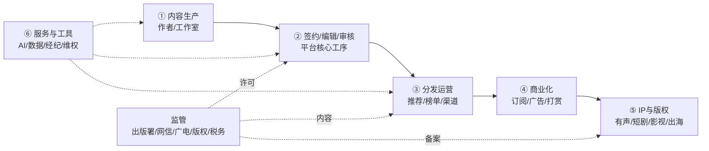
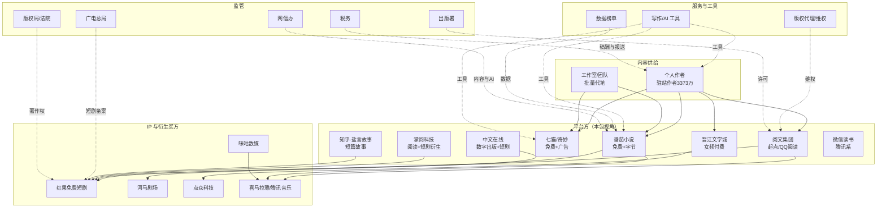
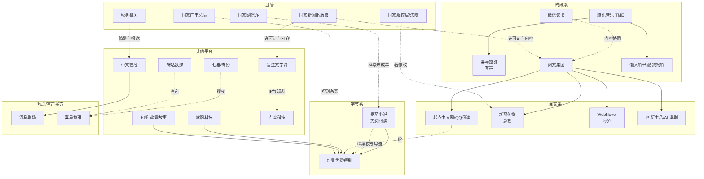

# 网络文学产业链总览（v0.1 · 公开源草稿）

> **这是工作假设，不是行业定论。** 分段方式、玩家归属、彼此关系都是按公开信息拼的，**客户的实际结构一定不同**——请拿它去被改（见文末待验证关系）。
> 信心：✅ 有公开源直接支撑 ／ ⚠️ 有源但可能过时/转述/口径不明 ／ ❓ 推断或未找到公开源
> 规划标注：**【公司自述】**（财报/官方稿原文）／**【媒体转述】**（媒体引用，未取原文）／**【推断】**（我推的）
> 与 `players.md`（单家画像）、`value-chain.md`（钱与成本）、`flow.md`（流程与审批）互补，不重复。

---

## 1. 产业链总览：每段在干啥（大白话版）

先记一句话：这条链是「**作者写 → 平台签/编/审 → 分发 → 收钱 → 卖 IP**」，外加卖工具的和管牌照的。

| # | 这一段 | 大白话：在干啥 | 谁在忙 | 钱/物怎么流 | 卡在哪 |
|---|---|---|---|---|---|
| ① | 内容生产 | 作者日更连载，编辑策划选题、约稿；工作室批量代笔 | 个人作者、工作室、平台编辑 | 平台付稿酬/保底/分成给作者 [S24] | 同质化、断更、AI 洗稿 [S01][S10] |
| ② | 签约/编辑/审核 | 签合同、跟稿、审内容，决定一本书能不能上 | 编辑、审核、法务、运营 | 平台内部成本；持证主体须有审校制度 [S13] | 审核人效与合规风险 ❓ |
| ③ | 分发运营 | 上架、给推荐位、冲榜、铺渠道，决定读者看不看得到 | 运营、算法、渠道商务 | 渠道分成与买量费用 ❓ | 推荐位稀缺、榜单规则不透明 ❓ |
| ④ | 商业化 | 付费订阅、免费广告、打赏月票，把注意力变成钱 | 商业化/广告/会员团队 | 读者与广告主的钱进平台 [S01] | 付费与免费两套 KPI 打架 ❓ |
| ⑤ | IP 与版权 | 把跑出来的书授权给有声、短剧、影视、动漫、出版、出海 | 版权/IP 运营、外部制作方 | 版权金与分成进平台，再与作者分 [S01][S05] | 授权链长、账期与分成口径 ❓ |
| ⑥ | 服务与工具 | 卖写作工具、AI 翻译、数据榜单、经纪与维权 | 工具厂商、数据方、MCN、代理所 | 服务费/订阅费 | 同质化、与平台自研冲突 ❓ |
| ⑦ | 监管 | 发牌照、定内容红线、管备案与税务 | 出版署、网信办、广电总局、版权局、税务 | 不产生收入，但能否决业务 | 规则更新快（AI/微短剧）[S19][S12] |

---

## 2. 一眼看懂：谁在链上哪个位置

---

## 3. 玩家总表（14 家/类，详见 `players.md`）

| 玩家 | 角色 | 现状 | 近 12 个月动作 | 未来规划 | 信心 | 来源 |
|---|---|---|---|---|---|---|
| 阅文集团 | 综合平台·付费+IP 龙头 | 港股 00772；2025 营收 73.66 亿元、年内亏损 7.76 亿元；在线 40.47 亿、版权 31.92 亿 | 2025 年报：IP 衍生品 GMV 破 11 亿元、AI 漫剧收入超 1 亿元；WebNovel AI 翻译作品超 1.7 万部 | 【公司自述】长青内容、IP+AI、全球化三大战略 | ✅ | S05、S06 |
| 番茄小说 | 免费阅读·字节系 | 非上市；2025-09 MAU 2.45 亿；签约作者超 60 万（2024-12 口径） | 2024-12 创作者大会宣布 2025 年投 2 亿现金扶持精品；与优酷启动超级 IP 共创 | 【媒体转述】继续免费+扶持+IP 授权 | ⚠️ | S09、S23 |
| 晋江文学城 | 女频·付费订阅 | 非上市；签约 16 家反洗稿平台之一；营收/用户未公开 | 2025-04 参与发布《网络文学行业反洗稿自律公约》 | ❓ 未找到公开规划 | ⚠️ | S10 |
| 七猫（七猫免费小说/奇妙） | 免费阅读·广告模式 | 非上市；2025-09 MAU 7656 万；累计服务用户超 7 亿（平台口径） | 2025-02 签约政策升级：保底+超保底分成/纯分成，保底千字 20—1000 元 | 【公司自述】"免费看书 100 年"，保底+分成扩作者 | ⚠️ | S09、S24 |
| 中文在线 | 数字出版+短剧出海 | A 股 300364；2025 营收 16.57 亿元（+42.92%），短剧及 IP 衍生 8.96 亿元、境外 6.79 亿元 | 2025-04 上线海外短剧平台 FlareFlow；逍遥 AI 服务 5 万+创作者 | 【公司自述】"AI First"、成为短剧行业 Netflix | ✅ | S07 |
| 掌阅科技 | 阅读+短剧衍生 | A 股 603533；2025 营收 32.43 亿元（+25.53%），归母净利 -1.76 亿元；短剧等衍生 18.55 亿元（+139.19%） | 2025 年报：业务重心向短剧等衍生倾斜 | 【媒体转述】继续衍生业务转型 | ⚠️ | S08 |
| 知乎·盐言故事 | 社区+短篇故事付费 | 美股 ZH/港股 2390；2025 营收 27.5 亿元、Non-GAAP 全年盈利 3790 万元；Q4 付费阅读 3.34 亿（51.8%） | 2025Q4：月均订阅会员 1220 万；IP 版权收入同比增超 5 倍、版权收益作者增 6 倍 | 【公司自述】强化 AI 漫剧布局 | ✅ | S16 |
| 微信读书（腾讯） | 阅读分发·腾讯系 | 非独立上市；注册用户超 2 亿、月活超 1.2 亿（评论文章引用） | 无独立公开财报动作 | ❓ 与阅文内容协同方式待验证 | ⚠️ | S27 |
| 喜马拉雅 | 有声平台 | 2026-05 成为腾讯音乐全资子公司；曾拥有超 3 亿全场景月活 | 2026-05 交割，对价含不超 12.6 亿美元现金+不超 1.75 亿股 TME A 类股 | 【媒体转述】与腾讯音乐长音频整合 | ⚠️ | S17 |
| 腾讯音乐（TME） | 音频生态·收购方 | 美股/港股上市；已布局懒人听书、酷我畅听 | 2026-05 完成收购喜马拉雅；市监总局附加限制性条件批准 | 【公司自述】长音频整合与 AI 技术赋能 | ⚠️ | S17 |
| 红果免费短剧（字节） | 免费短剧·IP 买方 | 非上市；2025-09 MAU 2.36 亿（+93.9%），仅次于腾讯视频/爱奇艺/芒果 TV | 与番茄重合用户 8726 万（+80.3%），"阅读—观看"闭环 | 【推断】继续承接番茄 IP 短剧化 | ⚠️ | S09 |
| 河马剧场 | 免费短剧 | 非上市；2025-09 MAU 5158 万（+99.4%） | 用户快速增长 | ❓ 未找到公开规划 | ⚠️ | S09 |
| 点众科技 | 短剧+网文·IP 买方 | 非上市；反洗稿 16 家平台之一；北京市属备案平台之一 | 参与 2025-04 反洗稿公约；短剧备案 | ❓ | ⚠️ | S10、S12 |
| 咪咕数媒 | 运营商系阅读/有声 | 非上市；中国移动系；反洗稿 16 家平台之一 | 参与 2025-04 反洗稿公约 | ❓ | ⚠️ | S10 |

**补充（待验证）**：WebNovel（阅文海外平台，AI 翻译作品超 1.7 万部 [S06]）、FlareFlow（中文在线海外短剧平台，200+国家/14+语种/3300 万注册 [S07]）、纵横中文网、磨铁文学、连尚文学、书旗中文网、长江中文网、联通沃悦读、趣阅小说网（均为反洗稿 16 家成员 [S10]）。

---

## 4. relations 表（10 条，带证据与信心）

| from | to | 关系类型 | 证据 | 信心 | 来源 |
|---|---|---|---|---|---|
| 阅文集团 | 新丽传媒 | 全资子公司（影视制作） | 2025 年因新丽传媒商誉减值 18 亿元 | ✅ | S05 |
| 腾讯音乐 | 喜马拉雅 | 全资收购（2026-05 交割） | 不超 12.6 亿美元现金 + 不超 1.75 亿股 TME A 类股；市监总局附加限制性条件批准 | ✅ | S17 |
| 字节跳动 | 番茄小说 / 红果短剧 | 同属（推断） | 媒体称"抖音旗下番茄免费小说"；番茄与红果重合用户 8726 万 | ⚠️ | S09 |
| 阅文集团 | WebNovel | 海外阅读平台（自营） | AI 翻译作品超 1.7 万部、贡献平台超 1/3 总营收、收入同比 +39% | ✅ | S06 |
| 中文在线 | FlareFlow | 海外短剧平台（自营） | 2025-04 上线；覆盖 200+国家、14+语种、注册超 3300 万 | ✅ | S07 |
| 知乎 | 盐言故事 | 自有原创故事平台 | 以盐言故事打造"内容—IP—多场景"路径 | ✅ | S16 |
| 16 家网文平台 | 反洗稿联盟 | 行业自律联合体 | 中国音数协指导，阅文承办；16 家共同发布公约 | ✅ | S10 |
| 番茄小说 | 优酷 | IP 共创合作 | 优酷副总裁在番茄创作者大会宣布"超级 IP 共创计划" | ⚠️ | S23 |
| 掌阅科技 | 短剧等衍生业务 | 自营业务延伸 | 2025 年短剧等衍生营收 18.55 亿元、同比 +139.19% | ✅ | S08 |
| 阅文/番茄/掌阅/中文在线等 | 红果/河马/点众 | IP 授权与短剧改编（推断） | 行业报告称 2025 年 IP 改编增量主要来自短剧与 AI 漫剧；具体授权关系未逐一披露 | ❓ | S01 |

---

## 5. 玩家关系图（推断，方框内为角色）

---

## 6. 待验证关系（请客户/一线补）

| # | 我画的关系 | 不确定点 | 找谁问 |
|---|---|---|---|
| 1 | 平台 ↔ 作者是"签约合作"不是雇佣 | 客户是签劳动合同、合作协议还是经纪约？ | 法务/作者运营 |
| 2 | 客户 ↔ 短剧方是"授权"还是"联合出品" | 有无投资分成、是否参与制作 | 版权/IP 负责人 |
| 3 | 客户 ↔ 有声平台是"授权金"还是"分成" | 独家 vs 非独家、账期 | 版权商务 |
| 4 | 客户 ↔ 应用商店/渠道的分成比例 | 30%？50%？有无特殊协议 | 渠道商务/财务 |
