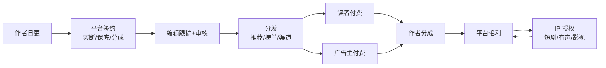

# 第 1 步产出：价值链草图（抽样）

> 目标不是画全，是**画出"钱从哪来、成本压在哪、哪一步会卡死"**。完整版见 `../value-chain.md`。

## 1. 草图

## 2. 三条钱流（我理解的）

| # | 谁付钱 | 付给谁 | 单价/口径 | 信心 |
|---|---|---|---|---|
| 1 | 读者 | 平台 | 按章订阅/会员；行业订阅 159.95 亿元 [S01] | ✅ 行业盘 |
| 2 | 广告主 | 平台 | 行业广告 274.49 亿元，已是第一大收入 [S01] | ✅ 行业盘 |
| 3 | 短剧/有声/影视方 | 平台→作者 | 版权金/保底+分成；行业版权 117.01 亿元 [S01] | ⚠️ 单笔条款未知 |

## 3. 成本压在哪儿（排序是猜的）

1. 内容成本：稿酬+保底+分成；保底是预付款，坏账风险大 ❓
2. 流量获取：应用商店分成、买量；短剧端投流占总成本 80% 以上 [S12]，阅读端待验证 ❓
3. 审核与编辑人力：机审系统+人审，无法从公开源估算 ❓
4. 技术与带宽：推荐、存储、AI 推理 ❓

## 4. 五个我填不出来的数字（下一步要问）

| # | 缺的数 | 为什么重要 |
|---|---|---|
| 1 | 客户四块收入占比 | 决定增长靠哪个引擎 |
| 2 | 作者成本占收入比 | 保底坏账是利润黑洞 |
| 3 | 获客成本与渠道分成 | 免费模式单位经济的地基 |
| 4 | 审核人效（人/天多少万字） | 内容供给扩张的隐性天花板 |
| 5 | 单部 IP 授权金额与账期 | IP 业务的现金流 |
