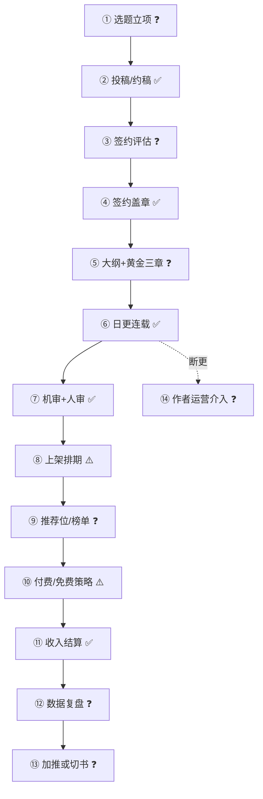

# 第 3 步产出：流程图 + 待验证 Top 3（抽样）

> 每节点标 ✅/⚠️/❓；❓ 就是要拿去被改的地方。完整版见 `../flow.md`、`../verification-list.md`。

## 1. 新书从投稿到变现（压缩版）

## 2. 节点信心表（节选）

| # | 节点 | 主要活动 | 输出物 | 信心 | 依据/待验证 |
|---|---|---|---|---|---|
| ① | 选题立项 | 看榜、定方向 | 选题单 | ❓ | 无公开 SOP |
| ③ | 签约评估 | 评题材/更新/合规 | 评估结论 | ❓ | 维度未知 |
| ④ | 签约盖章 | 三类合同+用印 | 合同 | ✅ | 三类模式公开 [S24] |
| ⑥ | 日更连载 | 日更+催更+全勤 | 章节 | ✅ | 全勤规则公开 [S24] |
| ⑦ | 机审+人审 | 敏感词+复审 | 审核记录 | ✅ | 审校制度 [S13] |
| ⑨ | 推荐位/榜单 | 算法+人工推荐 | 曝光 | ❓ | 规则不公开 |
| ⑫ | 数据复盘 | 追读/完读/留存 | 复盘报告 | ❓ | 指标定义未知 |

## 3. 待验证 Top 3（完整 15 条见 `../verification-list.md`）

| # | 待验证项 | 风险 | 成本 | 一句话 |
|---|---|---|---|---|
| 1 | 收入四块口径 | 5 | 1 | 分母错了后面全错 |
| 2 | 持证主体与许可证边界 | 5 | 1 | 决定业务合不合法 |
| 3 | 首订/均订/追读/完读率定义 | 4 | 1 | 名字一样、算法不同 |
