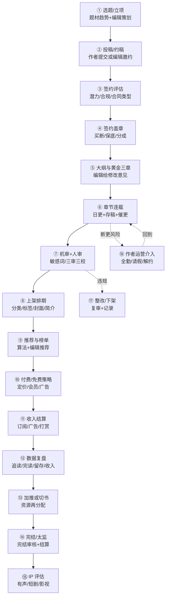
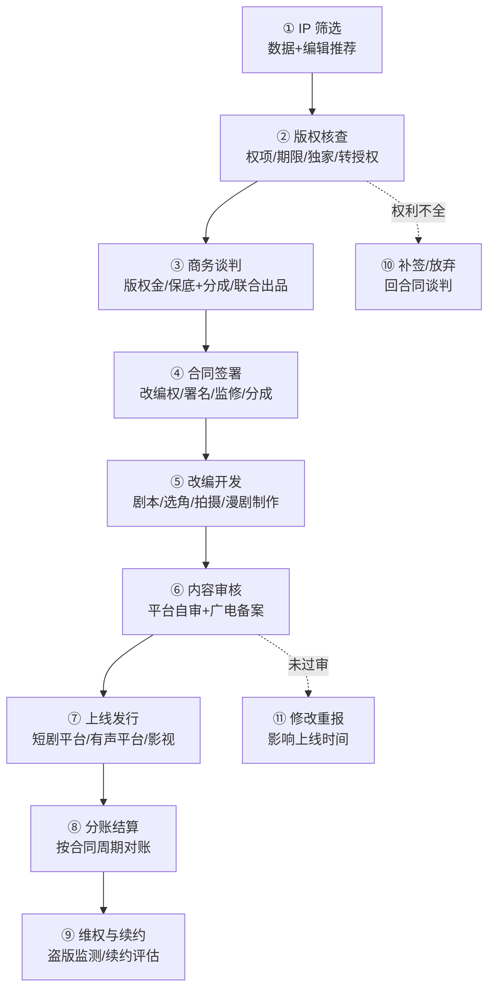
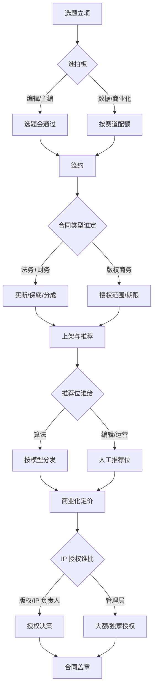

# 平台业务流程图（v0.1 · 带信心标记）

> **这是本包最该被改的文件。** 每个节点标了信心等级，文末汇总成待验证清单候选。
> ✅ 有来源 ／ ⚠️ 有来源但可能过时或口径不明 ／ ❓ 我猜的
> 用法：打印出来，逐节点问一线："这个顺序对吗？哪一步其实不是这样？"

---

## 1. 主流程 A：一本书从投稿到变现

### 节点信心表（流程 A）

| # | 节点 | 主要活动 | 输出物 | 信心 | 依据 / 待验证 |
|---|---|---|---|---|---|
| ① | 选题/立项 | 编辑根据榜单、题材趋势、竞品定方向 | 选题单/立项表 | ❓ | 行业通行做法，无公开 SOP；客户是否设"立项会"待验证 |
| ② | 投稿/约稿 | 作者后台投稿或编辑定向约稿 | 稿件/样章 | ✅ | 七猫公开"投稿/签约"政策 [S24] |
| ③ | 签约评估 | 看题材、更新能力、历史成绩、合规风险 | 评估结论 | ❓ | 评估维度与打分表未知 |
| ④ | 签约盖章 | 选合同类型，走法务/用印 | 合同 | ✅ | 三类签约模式公开 [S24]；须有编辑责任制度 [S13] |
| ⑤ | 大纲与黄金三章 | 编辑给结构/节奏/人设意见 | 修改稿 | ❓ | 行业叫法明确，但流程细节未知 |
| ⑥ | 章节连载 | 作者按日更节奏发布，平台催更、发全勤 | 连载章节 | ✅ | 全勤奖与请假规则公开 [S24] |
| ⑦ | 机审+人审 | 敏感词拦截、人工复审、抽检 | 审核记录 | ✅ | 内容审核责任制度 [S13]；生态治理 [S15] |
| ⑧ | 上架排期 | 分类、标签、封面、简介、首发时间 | 上架包 | ⚠️ | 平台公开"上架及推荐流程"存在 [S24]，细则未知 |
| ⑨ | 推荐与榜单 | 算法推荐、编辑推荐位、月票/畅销榜 | 曝光资源 | ❓ | 规则不公开；"算法推荐失衡"被行业报告点名 [S03] |
| ⑩ | 付费/免费策略 | 定章节价格、是否进会员、是否免费转广告 | 定价策略 | ⚠️ | 免费与付费模式并存 [S01][S24] |
| ⑪ | 收入结算 | 订阅分成、广告分成、打赏分成、全勤 | 稿酬单 | ✅ | 分成/保底/全勤规则公开 [S24]；平台报送义务 [S20] |
| ⑫ | 数据复盘 | 追读、完读、留存、ARPU 复盘 | 复盘报告 | ❓ | 指标定义各家不同，无公开口径 |
| ⑬ | 加推或切书 | 资源向头部倾斜或放弃 | 资源调整 | ❓ | 决策规则未知 |
| ⑭ | 完结/太监 | 完结审核、结尾质量判断、最终结算 | 完结状态 | ✅ | 七猫"烂尾完结"影响全勤的规则公开 [S24] |
| ⑮ | IP 评估 | 评估有声/短剧/影视改编潜力 | IP 评估表 | ❓ | 2025 年 IP 改编增量来自短剧和 AI 漫剧 [S01]，但评估标准未知 |
| ⑯ | 作者运营介入 | 断更提醒、请假、解约、心理与社群运营 | 运营记录 | ❓ | 全勤/请假规则公开 [S24]，干预流程未知 |
| ⑰ | 整改/下架 | 违规内容复审、整改、下架、上报 | 处置记录 | ✅ | 发现禁止内容须立即删除、保存记录并报告 [S13 第三十三条] |

---

## 2. 主流程 B：IP 授权 / 短剧改编

### 节点信心表（流程 B）

| # | 节点 | 主要活动 | 输出物 | 信心 | 依据 / 待验证 |
|---|---|---|---|---|---|
| ① | IP 筛选 | 用数据（阅读、完读、讨论度）挑可改编作品 | IP 池 | ❓ | 阅文有"版权助手"类工具 [S06]，客户是否用待验证 |
| ② | 版权核查 | 核对改编权、期限、地域、是否已独家授权 | 权项清单 | ✅ | 著作权法权项与许可合同 [S21] |
| ③ | 商务谈判 | 定版权金、保底+分成、是否联合出品 | 条款清单 | ⚠️ | 行业普遍"保底+分成"，具体比例不公开 ❓ |
| ④ | 合同签署 | 改编权、署名、监修、分成、违约责任 | 授权合同 | ✅ | 著作权许可/转让合同制度 [S21] |
| ⑤ | 改编开发 | 剧本、拍摄/制作、漫剧生产 | 成片/音频 | ⚠️ | 微短剧产业链公开 [S11]；AI 漫剧已工业化 [S05] |
| ⑥ | 内容审核 | 平台自审 + 微短剧备案（分层） | 备案号/上线许可 | ✅ | 微短剧分类分层审核 [S12]；AI 内容标识 [S19] |
| ⑦ | 上线发行 | 短剧平台/有声平台/电视台/海外 | 上线 | ⚠️ | 红果/河马等短剧平台月活数据 [S09] |
| ⑧ | 分账结算 | 按合同周期对账、开票、分成 | 结算单 | ❓ | 账期与分成基数未知 |
| ⑨ | 维权与续约 | 盗版监测、下架、诉讼、续约 | 维权记录 | ❓ | 维权成本与胜诉率未知 |
| ⑩ | 补签/放弃 | 权利不全时补签或放弃 | 决策 | ❓ | 推断 |
| ⑪ | 修改重报 | 未过审时修改重报 | 新版本 | ⚠️ | 备案未过需重报，媒体有类似表述 [S12] |

---

## 2.1 流程覆盖矩阵（8 域 × 本文流程）

| 业务域 | 主流程 A（新书） | 主流程 B（IP） | 审批链 |
|---|---|---|---|
| D1 内容生产/作者运营 | ①—⑥、⑬—⑯ | — | 选题谁拍板 |
| D2 签约与合同 | ③—④ | ②—④ | 合同谁定 |
| D3 审核与合规 | ⑦、⑰ | ⑥、⑪ | 审核/备案谁签 |
| D4 分发运营 | ⑧—⑨ | — | 推荐位谁给 |
| D5 商业化 | ⑩—⑪ | — | 定价谁批 |
| D6 版权与 IP | ⑮ | ①—⑪ | IP 授权谁批 |
| D7 数据与风控 | ⑫ | ① | — |
| D8 财务结算与税务 | ⑪、⑭ | ⑧ | — |

> 空格（—）不是"没有流程"，而是**本文没画**：客户那边一定有，但我没有公开源，留给你现场补。

---

## 3. 审批 / 决策链（另一张图）

**审批链上的四个待验证问题**：
1. **选题谁拍板**：编辑主编会？还是数据/商业化定赛道配额？❓
2. **合同谁定**：法务主导还是版权商务主导？买断/保底的审批权限在哪一级？❓
3. **推荐位谁给**：算法与编辑的权限边界；人工推荐位有没有配额与审批？❓
4. **IP 授权谁批**：多大金额/是否独家需要管理层签？❓

---

## 4. 时间轴：一本书的典型生命周期（推断）

| 阶段 | 时间 | 关键动作 | 证据 |
|---|---|---|---|
| 签约到上架 | 数天—数周 | 评估、盖章、上架排期 | ❓ 推断 |
| 上架到"出均订" | 2—4 周 | 曝光测试、追读验证 | 七猫全勤规则出现"前 2 个月""出均留"等节点 [S24] |
| 稳定连载 | 数月—数年 | 日更、推荐、月票、打赏 | 行业通行 [S24] |
| 完结/太监 | 视成绩 | 完结审核、最终结算 | "烂尾完结"影响全勤的规则 [S24] |
| IP 改编 | 6 个月—数年 | 筛选、授权、制作、备案、上线 | 微短剧备案与制作周期 [S12] |

**推断（请客户确认）**：阅读主业的节奏是"**天**"（日更/审核/榜单），IP 业务的节奏是"**月—年**"（授权/制作/备案/分账）。**用一套项目管理方法管这两件事，一定有一边不适配。**

---

## 5. 汇总：流程断点候选（进 verification-list）

| # | 断点 | 为什么可疑 | 问谁 |
|---|---|---|---|
| 1 | 签约合同与版权台账不同步 | "全版权"签了，但具体权项/期限没进系统 | 法务/版权 |
| 2 | 审核通过 ≠ 推荐安全 | 推荐会放大风险，运营与审核目标冲突 | 审核/运营 |
| 3 | 三套收入三套账期 | 订阅/广告/打赏结算周期不同，作者只看到一个月度数 | 财务/结算 |
| 4 | 免费与付费同书策略 | 同一本书两种商业模式，作者分成口径容易打架 | 商业化/编辑 |
| 5 | AI 辅助写作的责任边界 | 标识义务 vs 作者原创声明 vs 平台审核 | 法务/审核 |
| 6 | 短剧备案主体 | 平台备案还是制作方备案，决定 IP 授权合同条款 | 版权/法务 |

---

## 6. 拿流程图去问的三句话

1. "这个顺序里，**哪一步其实可以并行**？"（流程图常被画成串行）
2. "**哪一个节点会卡最久**？"（找瓶颈，不是找全）
3. "**哪个节点没有系统、靠人记**？"（数字化切口）
