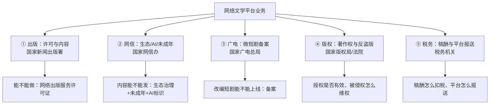

# 监管文件目录（v0.1 · 只到"知道去哪查"的程度）

> 用途：FDE 不需要读懂条文，但必须知道**客户哪句话背后是哪份文件**。
> 判读方式：客户说"这个要报批""这个不能写""这个能拿钱"——在右列找对应文件，再决定要不要深读。
> 信度：✅ 我打开了原文 ／ ⚠️ 打开了但只是新闻/转载/摘要 ／ ❓ 未找到可打开的公开源（见文末）

---

## 0. 一张图：五条监管线

---

## 1. 出版：许可、内容与年度核验

| 名称 | 发布机关 | 文号/年份 | 管什么 | 对客户意味着什么 | 链接 | 信度 |
|---|---|---|---|---|---|---|
| 网络出版服务管理规定 | 国家新闻出版广电总局、工业和信息化部 | 总局令第 5 号，2016-03-10 施行 | 网络出版服务许可、编辑责任制度、内容禁止条款、年度核验 | **总纲**：做网文平台须持《网络出版服务许可证》；许可证有效期 5 年；须有内容审校制度与 8 名以上专职编辑出版人员（中级以上不少于 3 名） | [S13](https://www.gov.cn/zhengce/2022-11/09/content_5724634.htm) | ✅ |
| 出版业发展"十五五"规划 | 国家新闻出版署 | 2026 年印发（答记者问 2026-09-22） | 精品供给、深度融合发展、国际传播、人才队伍 | 客户"十五五"内容规划与数字化投入的上级依据；**规划全文未取得，只读了答记者问** | [S26](https://www.nppa.gov.cn/xxfb/ywxx/202609/t20260922_1009390.html) | ⚠️（答记者问） |
| 年度中国网络文学发展报告 | 中国音像与数字出版协会（行业主管指导下） | 2025 年度报告，2026-10-15 发布 | 行业统计口径、市场规模、出海、IP、AI 应用 | **行业口径的"标准答案"**：营收 574.72 亿元、用户 6.46 亿等均出自此报告；客户对外汇报常用它 | [S01](https://www.nppa.gov.cn/xxfb/ywdt/202610/t20261016_1012682.html) | ✅ |
| 中国"网络文学+"大会（行业活动） | 北京市委宣传部、中国音数协、中国作协网络文学中心等 | 2026-10-15 第九届 | 行业表彰、报告发布、版本馆入藏 | 观察监管风向与平台动作的窗口；**不是法规** | [S02](https://cflac.org.cn/new_zixun/202610/t20261016_1371726.html) | ⚠️（媒体报道） |

**关键条文备忘（可直接引用）**：
- 网络出版服务：通过信息网络向公众提供具有编辑、制作、加工等出版特征的数字化作品 [S13 第二条]。
- 许可条件：确定的域名/平台、服务范围、技术设备（服务器须在境内）；专职编辑出版人员 8 名以上、中级以上不少于 3 名；法定代表人或主要负责人至少 1 人具中级以上出版专业职业资格 [S13 第八、九条]。
- 编辑责任制度、内容审核责任制度、责任编辑制度、责任校对制度 [S13 第二十三条]。
- 年度核验每年一次，内容包括设立条件、出版经营、出版质量、内部管理 [S13 第三十八、三十九条]。

---

## 2. 网信：内容生态、未成年人与 AI

| 名称 | 发布机关 | 文号/年份 | 管什么 | 对客户意味着什么 | 链接 | 信度 |
|---|---|---|---|---|---|---|
| 网络信息内容生态治理规定 | 国家互联网信息办公室 | 网信办令第 5 号，2020-03-01 施行 | 内容生产者/平台责任、违法与不良信息、算法推荐治理 | 客户说"这个题材不能写""要有正能量"时，先找这份；**平台对跟帖/评论也担责** | [S15](https://www.gov.cn/zhengce/zhengceku/2020-11/25/content_5564110.htm) | ✅ |
| 未成年人网络保护条例 | 国务院 | 国令第 766 号，2024-01-01 施行 | 未成年人模式、防沉迷、消费限制、平台义务 | 付费阅读/打赏必须能限制未成年人消费；"未成年人模式"是产品硬需求 | [S14](https://www.gov.cn/zhengce/content/202310/content_6911288.htm) | ✅ |
| 生成式人工智能服务管理暂行办法 | 网信办等七部门 | 第 15 号令，2023-08-15 施行 | 生成式 AI 服务、训练数据与内容责任、分类分级监管 | 客户若用 AI 生成/辅助写作或对公众提供 AI 服务，落在本办法范围内 | [S22](https://www.gov.cn/gongbao/2023/issue_10666/202308/content_6900864.html) | ✅ |
| 人工智能生成合成内容标识办法 | 网信办、工信部、公安部、广电总局 | 国信办通字〔2025〕2 号，2025-03-07 | AI 生成合成内容的显式/隐式标识义务 | **AI 辅助写作/AI 漫剧/AI 配音都要能标识**；客户说"我们只是辅助"时要分清"生成"与"辅助"边界 | [S19](https://www.gov.cn/zhengce/zhengceku/202503/content_7014286.htm) | ✅ |

---

## 3. 广电：微短剧备案

| 名称 | 发布机关 | 文号/年份 | 管什么 | 对客户意味着什么 | 链接 | 信度 |
|---|---|---|---|---|---|---|
| 关于微短剧备案最新工作提示（分类分层审核） | 国家广播电视总局 | 2024-06-01 起施行（媒体转述） | 微短剧备案与上线审核 | **IP 改编短剧的第一道闸**：投资 100 万元以上由总局审核；30 万—100 万由省级广电审核；30 万以下由播出/引流平台履行内容管理；未审核备案不得上网传播 | [S12](http://www.news.cn/ent/20240620/868fcc925d7347069000cbd32cee483d/c.html) | ⚠️（媒体转述，未取总局原文） |
| 网络视听节目备案系统 | 国家广播电视总局 | 系统 | 备案提交、上线备案号 | 客户做短剧/漫剧要有备案流程与责任人；2024-06-01 当日备案 3309 部、约 22.7 万集 | [S12](http://www.news.cn/ent/20240620/868fcc925d7347069000cbd32cee483d/c.html) | ⚠️ |

**未纳入本表的**：微短剧 2025—2026 年是否出台新的分层口径（"广电 21 条"等说法在媒体出现），**本次未取得原文，标待验证** ❓。

---

## 4. 版权：著作权与反盗版

| 名称 | 发布机关 | 文号/年份 | 管什么 | 对客户意味着什么 | 链接 | 信度 |
|---|---|---|---|---|---|---|
| 中华人民共和国著作权法 | 全国人大常委会 | 2020-11-11 第三次修正 | 作品定义、信息网络传播权、许可与转让合同 | **签约合同的总依据**：授权范围、期限、地域、独家/非独家、转授权都要写清；客户说"全版权"时要对照"信息网络传播权"等具体权项 | [S21](https://www.gov.cn/guoqing/2021-10/29/content_5647633.htm) | ✅ |
| 网络文学行业反洗稿自律公约 | 中国音数协 + 16 家平台 | 2025-04-28 发布 | AI 辅助创作边界、洗稿认定、反洗稿联盟 | **行业自律不是法律**，但它定义了"平台怎么认定洗稿"；客户若在 16 家名单内，内部应有对应规则 | [S10](https://www.chinawriter.com.cn/n1/2025/0430/c404023-40471794.html) | ✅ |
| 剑网行动（版权专项整治） | 国家版权局等 | 每年一次（2025 年为"剑网 2025"） | 视听、动漫等重点作品版权整治 | 客户被侵权时的主要行政救济渠道之一；**本次未打开官方原文** | — | ❓ |
| 信息网络传播权保护条例 | 国务院 | 2006 年（后续修订待核实） | 通知—删除、避风港规则 | 客户处理盗版链接/平台投诉的规则基础；**未取得原文** | — | ❓ |

---

## 5. 税务：稿酬与平台报送

| 名称 | 发布机关 | 文号/年份 | 管什么 | 对客户意味着什么 | 链接 | 信度 |
|---|---|---|---|---|---|---|
| 互联网平台企业涉税信息报送规定 | 国务院 | 国令第 810 号，2025-06-20 公布并施行 | 平台向税务机关报送平台内经营者/从业人员身份信息、收入信息 | **平台必须报送作者收入信息**；客户结算系统要能出"人—收入—期间"的报送口径 | [S20](https://www.gov.cn/zhengce/zhengceku/202506/content_7029053.htm) | ✅ |
| 个人所得税法及稿酬所得预扣规则 | 全国人大/税务总局 | 待验证 | 稿酬所得计税、预扣预缴 | 作者最关心"到手多少"；平台代扣方式直接影响作者体验与合规 | — | ❓（未找到一手原文） |
| 增值税（数字内容/信息服务） | 财政部/税务总局 | 待验证 | 平台与作者开票、税率 | 分成结算时"含税/不含税"口径必须写死 | — | ❓ |

---

## 6. 客户嘴里的话 → 对应文件（速查）

| 客户说 | 大概率对应 |
|---|---|
| "我们有网络出版许可证" | S13（许可证、年度核验）；追问"证在哪个法人名下、业务范围含不含网络文学" |
| "作者签的是合作协议/经纪约" | S21（著作权许可/转让）+ 合同文本；追问"独家/非独家、期限、地域、转授权" |
| "这本书要卖短剧" | S12（备案主体与投资额分层）+ S21（改编权） |
| "AI 只是辅助，不算生成" | S19（标识义务）+ S10（反洗稿认定）；追问"AI 参与比例、是否对外披露" |
| "未成年人充值要退" | S14（消费限制、未成年人模式） |
| "作者稿费我们代扣代缴" | S20（平台报送）+ 个税规则 |
| "这个题材不能写" | S15（生态治理）+ S13 第二十四条（禁止内容）+ 平台内部审稿细则 |
| "行业规模 574 亿" | S01（2025 年度网文报告）；注意与 S03 数字阅读口径不同 |

---

## 7. 未找到公开源、需要客户/同行补的（进 verification-list）

1. **网络文学内容审核的细化标准**：出版署/网信办历年专项行动通报的具体口径，未取得原文。
2. **微短剧 2025—2026 新规**：只看到媒体提及"松绑/提效"，未取得总局原文。
3. **稿酬个税预扣的具体计算口径**：未找到可引用的官方操作文件。
4. **信息网络传播权保护条例现行版本**：未核对最新修订。
5. **网络文学平台"总编辑负责制"的实际要求**：公开文件中只见编辑责任制度，未见网文专项细则。

---

## 8. 监管时间轴（2016 → 2026，只列与本包相关的）

| 时间 | 文件/事件 | 管什么 | 来源 |
|---|---|---|---|
| 2016-03 | 网络出版服务管理规定施行 | 许可、编辑责任、年度核验 | S13 |
| 2019-12 | 网络信息内容生态治理规定公布（2020-03 施行） | 内容生态、平台责任 | S15 |
| 2020-11 | 著作权法第三次修正 | 作品、信息网络传播权 | S21 |
| 2023-07 | 生成式人工智能服务管理暂行办法公布（2023-08 施行） | 生成式 AI 服务 | S22 |
| 2023-10 | 未成年人网络保护条例公布（2024-01 施行） | 未成年人模式、消费限制 | S14 |
| 2024-06 | 微短剧分类分层审核/备案施行 | 短剧上线闸门 | S12 |
| 2025-03 | 人工智能生成合成内容标识办法印发 | AI 内容标识 | S19 |
| 2025-04 | 网络文学行业反洗稿自律公约发布 | AI 辅助创作与洗稿 | S10 |
| 2025-06 | 互联网平台企业涉税信息报送规定施行 | 平台报送作者收入 | S20 |
| 2026-09 | 出版业发展"十五五"规划印发 | 内容供给与融合发展 | S26 |
| 2026-10 | 2025 年度中国网络文学发展报告发布 | 行业口径与政策风向 | S01 |

---

## 9. 三条红线与客户合规自检清单

> 这三条是 FDE 最容易在方案里踩到的（推断 + 公开源支撑），不是法律意见。

1. **无证从事网络出版服务**：平台须持《网络出版服务许可证》，未批准擅自从事会被取缔、罚款 [S13]。→ 先确认持证主体。
2. **内容违规不处置**：发现禁止内容须立即删除、保存记录并报告 [S13]；生态治理规定还要求平台对违法与不良信息负责 [S15]。→ 审核流程必须有"发现—处置—留痕—上报"闭环。
3. **AI 生成内容不标识**：2025 年标识办法要求显式/隐式标识 [S19]；微短剧还要过备案 [S12]。→ AI 漫剧/配音/封面都要能标识。

| # | 自检项 | 去哪找依据 | 客户常见回答 |
|---|---|---|---|
| 1 | 持证主体与业务范围 | S13 | "证在集团/合作方名下" ❓ |
| 2 | 内容审核制度与责任人 | S13 | "有审核部" ❓ |
| 3 | 未成年人模式与消费限制 | S14 | "做了青少年模式" ❓ |
| 4 | AI 内容标识与使用声明 | S19、S10 | "AI 只是辅助" ❓ |
| 5 | 短剧备案流程 | S12 | "制作方去备" ❓ |
| 6 | 版权授权台账 | S21 | "合同都在法务" ❓ |
| 7 | 平台涉税信息报送 | S20 | "财务在弄" ❓ |
| 8 | 年度核验材料 | S13 | "每年都过" ❓ |
