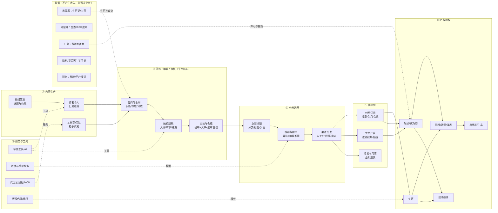
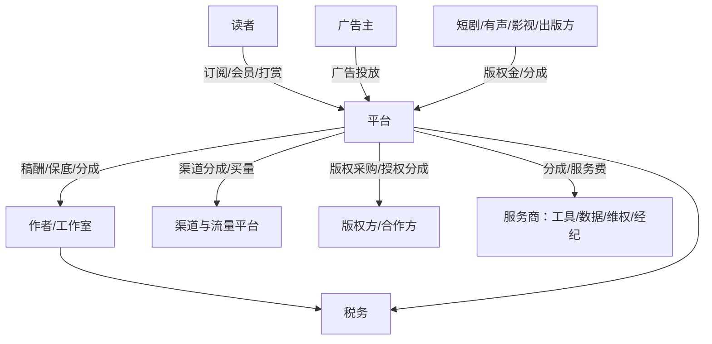

# 网络文学价值链草图（v0.1 · 公开源）

> 用法：这张图是**用来被改的**。每个环节只给 1—3 个敢标来源的数字，其余是结构占位。
> 符号：✅ 有来源 ／ ⚠️ 有来源但可能过时或口径不明 ／ ❓ 推断，请客户纠正。
> 本文件回答三件事：**钱从哪来、成本压在哪、哪一步会卡死**。玩家关系见 `chain.md`，环节明细见 `activities.md`。

---

## 1. 一张图：内容 → 钱 → IP

---

## 2. 钱怎么流：三条主链 + 一条暗线

| # | 谁付钱 | 付给谁 | 计价方式 | 数字/证据 | 信心 |
|---|---|---|---|---|---|
| 1 | 读者 | 平台 | 按章订阅、包月/会员、打赏、月票 | 2025 年订阅收入 159.95 亿元 [S01]；数字阅读大众阅读订阅 165.52 亿元 [S03] | ✅ 行业盘，⚠️ 客户内部分成未知 |
| 2 | 广告主 | 平台 | CPM/CPC/激励视频分成 | 2025 年广告收入 274.49 亿元，占 47.8% [S01] | ✅ 行业盘 |
| 3 | 短剧/有声/影视/出版方 | 平台 → 作者 | 版权金、保底+分成、买断 | 2025 年版权收入 117.01 亿元 [S01]；IP 改编 91392 部 [S01] | ✅ 行业盘，❓ 单笔条款未知 |
| 4 | 平台 | 作者/工作室 | 千字稿酬、保底、分成、全勤奖 | 七猫公开：保底千字 20—1000 元，模式为"保底+超保底分成/纯分成/超级纯分成" [S24] | ⚠️ 单平台公开政策 |
| 5 | 平台 | 渠道/应用商店/投流 | 渠道分成、买量 | 微短剧"投流成本占总成本 80% 以上"（行业报道）[S12] | ⚠️ 短剧口径，阅读端待验证 |
| 6 | 平台/作者 | 税务 | 稿酬个税、平台代扣、涉税信息报送 | 2025-06 起平台须向税务机关报送平台内经营者/从业人员身份与收入信息 [S20] | ✅ 规则存在，❓ 客户执行口径 |

**暗线（最容易漏）**：**"免费"不是不赚钱，是换广告主付钱**。2025 年广告已超过订阅成为第一大收入项 [S01]，这意味着免费书的运营目标（曝光、完读、广告位效率）与付费书（首订、均订、留存）**是两套 KPI**，组织上通常也是两拨人。

---

## 3. 环节拆解（每段在忙什么、钱压在哪）

### 3.1 内容生产：供给极大、单本期望值极低

| 项 | 内容 | 数字/来源 |
|---|---|---|
| 谁在写 | 个人作者为主，工作室/团队承接批量代笔；平台编辑做选题与约稿 | 驻站作者 3373.02 万人 [S01]；番茄签约作者超 60 万、lv5 以上 2900 人、金番 39 人 [S23] |
| 收入分布 | 头部极少、长尾极大；平台用全勤/保底兜底 | 番茄：截至 2024-10 累计超 50 万作者获收入，9374 位年收入超 3 万、3228 位超 10 万 [S23] |
| 成本大头 | 稿酬/保底/分成 + 编辑人力 + 全勤奖 | 保底千字 20—1000 元 [S24]；具体总额待验证 ❓ |
| 瓶颈 | 同质化、断更/太监、AI 洗稿 | 2025 年报告点名内容同质化与洗稿侵权 [S01]；16 家平台签反洗稿公约 [S10] |

### 3.2 签约 / 编辑 / 审核：平台的"加工厂"，也是最大合规成本

| 项 | 内容 | 数字/来源 |
|---|---|---|
| 签约模式 | 买断（一次性）、保底（预付+超保底分成）、纯分成（无预付） | 七猫公开三类模式 [S24]；其他平台条款待验证 ❓ |
| 编辑动作 | 选题、大纲、黄金三章、章节审读、推荐位申请、催更 | 行业通行做法，无公开 SOP ❓ |
| 审核 | 机器敏感词 + 人工复审 + 三审三校；持证主体须有内容审校制度 | 网络出版服务须有内容审核责任制度、责任编辑制度 [S13] |
| 成本 | 编辑/审核人力、机审系统、复审返工 | 人效与单价**全部待验证** ❓ |

### 3.3 分发运营：推荐位与榜单是"注意力分配权"

| 项 | 内容 | 数字/来源 |
|---|---|---|
| 上架 | 分类/标签/封面/简介/首发章；免费书与付费书排期逻辑不同 | 结构推断 ❓ |
| 推荐 | 算法推荐 + 编辑推荐位 + 榜单（月票/畅销/新书） | 行业通行，规则不公开 ❓ |
| 渠道 | 自有 APP、小程序、应用商店、运营商、海外 APP | 头部 APP 月活：番茄 2.45 亿、七猫 7656 万 [S09] |
| 关键指标 | 曝光→点击→追读→完读→付费转化 | 口径与阈值待验证 ❓ |

### 3.4 商业化：付费与免费两套引擎

| 模式 | 钱从哪来 | 关键指标 | 证据 |
|---|---|---|---|
| 付费订阅 | 读者按章/包月 | 首订、均订、追读、留存 | 2025 年订阅 159.95 亿元 [S01] |
| 免费广告 | 广告主按曝光/点击/激励视频 | DAU、使用时长、广告填充率、eCPM | 2025 年广告 274.49 亿元 [S01] |
| 打赏/月票 | 读者为情绪/排名付费 | 打赏流水、月票数、榜单位置 | ❓ 平台与作者分成比例待验证 |
| 会员 | 打包多书/多权益 | 会员数、续费率 | 知乎月均订阅会员 1220 万 [S16]；喜马拉雅 3 亿月活 [S17] |

### 3.5 IP 与版权：从"卖字"到"卖改编权"

| 路径 | 谁买 | 变现方式 | 证据 |
|---|---|---|---|
| 有声 | 音频平台/自建 | 授权金、分成、联合出品 | 2025 年有声阅读市场 134 亿元 [S18]；喜马拉雅并入腾讯音乐 [S17] |
| 短剧/微短剧 | 短剧平台/制作方 | 版权金、保底+分成、联合出品 | 2024 年微短剧市场 504.4 亿元 [S11]；2025 IP 改编增量主要来自短剧 [S01] |
| 影视/动漫/漫剧 | 影视公司/平台 | 版权金、投资分成 | 阅文版权运营 31.92 亿元、AI 漫剧收入超 1 亿元 [S05] |
| 出版/衍生品 | 出版社/品牌方 | 版税、授权费 | 阅文 IP 衍生品 GMV 破 11 亿元 [S05] |
| 出海 | 海外平台/自建 | 订阅、广告、授权 | 海外市场 69.83 亿元、+45.03% [S01]；出海单部收益约为国内 5.72 倍 [S01] |

### 3.6 服务与工具

不持内容、卖能力：写作工具/AI（阅文"作家助手"、中文在线"逍遥AI" [S06][S07]）、数据榜单、代运营/经纪、版权代理/维权。谁在买：平台与作者；怎么收钱：服务费/订阅费。规模与格局**待验证** ❓。

---

## 4. 成本大头（排序是推断，请客户确认）

1. **内容成本**：稿酬+保底+分成，通常是与作者分成后的净额；免费模式下变成"按有效阅读/广告分成" ❓。
2. **流量获取**：应用商店分成、信息流买量；短剧端公开报道投流占总成本 80% 以上 [S12]，阅读端比例待验证 ❓。
3. **审核与编辑人力**：机审系统 + 人工复审 + 三审三校；无法从公开源估算 ❓。
4. **技术与带宽**：阅读 APP、推荐系统、AI 推理算力；AI 漫剧/翻译带来新增算力成本 [S05][S07]。
5. **版权采购/授权分成**：外采 IP、有声/短剧改编投资。
6. **税费与合规**：增值税、稿酬个税代扣、平台涉税报送的系统改造成本 [S20]。

---

## 5. 一句话总结（拿去问客户）

> "我理解这是一门**先用保底/全勤把海量连载囤起来、靠免费广告和付费订阅把读者留住、再把头部 IP 卖给短剧和有声**的生意；收入结构已经从'订阅+版权'转向'广告最大、版权第二、订阅第三' [S01]。**这个理解对吗？你们家是哪一档？**"
