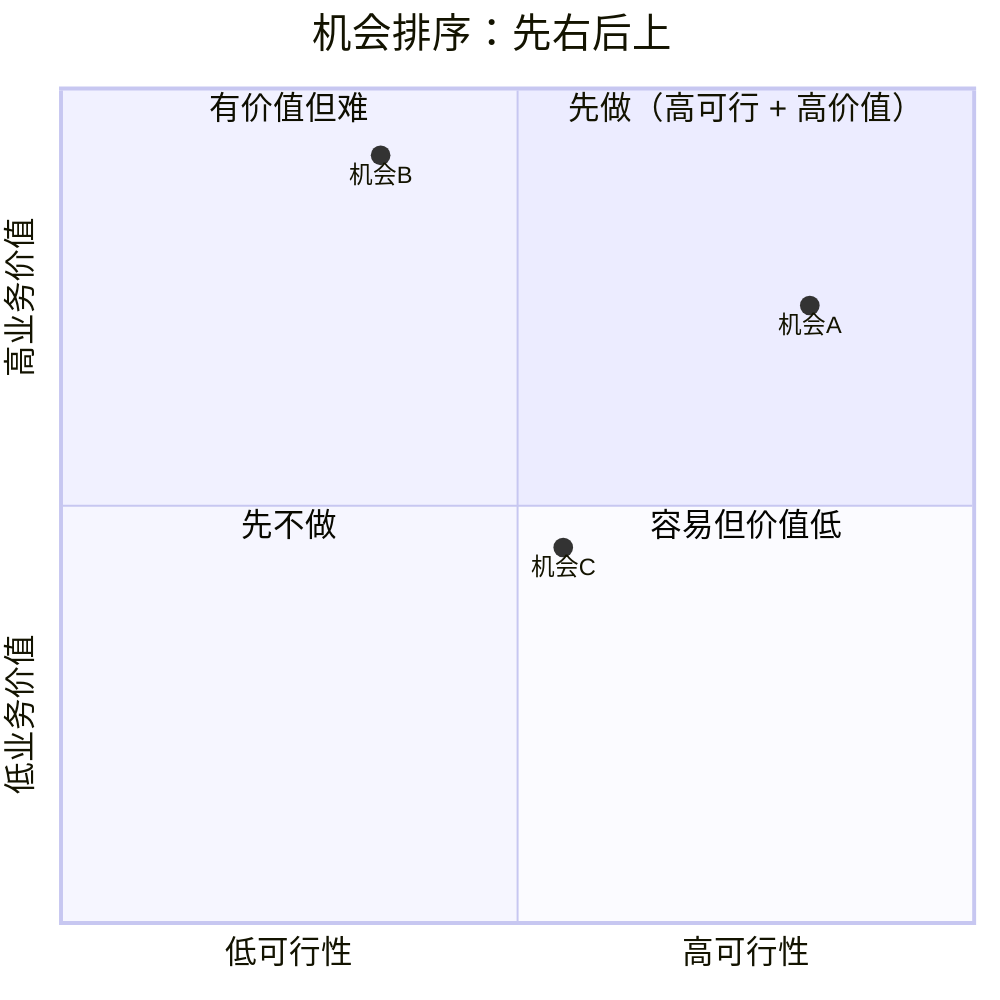

# 算账与找机会：把流程图变成能说服客户的数字

> 流程图本身没什么价值——装饰性的流程图在企业里到处都是。真正让它有用的是：**给每个环节标上四个数字**，算出「哪里值得改」，再判断「哪里适合用 AI」。

## 1. 四个数字

| 数字 | 单位 | 怎么问 | 注意 |
|---|---|---|---|
| 耗时 | 分钟/次 | 这一步平均花多长时间？观察 2–3 次，别只信回忆 | 问范围（最短/最长/典型），不要一个点值 |
| 日频次 | 次/天 | 每天发生多少次？有没有系统日志/派工单？ | 忙季/淡季分开；按岗位/班次问 |
| 出错率 | % | 这一步出错的比例？最近一个月有哪些错？ | 用「上个月几次」反推，比直接问 % 准 |
| 单次代价 | 元/次 | 错了之后要返工/补发/罚款/停机多久？折成钱 | 分清直接损失和隐性成本；拿不准给区间 |
| 人力单价 | 元/小时 | 这一步由谁做、什么职级？然后找 HR/财务要 | **最容易漏**；没有它，前三个数字只能说明「很费劲」，不能算钱 |

> 只拿到前三个数字，结论是「这里很忙」；乘上人力单价，才是「这里每天烧多少钱」。

## 2. 两个成本，一个上限

```text
每天人力成本 = 耗时(分钟) ÷ 60 × 日频次 × 人力单价(元/小时)
每天风险成本 = 出错率 × 日频次 × 单次代价(元)
改进上限     = 每天人力成本 + 每天风险成本
年化上限     = 改进上限 × 250 个工作日（可选，用来对客户讲规模）
```

**改进上限不是承诺收益**，而是「这个环节最多值多少钱」。真正的收益要看 AI 能替掉多少、落地损耗多少。

计算示例（虚构，只演示算法）：

```text
耗时 12 分钟/次，日频次 200 次，人力单价 60 元/小时
人力成本 = 12/60 × 200 × 60 = 2,400 元/天
出错率 3%，单次代价 50 元
风险成本 = 0.03 × 200 × 50 = 300 元/天
改进上限 = 2,400 + 300 = 2,700 元/天 ≈ 67.5 万元/年（250 天）
```

可以用脚本算：

```bash
python3 scripts/calc_process.py --minutes 12 --freq 200 --error-rate 0.03 --cost-per-error 50 --hourly-rate 60
```

## 3. 数据从哪来

| 数字 | 一手来源 | 拿不到时 |
|---|---|---|
| 耗时 | 现场观察、跟班、系统操作日志 | 问 2–3 个人要范围，取中位数并标「估算」 |
| 日频次 | 工单/派工/呼叫/审批系统、台账 | 问班组长「上个班多少次」，按班次折算 |
| 出错率 | 返工单、投诉、差错台账、质检记录 | 问「上个月出过几次」，用次数反推 |
| 单次代价 | 返工工时、补发/赔偿、罚款、停机损失 | 拆成「人工 + 材料 + 影响」给区间 |
| 人力单价 | HR/财务的岗位薪酬包（含社保公积金） | 用职级薪酬区间估，标「估算，待 HR 确认」 |

**纪律**：每个数字都要标来源（谁说的/哪张表/哪次观察）和信心（✅/⚠️/❓）。宁可写「6–10 分钟」，不要写一个假装精确的「8 分钟」。

## 4. 哪些环节适合用 AI：六个信号

| # | 信号 | 现场怎么验证 |
|---|---|---|
| 1 | **大量重复的人工判断**：同类判断每天几百次，标准相对稳定 | 问「这个判断一天做几次？新人多久能学会？」 |
| 2 | **信息散落在多个系统**：员工要在三四个系统之间切换、比对、拼凑 | 让对方演示一遍；数切了几个系统、抄了几次 |
| 3 | **大量非结构化文档**：PDF、扫描件、邮件、会议记录、聊天记录 | 问「这类文件一天来多少？现在怎么处理？」 |
| 4 | **有明确标准，但靠人记忆**：制度写得清，执行靠脑子，记不全就出错 | 找制度原文；问「不查手册能记住几条？」 |
| 5 | **流程里有大量等待**：等审批、等回复、等材料 | 画等待节点；问「平均等多久？卡在谁那？」 |
| 6 | **有人在偷偷自救**：员工自己做 Excel、话术本、检查清单，或已经在用 AI | 问「有没有你自己整理的表/模板？能看看吗？」——这是最强信号 |

一个机会至少命中 **2 个信号**再进候选；只命中 1 个的，先放观察区。

## 5. 机会排序：四个维度，两个红灯

先给每个候选机会打分：

| 维度 | 怎么打（1–5） |
|---|---|
| **业务价值** | 改进上限越大、越贴近客户核心 KPI，分越高；可直接引用上面的钱数 |
| **可行性** | 技术难度、流程配合度、上线周期；越容易越快，分越高 |
| **数据可得性** | 5=数据已有且能拿到；3=要申请/清洗；1=没有数据或拿不到 |
| **政治阻力** | 5=几乎没人反对；3=有部门担心；1=会动别人预算/编制/权力 |

**两个红灯（比技术难度更能杀死项目）**：

- **数据红灯**：没有数据、拿不到、要等很久 → 先别做；
- **政治红灯**：改动会触动关键人的利益（预算、编制、考核权）→ 先别做。

红灯不是永久否决，而是「先解决数据/人，再谈技术」。

## 6. 第一个项目怎么选

经验规则：**选第一象限里最靠右的那个，而不是最靠上的那个。**

- 第一象限 = 业务价值高 + 可行性高；
- **最靠右** = 同等高价值里，选最容易落地、最快能证明「这条路走得通」的；
- 不要一上来啃价值最高但最难啃的骨头——第一个项目要的是**成功案例**，不是最大收益。



> 图里机会 B 价值最高但可行性低；机会 A 价值稍低但最靠右——第一个项目选 A。

## 7. 对客户怎么讲

用客户自己的数字，不靠观点：

1. 先复述环节和四个数字（带来源）；
2. 给出「改进上限」和计算过程；
3. 说明 AI 能替掉哪一段、替不掉哪一段；
4. 给第一项目的预期收益、前提、风险；
5. 明确下一步要客户提供什么数据/谁配合。

一页纸模板已并入 `templates/opportunities.md` 的「净 ROI / 试点」节；详细表见 `templates/process-metrics.md` 和 `templates/opportunities.md`。

## 8. 常见坑

1. **只拿到三个数字**：没有人力单价，算不出钱，只能停留在「很忙」。
2. **用行业平均值代替客户数字**：客户不信平均值，只信自己的数。
3. **假装精确**：8 分钟不如「6–10 分钟」诚实。
4. **只看均值不看分布**：平均 5 分钟，可能一半是 1 分钟、一半是 20 分钟。
5. **忽视等待和返工**：它们常常比操作本身更贵。
6. **选价值最高而不是最可行**：第一个项目失败，后面很难推进。
7. **不问政治**：方案再好，动了别人预算也会死。

## 9. 从机会到方案：AI 适配矩阵

六个信号回答“哪里可能有 AI 机会”；这一节回答“具体用什么 AI、怎么落地”。

| 任务类型 | 典型工作 | 适合的信号 | 主要风险 | 最少要有什么数据 |
|---|---|---|---|---|
| 抽取 | 从 PDF/合同/工单里抽字段 | 3、4 | 版式变化、字段歧义 | 有标注样本 + 人工复核 |
| 分类/路由 | 工单分类、风险分级、内容审核 | 1、4 | 类别漂移、边界样本 | 历史分类记录 + 标准 |
| 摘要/生成 | 日报、纪要、话术、初稿 | 3、5 | 幻觉、合规 | 可核对的原文 |
| 检索/问答 | 制度问答、跨系统找信息 | 2、3 | 召回不全、权限 | 文档 + 权限体系 |
| Agent/流程自动化 | 多步操作、跨系统代办 | 2、5 | 错误放大、权限/审计 | 系统 API + 回滚方案 |
| 预测/优化 | 需求预测、排产、定价 | 1、5 | 数据漂移、可解释性 | 历史数据 + 评估口径 |

用法：每个候选机会在 `opportunities.md` 的「方案匹配」里填一行；如果填不出“任务类型 + 数据 + 人工复核”，说明还没到方案阶段。

## 10. 方案匹配检查（solution fit）

1. **替哪一段**：是替整个环节，还是只替其中的抽取/初稿/检索？第一项目尽量只替一段。
2. **输入从哪来**：系统导出、扫描件、聊天记录、人工录入？拿不到就先解决数据。
3. **输出给谁用**：人直接采用，还是必须复核？错误代价高的必须 human-in-the-loop。
4. **怎么集成**：旁路文件 → API → 嵌入系统；第一项目优先旁路，避免核心系统改造。
5. **自建还是采购**：数据敏感/差异化高 → 自建；通用能力 → 采购/API。
6. **怎么评估**：准确率/召回、人工接管率、处理时长、返工率、投诉率；不要只看“像不像”。

## 11. 试点设计（pilot）

第一项目不是“上线”，是“证明这条路走得通”。

| 要素 | 要写清 |
|---|---|
| 范围 | 一个班组/一个品类/一条产线，越小越好 |
| 基线 | 现在的耗时、频次、出错率、成本（客户数字） |
| 目标 | 只定 1–2 个指标，写清提升幅度 |
| 测量 | 系统日志/抽样/人工记录；谁记录、多久看一次 |
| 护栏 | 质量、合规、投诉、返工不能恶化 |
| 停止条件 | 什么情况下停掉/回滚 |
| 采用 | 使用率、人工接管率、谁培训、谁推动 |

试点报告要回答：**基线是什么、做了什么、结果如何、能不能复制、下一步建议**。

## 12. 净 ROI：别把毛上限当收益

```text
毛改进上限 = 每天人力成本 + 每天风险成本
可实现收益 = 毛改进上限 × 可实现比例 × 250 天
净收益     = 可实现收益 - 建设成本 - 年运行成本
回收期     = 建设成本 ÷ (可实现收益 - 年运行成本)
```

- 可实现比例要保守，并写明假设（AI 只替 40%？人工复核吃掉 20%？）；
- 建设成本含开发/采购/集成/培训；
- 运行成本含模型调用、人工复核、运维；
- 回收期为负或超过客户耐心 → 第一项目换一个。

算账示例：

```bash
python3 scripts/calc_process.py --minutes 12 --freq 200 --error-rate 0.03 \
  --cost-per-error 50 --hourly-rate 60 \
  --realization 0.4 --build-cost 200000 --run-cost-per-day 200
```

## 13. 干系人与采用

技术可行 ≠ 能落地。方案匹配后，回到 `decision-brief.md` 第 6 节：

- 谁拍板、谁出钱、谁使用、谁被替代；
- 每个人得到什么/失去什么；
- 谁会在试点阶段阻挠；
- 需要什么培训、激励、制度配套；
- 采用指标是什么。

政治红灯不是“以后再说”，是第一项目选型的前置条件。
