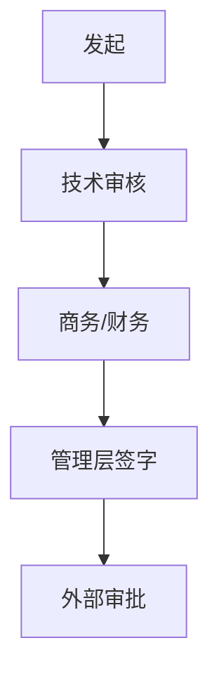

# {{INDUSTRY}} · 业务域 / 流程 / 活动

> 第 3 步的合并文件：先分业务域，再画流程，最后拆活动表。  
> 三部分共用一套编号；活动表的「业务域」列写域编号或域名。

## 1. 业务域

> ⚠️ 不要改表头关键词：validator 依赖「业务域 + 目标」计数，改名会导致计数为 0。

> 目标：在画流程之前，先把**业务域**分对。域是「一块相对独立、有明确目标和负责人、与其他域有接口的业务」。
> 这是按公开信息推断的划分，**客户实际组织可能不同**；标 ❓ 的域/接口要进 `verification-list.md`。

## 1. 业务域总表

| # | 业务域 | 目标（这块为什么存在） | 负责角色/部门 | 主要流程 | 接口（上游/下游域） | 当前痛点/成熟度 | 信心 | 来源 |
|---|---|---|---|---|---|---|---|---|
| 1 |  |  |  |  |  |  |  |  |
| 2 |  |  |  |  |  |  |  |  |
| 3 |  |  |  |  |  |  |  |  |
| 4 |  |  |  |  |  |  |  |  |
| 5 |  |  |  |  |  |  |  |  |

> 建议 6–8 个域；少于 3 个说明颗粒度太粗，超过 10 个说明把流程当成了域。

## 2. 每个域展开

### 域 1 · 名称

- 目标：
- 负责角色/部门：
- 包含流程：
- 上游接口：
- 下游接口：
- 关键指标：
- 当前痛点/成熟度：
- 信心/来源：

### 域 2 · 名称

- 目标：
- 负责角色/部门：
- 包含流程：
- 上游接口：
- 下游接口：
- 关键指标：
- 当前痛点/成熟度：
- 信心/来源：

### 域 3 · 名称

- 目标：
- 负责角色/部门：
- 包含流程：
- 上游接口：
- 下游接口：
- 关键指标：
- 当前痛点/成熟度：
- 信心/来源：

## 3. 域间接口图

## 4. 待验证的域划分

| # | 我猜的域/接口 | 为什么不确定 | 问谁 |
|---|---|---|---|
| D1 |  |  |  |

---

## 依据与来源

- 正文用 `[S01]` 标注来源。
- 完整清单（谁发的、日期、链接、等级）见 `sources.md`；没找到的写「未找到公开源」，不要编。

---

## 2. 流程

> 这张图大概率是错的。关键不是对，是**标出你不确定的地方**，让对方能一句话纠正。
> 信心标记：✅ 有来源 / ⚠️ 有来源但可能过时 / ❓ 猜的。

## 主干流程

## 节点信心表

| 节点 | 我理解的是 | 信心 | 来源/依据 | 备注 |
|---|---|---|---|---|
| 资源评价 |  | ✅/⚠️/❓ |  |  |
| 矿权 |  |  |  |  |
| 勘探 |  |  |  |  |
| 开发方案 |  |  |  |  |
| 钻完井 |  |  |  |  |
| 压裂 |  |  |  |  |
| 排采 |  |  |  |  |
| 集输/增压 |  |  |  |  |
| 净化/液化/发电 |  |  |  |  |
| 销售/利用 |  |  |  |  |

## 审批 / 决策链

## 关键组织与角色

| 角色 | 管什么 | 关心什么 | 来源 |
|---|---|---|---|
|  |  |  |  |

## 待验证（从 ❓/⚠️ 生成）

→ 写入 `verification-list.md`

---

## 依据与来源

- 正文用 `[S01]` 标注来源。
- 完整清单（谁发的、日期、链接、等级）见 `sources.md`；没找到的写「未找到公开源」，不要编。

---

## 3. 活动表

> ⚠️ 不要改表头关键词：validator 依赖「业务域 + 环节」计数，改名会导致计数为 0。

> 用途：把每条流程拆到「可被一线员工逐行纠正」的粒度。**第 4 步访谈时，直接把这张表推给对方：「您帮我看看哪一行不对」。**

## 填写规则

- **一行 = 一个环节/活动**，不是一步流程；粒度以「一个人/一个岗位能独立完成」为准。
- 「谁做」写角色/部门，不写具体人名（除非访谈确认）；「影响谁」写上下游、客户、监管、内部其他部门。
- 「用什么工具」写系统类别（如 SCADA、生产管理系统、ERP），不确定就写类别 + ❓，**不要编厂商名**。
- 「业务背景」写**为什么这么做**（合规、结算、考核、历史原因），这是访谈里最容易拿到隐性知识的一列。
- **现场补充五列**（新手最容易漏、但一线最常聊）：
  - **多久一次 / 什么触发**：每天/每周/每月/按项目/异常时；什么条件下必须做。
  - **常见异常 / 出错后果**：现场最容易出什么问题，出了会怎样（停机/罚款/返工/数据错）。
  - **上下游交接**：谁把东西给这一行、这一行交给谁；留下什么记录/单据/系统数据。
  - **谁验收/签字**：这一行做完谁签字、谁验收（岗位，不写人名）。
  - **是否外包/自营**：这一行是自己人干、外包，还是混合；不确定标 ❓。
- **关键环节写具体**：场景、输入输出、例外情况；有公开例子时在单元格写「例：…（[Sxx]）」，没有就写「未找到公开源，待客户确认」。
- 不确定的格子写 `❓`，并在 `verification-list.md` 里有一条对应问题。

## 活动表

| 业务域 | 流程 | 环节/活动 | 当前环节做什么 | 谁做 | 影响到谁 | 用什么工具/系统 | 业务背景（为什么） | 多久一次 / 什么触发 | 常见异常 / 出错后果 | 上下游交接（谁给、给谁、留什么记录） | 谁验收/签字 | 是否外包/自营 | 输入→输出 | 信心 | 来源 |
|---|---|---|---|---|---|---|---|---|---|---|---|---|---|
|  |  |  |  |  |  |  |  |  |  |  |  |  |  |  |  |
|  |  |  |  |  |  |  |  |  |  |  |  |  |  |  |  |
|  |  |  |  |  |  |  |  |  |  |  |  |  |  |  |  |

## 统计（收尾时填）

- 覆盖业务域：__ 个
- 活动行数：__（目标 ≥15）
- ❓/⚠️ 行数：__（目标 ≥5）
- 最不确定的 5 行：
- 现场最常出问题的 3 类事：

## 与其它产物的关系

- `domains.md`：域划分与接口
- `flow.md`：每个域的流程
- `verification-list.md`：从本表的 ❓/⚠️ 生成
- `corrections.md`：访谈后把被改的行写进修正记录，并回填本表

---

## 依据与来源

- 正文用 `[S01]` 标注来源。
- 完整清单（谁发的、日期、链接、等级）见 `sources.md`；没找到的写「未找到公开源」，不要编。

---

## 依据与来源

- 正文用 `[S01]` 标注来源，完整清单见 `sources.md`。
