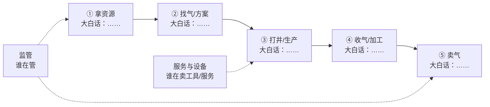
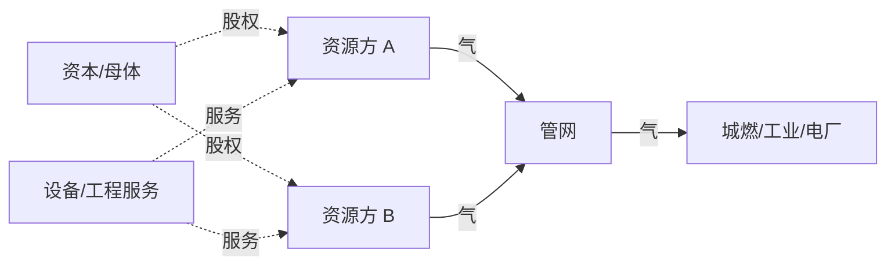
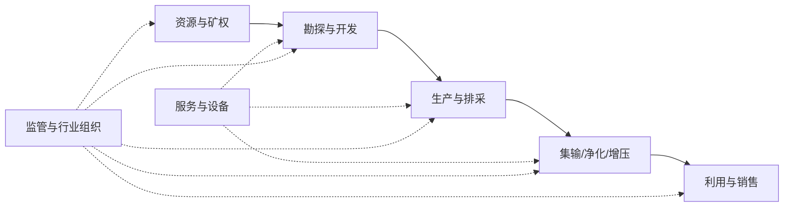

# {{INDUSTRY}} · 全链路关系

> ⚠️ 不要改表头关键词：validator 依赖「玩家 + 现状」和「from + 关系类型」计数，改名会导致计数为 0。

> 目标：不只看研报，而是基于公开资料整理出「行业分段 → 每段玩家 → 玩家现状/未来规划 → 彼此关系」。
> 纪律：每个数字/关系带 `[S#]`；规划必须标「公司自述 / 媒体转述 / 推断」；查不到就标 ❓，进 `verification-list.md`。
> **分段方式只是工作假设**，客户实际可能按别的维度划分——这正是 第 4 步 要拿去被否定的地方。

## 1. 产业链总览：每段在干啥

先记住一句话：这条链是「______ → ______ → ______ → 卖出去」，外加服务和监管。（用大白话填，不要抄行业黑话。）

| # | 这一段 | 大白话：在干啥 | 谁在忙 | 钱/物怎么流 | 卡在哪 |
|---|---|---|---|---|---|
| 1 | 资源与矿权 |  |  |  |  |
| 2 | 勘探与开发 |  |  |  |  |
| 3 | 生产与排采 |  |  |  |  |
| 4 | 集输/净化/增压 |  |  |  |  |
| 5 | 利用与销售 |  |  |  |  |
| 6 | 服务与设备 |  |  |  |  |
| 7 | 监管与行业组织 |  |  |  |  |

## 2. 每段玩家

### 2.1 资源与矿权

| 玩家 | 角色 | 现状（上市/规模/区块） | 近 12 个月动作 | 未来规划 | 信心 | 来源 |
|---|---|---|---|---|---|---|
|  |  |  |  |  |  |  |

### 2.2 勘探与开发

| 玩家 | 角色 | 现状 | 近 12 个月动作 | 未来规划 | 信心 | 来源 |
|---|---|---|---|---|---|---|
|  |  |  |  |  |  |  |

### 2.3 生产与排采

| 玩家 | 角色 | 现状 | 近 12 个月动作 | 未来规划 | 信心 | 来源 |
|---|---|---|---|---|---|---|
|  |  |  |  |  |  |  |

### 2.4 集输/净化/增压

| 玩家 | 角色 | 现状 | 近 12 个月动作 | 未来规划 | 信心 | 来源 |
|---|---|---|---|---|---|---|
|  |  |  |  |  |  |  |

### 2.5 利用与销售

| 玩家 | 角色 | 现状 | 近 12 个月动作 | 未来规划 | 信心 | 来源 |
|---|---|---|---|---|---|---|
|  |  |  |  |  |  |  |

### 2.6 服务与设备 / 监管

| 玩家 | 角色 | 现状 | 近 12 个月动作 | 未来规划 | 信心 | 来源 |
|---|---|---|---|---|---|---|
|  |  |  |  |  |  |  |

> 规划列必须写清来源性质：`自述`（公司公告/年报）／`转述`（媒体/研报）／`推断`（你从动作反推）。

### 2.7 玩家画像补充：赛道 / 收入结构 / 用户画像

| 玩家 | 主要赛道 | 收入结构（最近公开期） | 用户画像 | 来源 | 信度 |
|---|---|---|---|---|---|
|  | 付费阅读 / 免费广告 / IP 改编 / 短剧 / 有声 / 出海 / 出版 / 社区 | 分部收入、占比、趋势；未上市/未披露写「未公开披露」 | 年龄/性别/城市/付费习惯；只写有来源的 |  |  |

> 收入结构优先用年报/中报的分部数据；拿不到就写「未公开披露」，**不要用行业平均替代**。

## 3. 玩家关系

| from | 关系类型 | to | 证据（一句话 + [S#]） | 信心 | 来源 |
|---|---|---|---|---|---|
|  | 供应 / 采购 / 股权 / 合资 / 技术 / 客户 / 渠道 / 竞争 / 监管 |  |  |  |  |

**关系类型说明**：供应/采购=买卖；股权=持股/控股；合资=共同项目公司；技术=授权/合作研发；客户=下游买家；渠道=代理/分销；竞争=同一环节直接竞争；监管=审批/监管关系。**不确定的关系不要写成事实。**

### 3.1 玩家关系图（先看大概，准确依据看表）

## 4. 全链路图

## 5. 待验证关系（→ `verification-list.md`）

| # | 我猜的关系 | 为什么不确定 | 错了会怎样 | 问谁 |
|---|---|---|---|---|
| R1 |  |  |  |  |

## 6. 数据缺口

- 玩家总数：__（目标 ≥10）
- 关系条数：__（目标 ≥5）
- 规划来源分布：自述 __ / 转述 __ / 推断 __
- 最不确定的 3 个玩家/关系：

---

## 依据与来源

- 正文用 `[S01]` 标注来源。
- 完整清单（谁发的、日期、链接、等级）见 `sources.md`；没找到的写「未找到公开源」，不要编。
