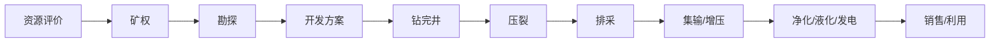
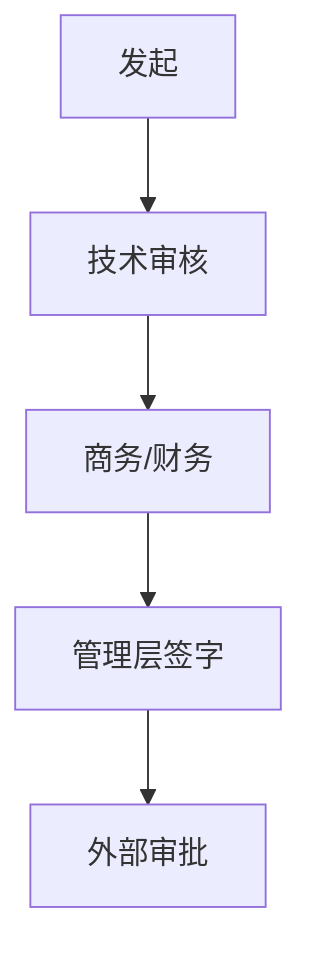

# {{INDUSTRY}} · 客户业务流程图

> 这张图大概率是错的。关键不是对，是**标出你不确定的地方**，让对方能一句话纠正。
> 信心标记：✅ 有来源 / ⚠️ 有来源但可能过时 / ❓ 猜的。

## 主干流程

## 节点信心表

| 节点 | 我理解的是 | 信心 | 来源/依据 | 备注 |
|---|---|---|---|---|
| 资源评价 |  | ✅/⚠️/❓ |  |  |
| 矿权 |  |  |  |  |
| 勘探 |  |  |  |  |
| 开发方案 |  |  |  |  |
| 钻完井 |  |  |  |  |
| 压裂 |  |  |  |  |
| 排采 |  |  |  |  |
| 集输/增压 |  |  |  |  |
| 净化/液化/发电 |  |  |  |  |
| 销售/利用 |  |  |  |  |

## 审批 / 决策链

## 关键组织与角色

| 角色 | 管什么 | 关心什么 | 来源 |
|---|---|---|---|
|  |  |  |  |

## 待验证（从 ❓/⚠️ 生成）

→ 写入 `verification-list.md`

---

## 依据与来源

- 正文用 `[S01]` 标注来源。
- 完整清单（谁发的、日期、链接、等级）见 `sources.md`；没找到的写「未找到公开源」，不要编。
