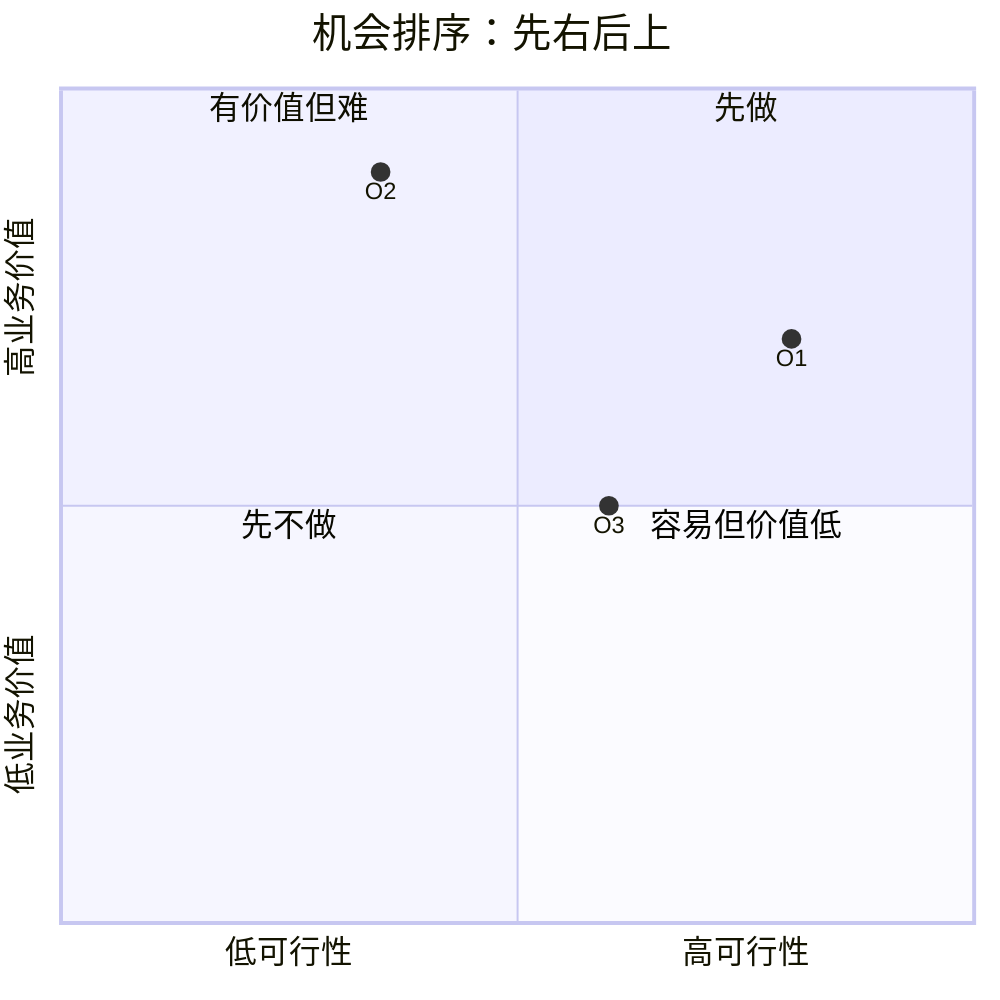

# {{INDUSTRY}} · AI 机会清单与排序

> 从「改进上限高」的环节里找 AI 机会：先看六个信号，再打四个分，最后选「第一象限最靠右」的做第一个项目。
> 详细方法见 `references/opportunity-analysis.md`。

## 1. 候选机会

| 机会ID | 对应环节 | 机会描述（AI 能替哪一段） | 命中信号（1–6） | 预估改进上限（元/天） | 备注 |
|---|---|---|---|---|---|
| O1 |  |  |  |  |  |
| O2 |  |  |  |  |  |
| O3 |  |  |  |  |  |

> 至少命中 2 个信号再进候选；只命中 1 个的放观察区。

## 2. 六个信号自检

| # | 信号 | O1 | O2 | O3 |
|---|---|---|---|---|
| 1 | 大量重复的人工判断 |  |  |  |
| 2 | 信息散落在多个系统 |  |  |  |
| 3 | 大量非结构化文档 |  |  |  |
| 4 | 有明确标准但靠人记忆 |  |  |  |
| 5 | 流程里有大量等待 |  |  |  |
| 6 | 有人在偷偷自救（Excel/话术本/已用 AI） |  |  |  |

## 3. 四维打分

| 机会 | 业务价值（1–5） | 可行性（1–5） | 数据可得性（1–5） | 政治阻力（5=阻力小） | 红灯（数据/政治） | 结论 |
|---|---|---|---|---|---|---|
| O1 |  |  |  |  |  |  |
| O2 |  |  |  |  |  |  |
| O3 |  |  |  |  |  |  |

**红灯规则**：数据可得性 ≤2 或政治阻力 ≤2 → 先别做，先解决数据/人。

## 4. 象限图

## 5. 第一个项目

- 选第一象限里**最靠右**的（最容易落地），不是最靠上的（价值最高）。
- 第一项目：______
- 选它的理由（3 条）：
  1.
  2.
  3.
- 预期收益（用客户数字）：______ 元/天 ≈ ______ 元/年
- 前提/依赖：
- 最大风险：
- 下一步要客户提供的数据/人：

## 6. 不做什么（明确写出来）

- 数据红灯：
- 政治红灯：
- 价值低/可行性低：

---

## 依据与来源

- 数字来源见 `process-metrics.md`；正文用 `[S01]` 标注公开来源。
- 完整清单见 `sources.md`。
