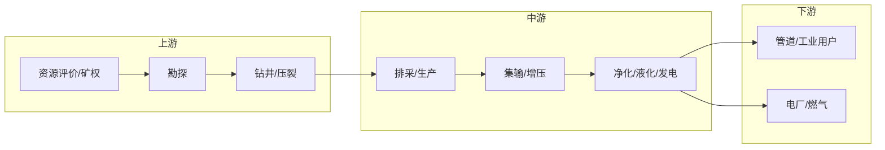

# {{INDUSTRY}} · 价值链草图

> 目标：知道钱从哪来、到哪去、卡在哪。细节不必记住。
> 每条数字挂 `[S#]`；没有来源写「待验证」；推断标「推断」。

## 一句话

（这个行业靠什么赚钱？用一句话说清。）

## 价值链

## 环节表

| 环节 | 主要活动 | 收入项 | 成本大头 | 关键瓶颈 | 来源 |
|---|---|---|---|---|---|
| 上游 |  |  |  |  |  |
| 中游 |  |  |  |  |  |
| 下游 |  |  |  |  |  |

## 钱怎么流

- 收入项：
- 成本大头：
- 补贴/政策相关收入：
- 回款周期与账期：

## 玩家

| 玩家 | 位置 | 角色 | 近 12 个月动作 | 来源 |
|---|---|---|---|---|
|  |  |  |  |  |

## 客户在链条上的位置

- 客户做什么：
- 客户卖给谁：
- 客户从谁买：
- 客户与谁竞争/合作：

## 待验证

| # | 我猜 | 为什么不确定 | 找谁 |
|---|---|---|---|
| V1 |  |  |  |

## 来源

（见 `sources.jsonl`；正文用 `[S01]` 引用）

---

## 依据与来源

- 正文用 `[S01]` 标注来源。
- 完整清单（谁发的、日期、链接、等级）见 `sources.md`；没找到的写「未找到公开源」，不要编。
